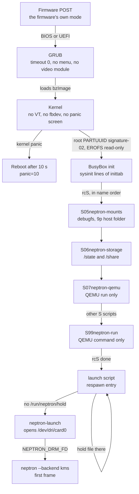
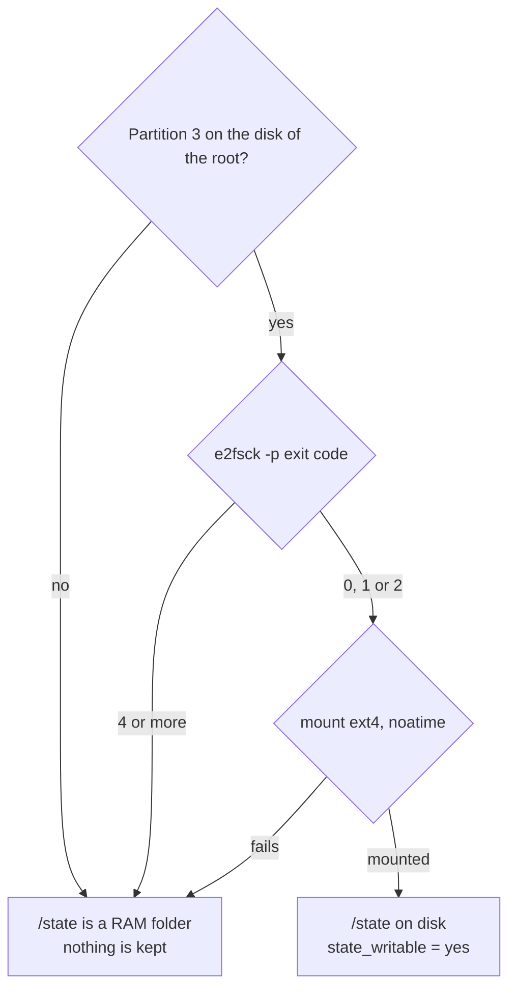
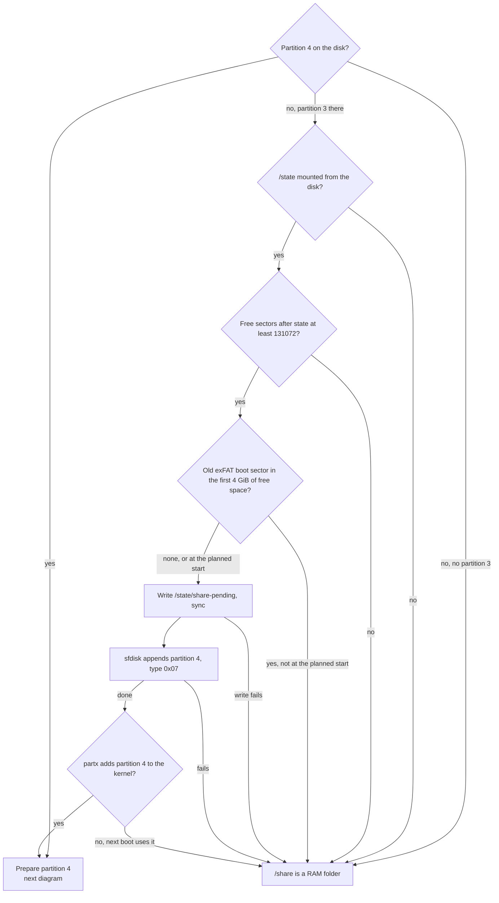
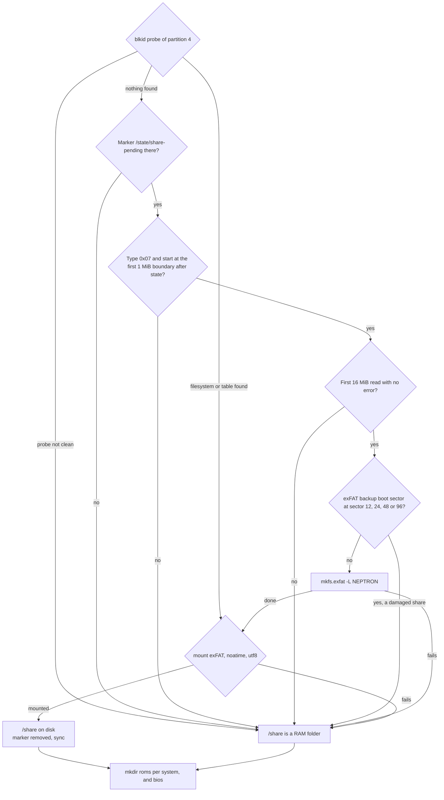
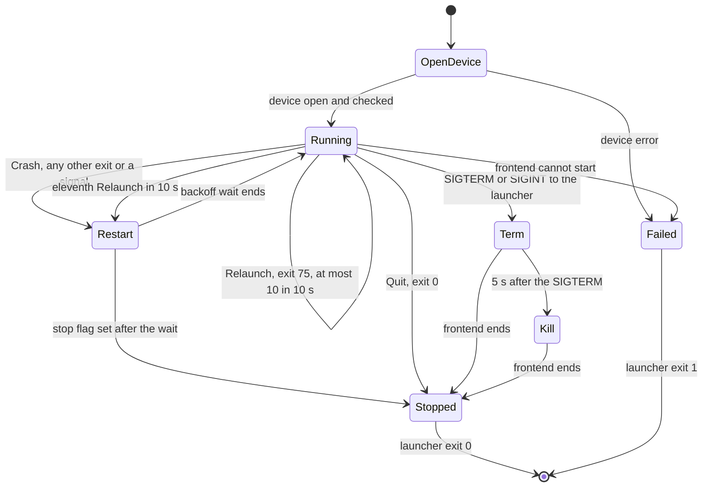
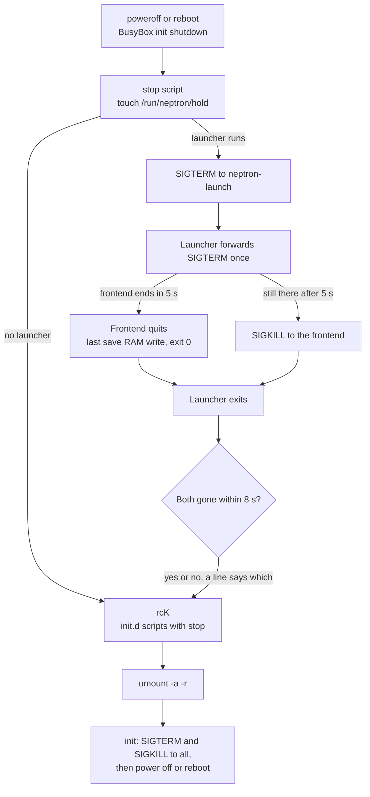

# 1. Power-on to first picture

This flow covers the PC image from the power button to the first frame of the frontend, and back down at shutdown. It says what the screen gets before NEPTRON code runs, how the init scripts mount the state and share partitions (and when the first boot makes the share partition), and how the launcher (`apps/neptron-launch`) holds the display and restarts the frontend. What the frontend does after its process starts is in [Frontend boot](02-frontend-boot.md). The files on the partitions are in [Settings and files on disk](08-on-disk.md).

## Diagrams

### Boot sequence

### State partition (partition 3)

### Share partition: the first boot makes partition 4

`make_partition` runs only when the disk has no partition 4 and has a partition 3.

### Share partition: format only by the rules, then mount

### The launcher

The state names are the values of `Exit`, `Next` and `StopAction` in the launcher code.

BusyBox init starts the launch script again each time the launcher ends (the `respawn` entry), whatever the exit code, unless `/run/neptron/hold` exists.

### Shutdown order

## States and screens

### What the screen gets before the frontend

| Stage | What the screen gets | Source |
| --- | --- | --- |
| Firmware (POST) | The firmware's own mode. On a PC this is usually 31 kHz. NEPTRON code cannot change it. | Outside the image |
| GRUB | No change. `grub.cfg` has `set timeout=0` and no menu. GRUB loads no video module, so it sets no display mode. The built-in modules are `boot linux fat part_msdos normal` (plus `biosdisk` for BIOS). | `os/board/pc/grub.cfg`, defconfig |
| Kernel | No mode of its own. `video.config` turns off `CONFIG_DRM_FBDEV_EMULATION`, `CONFIG_FRAMEBUFFER_CONSOLE`, `CONFIG_FB`, `CONFIG_DRM_SIMPLEDRM`, `CONFIG_SYSFB_SIMPLEFB`, `CONFIG_DRM_PANIC`, `CONFIG_DRM_EFIDRM`, `CONFIG_DRM_VESADRM`, `CONFIG_DRM_CLIENT_LOG` and `CONFIG_LOGO`. `console.config` turns off `CONFIG_VT`. `check-kernel-config.sh` fails the build when one of these is on. i915 is built in; amdgpu and radeon are modules. The kernel log goes to `ttyS0` only (`console=ttyS0,115200 quiet`). | `os/board/pc/video.config`, `console.config`, `check-kernel-config.sh` |
| Init scripts | No change. No script touches the display. | `os/board/common/rootfs-overlay/etc/init.d` |
| Launcher | No change. It opens the DRM device and holds it, but it sets no mode and makes no commit. | `apps/neptron-launch/README.md`, "What it does not do" |
| Frontend | Its first commit is the first NEPTRON picture. See [Frontend boot](02-frontend-boot.md). | `apps/neptron` |

Which mode stays on the wire until the first commit depends on the driver. The hardware checklist expects that i915 keeps the firmware's mode until the first `set_mode`. This is not verified on hardware.

### Launcher states

| State | What the user sees |
| --- | --- |
| `OpenDevice` | Nothing new on the screen. |
| `Running` | The frontend's picture. |
| `Restart` (the backoff wait) | No frontend runs. The launcher keeps the device open, so the last mode stays on the wire (see `Device` in `device.rs`). The wait is 250 ms to 8 s. |
| `Term` | The frontend ends its frame loop as a quit. |
| `Kill` | The frontend is stopped by force. A save RAM write in progress does not finish. |
| `Stopped` | The launcher closes the device. The kernel removes the framebuffers; some drivers switch the CRTC off. |
| `Failed` | The launcher exits with code 1 and a line on standard error. Init starts the launch script again. |

### Storage results

| Result | What the user sees |
| --- | --- |
| `/state` on disk, `/share` on disk | Normal. Settings, saves and the guard record are kept. The game list shows the ROMs of `/share/roms`. |
| `/state` is a RAM folder | A Warning notice that stays until OK: "The state partition is not in use (<reason>). Settings, saves and display choices are lost at power-off." The frontend starts in the safe picture (the guard record in RAM counts no boot). Settings, saves and the guard record are lost at power off. No share partition is made. |
| `/share` is a RAM folder | A Warning notice that stays until OK: "The share partition is not in use (<reason>). The game folder is empty, and files copied to it are lost at power-off." The ROM folders are empty, so the game list has no games. |

The script writes one line for each decision to the console (`ttyS0`). The lines start with `neptron-storage:`.

## Transitions

### Boot

| From | To | Condition | Constant = value | On the wire, on disk |
| --- | --- | --- | --- | --- |
| Firmware | GRUB | BIOS: GRUB boot code in the MBR gap. UEFI: `EFI/BOOT/bootx64.efi` on the FAT partition. | | No change |
| GRUB | Kernel | At once, entry `NEPTRON` | `timeout=0` | Kernel line: `root=PARTUUID=<signature>-02 rootfstype=erofs ro rootwait quiet console=ttyS0,115200 panic=10` |
| Kernel | Reboot | Kernel panic | `panic=10` (10 s) | |
| Kernel | BusyBox init | Root mounted read-only | | Root filesystem EROFS, never written |
| init | rcS | After the sysinit lines: mount `/proc`, `mount -a`, hostname | | |
| rcS | Launch script | All `S??*` scripts have run in name order | | `S05neptron-mounts`, `S06neptron-storage`, `S07neptron-qemu`, Buildroot's own scripts, then `S99neptron-run`. The development image adds `S41neptron-address` (background) and `S49neptron-ssh-keys` |
| Launch script | `neptron-launch` | `/run/neptron/hold` does not exist (checked each second) | | Release: `exec /usr/bin/neptron-launch -- /usr/bin/neptron --backend kms`. Development: the hot folder binaries when present, output to `svlogd` |

The disk signature is fixed for each build variant: `4e505452` (release), `4e505444` (development), `4e50544e` (release with no 15 kHz patches), `4e505445` (development with no 15 kHz patches). The root partition is `<signature>-02`.

### Storage

| From | To | Condition | Constant = value | On disk |
| --- | --- | --- | --- | --- |
| Start | `/state` on disk | Partition 3 of the root disk exists, `e2fsck -p` exits 0, 1 or 2, and the ext4 mount works | | Mounted at `/state`, `noatime` |
| Start | `/state` RAM folder | No partition 3, or `e2fsck -p` exits 4 or more, or the mount fails | | `tmpfs` at `/state`. Line: `neptron-storage: e2fsck <dev> left errors (exit <code>); /state is a RAM folder`, `neptron-storage: <dev> does not mount; /state is a RAM folder` or `neptron-storage: no state partition, /state is a RAM folder` |
| No partition 4 | Partition 4 made | `/state` on disk, free space at least the limit, no old share at another start | `SHARE_MIN_SECTORS` = 131072 sectors (64 MiB), `ALIGN_SECTORS` = 2048 sectors (1 MiB), `OLD_SHARE_SCAN_SECTORS` = 8388608 sectors (4 GiB) | `/state/share-pending` written and synced, then `sfdisk --append` with type 7 over all free space, then `partx --add --nr 4`. Line: `neptron-storage: making partition 4 from <n> free sectors` |
| No partition 4 | `/share` RAM folder | `/state` not on disk | | Line: `neptron-storage: the state partition is not mounted, so no share partition is made` |
| No partition 4 | `/share` RAM folder | Too little free space | `SHARE_MIN_SECTORS` = 131072 | Line: `neptron-storage: <n> free sectors after the state partition, no share partition made` |
| No partition 4 | `/share` RAM folder | An exFAT boot sector in the free space, not at the planned start | `OLD_SHARE_SCAN_SECTORS` = 8388608 | Line: `neptron-storage: an old exFAT share starts at sector <n>, not at <m>; no share partition made, the disk is left untouched` |
| Partition 4 made | `/share` RAM folder this boot | `partx` fails | | Line: `neptron-storage: the kernel does not see partition 4; the next boot uses it` |
| Partition 4 | Mounted | `blkid` finds a filesystem or a partition table | | No format. Mount `exfat`, `noatime,iocharset=utf8` |
| Partition 4, empty | Formatted | Marker there, type 7, start in the first 1 MiB after state, first 16 MiB read cleanly, no exFAT backup boot sector | `READ_CHECK_MIB` = 16, `EXFAT_BACKUP_SECTORS` = 12 24 48 96 | `mkfs.exfat -L NEPTRON`. Line: `neptron-storage: <dev> holds no filesystem; formatting it exFAT` |
| Partition 4 | `/share` RAM folder | One rule fails | | Line: `neptron-storage: the share partition <dev> was left untouched: <reason>`. The reasons are in "What can go wrong" |
| Mounted | Marker removed | The mount worked and the marker exists | | `rm -f /state/share-pending`, `sync`. Line: `neptron-storage: <dev> mounted at /share` |
| Any | Status file | Always | | `/run/neptron/storage.toml`: `state` and `share`, each `partition` or `ram`, and `state_reason` or `share_reason` for a RAM folder: the last `neptron-storage:` line before it. The frontend reads it at boot (`StorageStatus::read`), logs `neptron: storage: <notice>` and shows the notice. |
| Any | ROM folders | Always, also on a RAM folder | | `mkdir -p /share/roms/<id>` for each `/usr/share/neptron/systems/<id>.toml` (`megadrive`, `nes`, `snes`), and `mkdir -p /share/bios` |

### Launcher

| From | To | Exact condition | Constant = value | What happens |
| --- | --- | --- | --- | --- |
| `OpenDevice` | `Failed` | The path cannot be opened, is not a character device of the DRM major, opens on descriptor 0, 1 or 2, or close-on-exec cannot be cleared | `DEFAULT_DEVICE` = `/dev/dri/card0`, `STANDARD_FD_MAX` (from `neptron-kms`) | Launcher exit code 1. Lines: `cannot open <path>: <error>`, `<path> is not a DRM device (a character device of major 226)`, `<path> opened on descriptor <fd>, a standard stream; start the launcher with 0, 1 and 2 open`, `cannot pass <path> to the frontend: <error>` |
| `OpenDevice` | `Running` | Device checked | `DRM_FD_ENV` = `NEPTRON_DRM_FD` | The frontend starts with the descriptor number in `NEPTRON_DRM_FD`. Both share one open file description: DRM master, framebuffers and mode |
| `Running` | `Running` | Frontend exit code 75, and at most 10 relaunches in the last 10 s | `RELAUNCH_EXIT_CODE` = 75, `RELAUNCHES_MAX` = 10, `RELAUNCH_WINDOW_NS` = 10 s | New frontend at once, no wait. The device stays open, so the mode stays on the wire. The new run reads `/run/neptron/next.toml` |
| `Running` | `Restart` | Frontend exit code 69: no display answered in the frontend's wait | `NO_DISPLAY_EXIT_CODE` = 69, `NO_DISPLAY_WAIT_NS` = 1 s | Wait 1 s. No crash is counted, and no relaunch of the window is used. Line, at the first such exit and then at most once a minute (`NO_DISPLAY_LOG_INTERVAL_NS` = 60 s): `neptron-launch: the frontend found no display; it starts again every 1000 ms. An analog connector with no EDID (a VGA CRT) is used only when display.output names it` |
| `Running` | `Restart` | Any exit code other than 0, 69 and 75, or a signal (a panic is 101) | `BACKOFF_FIRST_NS` = 250 ms, `BACKOFF_MAX_NS` = 8 s | Wait 250 ms, doubled for each crash in a row: 250 ms, 500 ms, 1 s, 2 s, 4 s, then 8 s for each further crash. Line: `neptron-launch: the frontend ended with <code> after <ms> ms, crash <n> in a row; start again in <ms> ms` |
| `Running` | `Restart` | The eleventh exit 75 in 10 s | `RELAUNCHES_MAX` = 10, `RELAUNCH_WINDOW_NS` = 10 s | Counted as a crash, with its wait |
| any run | crash count reset | The run lasted at least 30 s | `STABLE_RUN_NS` = 30 s | The next crash waits 250 ms again |
| `Running` | `Stopped` | Frontend exit code 0 | | Launcher exit 0. Line: `neptron-launch: the frontend ended after <n> runs`. The frontend exits 0 only after SIGTERM or SIGINT |
| `Running` | `Term` | SIGTERM or SIGINT to the launcher | `CHILD_POLL` = 20 ms | SIGTERM to the frontend, once. The frontend reads its stop flag at the end of the next frame and ends as a quit |
| `Term` | `Kill` | The frontend is still there 5 s after the SIGTERM | `STOP_WAIT_NS` = 5 s | SIGKILL first, then the line `neptron-launch: the frontend did not end 5000 ms after SIGTERM; SIGKILL` |
| `Restart` | `Stopped` | A stop signal came during the wait | | The launcher exits after the wait ends. The wait is a plain sleep, so it can take up to 8 s |
| `Running` | `Failed` | The frontend program cannot start (spawn or wait fails) | | Launcher exit 1. Line: `neptron-launch: cannot run the frontend after <n> runs: <error>` |

Exit codes of the frontend, as the launcher sees them:

| Frontend exit | When | Launcher |
| --- | --- | --- |
| 0 | SIGTERM or SIGINT (`Outcome::Quit`) | Stops |
| 75 | A planned relaunch: into a game, back to the list, a game that did not start | Starts it at once |
| 69 | No connected display after the wait of up to 15 s (`neptron: no connected display after <ms> ms`, then `neptron: cannot open the display: no connected display found; ...`) | Restart after 1 s, no backoff |
| 1 | The display does not open for another reason (`neptron: cannot open the display: ...`), the boot fails (`neptron: the frontend cannot start: ...`), the relaunch file cannot be written, the build has no backend | Crash, backoff |
| 2 | A wrong command line | Crash, backoff |
| 101 or a signal | A panic or a kill | Crash, backoff |

Exit codes of the launcher: 0 after a quit or a stop, 1 after a device error or a start failure, 2 for a wrong command line. Init starts the launch script again in every case.

### Shutdown

| Step | Exact condition | Constant = value | What happens |
| --- | --- | --- | --- |
| 1. `stop` script | First `::shutdown:` entry of `inittab` | `STOP_WAIT_DS` = 80 (8 s, in 100 ms steps) | Creates `/run/neptron/hold` so no new launcher starts. Sends SIGTERM to `neptron-launch`. Waits until neither `neptron-launch` nor `neptron` runs, at most 8 s (3 s more than `STOP_WAIT_NS`). Line: `neptron-stop: the launcher and the frontend stopped in <s> s` or `neptron-stop: the launcher or the frontend still runs after 8 s; init stops them` |
| 2. `rcK` | After step 1 | | The init.d scripts with `stop`. The NEPTRON scripts do nothing on `stop` |
| 3. `umount -a -r` | After step 2 | | Unmounts every filesystem, or remounts it read-only |
| 4. init | After the shutdown entries | | SIGTERM, then SIGKILL to every process, then power off or reboot |

The frontend's quit writes the game's save RAM (`Session::quit`) and the writer backlog (`Outbox::finish`) before exit 0. Steps 1 to 3 run before the file systems become read-only, so these writes reach the disk.

Nothing in the release image starts a shutdown: no code calls `poweroff` or `reboot`, there is no handler for the power button and no shell. On the release image, turning the machine off is a power cut. On the development image, `poweroff` or `reboot` over SSH runs this order.

## What can go wrong

| Case | What the user sees | Way out |
| --- | --- | --- |
| A 15 kHz monitor on a PC | The firmware's POST and the time to the first commit are at the firmware's frequency, usually 31 kHz. The launcher does not blank the output. | Firmware fast boot. A sync-protecting adapter for an arcade monitor. |
| Two NEPTRON sticks of the same variant plugged in | Both have the same root `PARTUUID`. The kernel can take the root from either, and the storage script uses partitions 3 and 4 of that disk. | Plug in one stick only. |
| The disk has no free space after the state partition, or less than 64 MiB | No share partition. The game list is empty at every boot. | Write the image to a larger stick. |
| An old exFAT share lies at another start than the planned one (a different image layout) | No share partition, the disk is left untouched, empty game list. | Copy the ROMs off on a PC, then make the free space empty. |
| Partition 4 exists with no filesystem and no marker | `the share partition <dev> was left untouched: it holds no filesystem, and this system did not make it (no /state/share-pending)`. Empty game list. | Format it exFAT on a PC. |
| Partition 4 has another type or start | `... left untouched: its type or its start is not those of the share partition of this image`. | Fix the partition on a PC. |
| Partition 4 does not read cleanly | `... left untouched: its first 16 MiB do not read cleanly`. | Replace the stick. |
| Partition 4 has a damaged exFAT main boot sector and a good backup | `... left untouched: it holds an exFAT backup boot sector (sector <n>), so it is a damaged share`. Empty game list. | Repair the share with an exFAT tool on a PC. |
| `blkid` cannot probe partition 4 cleanly | `... left untouched: blkid could not probe it cleanly`. | Check the stick on a PC. |
| `e2fsck` cannot repair the state partition | `/state` is a RAM folder. The notice "The state partition is not in use (e2fsck <dev> left errors (exit <code>); /state is a RAM folder). ..." stays until OK, and the start uses the safe picture. Settings, saves and the guard record of this boot are lost at power off. The guard starts with no record. | Repair or re-create the ext4 state partition on a Linux PC. |
| `/dev/dri/card0` is missing or is not the GPU | The launcher exits 1 at each start, init starts it again. No picture from NEPTRON. The launcher has no wait of its own for this case. | Needs a shell; check the driver and the device node. |
| The frontend crashes in a loop | The last mode stays on the wire while the launcher waits 250 ms, then up to 8 s. Each start counts as a boot for the [guard](03-guard.md). After `SAFE_MODE_FAILED_BOOTS` = 2 failed boots the next start is in safe mode. | Wait for safe mode, or see [What happens when](10-what-happens-when.md). |
| A frontend stuck in a core at shutdown | SIGKILL 5 s after the SIGTERM. The save RAM since the last flush is lost. | None needed. The shutdown goes on. |
| Kernel panic | The machine restarts after 10 s. | None needed. |

## Source

- [grub.cfg](../../os/board/pc/grub.cfg): the boot entry.
- [genimage.cfg](../../os/board/pc/genimage.cfg), [post-image.sh](../../os/board/pc/post-image.sh): the disk image, the partitions and the disk signature.
- [post-build.sh](../../os/board/pc/post-build.sh): the release checks, the development SSH key.
- [video.config](../../os/board/pc/video.config), [console.config](../../os/board/pc/console.config), [check-kernel-config.sh](../../os/board/pc/check-kernel-config.sh): the silent kernel.
- [inittab](../../os/board/pc/rootfs-overlay/etc/inittab): sysinit, the `respawn` launcher, the shutdown entries.
- [S05neptron-mounts](../../os/board/common/rootfs-overlay/etc/init.d/S05neptron-mounts), [S06neptron-storage](../../os/board/common/rootfs-overlay/etc/init.d/S06neptron-storage) (`partition`, `signature`, `format_refusal`, `old_share`, `make_partition`, `prepare_share`), [S07neptron-qemu](../../os/board/pc/rootfs-overlay/etc/init.d/S07neptron-qemu), [S99neptron-run](../../os/board/common/rootfs-overlay/etc/init.d/S99neptron-run).
- [launch](../../os/board/common/rootfs-overlay/usr/libexec/neptron/launch), [launch (development)](../../os/board/pc/dev-overlay/usr/libexec/neptron/launch), [stop](../../os/board/common/rootfs-overlay/usr/libexec/neptron/stop), [host-run](../../os/board/common/rootfs-overlay/usr/libexec/neptron/host-run).
- [main.rs](../../apps/neptron-launch/src/main.rs): `main`, `Process::run`.
- [backoff.rs](../../apps/neptron-launch/src/backoff.rs): `Exit::of_code`, `Backoff::after`, `Backoff::relaunch_fits`.
- [supervise.rs](../../apps/neptron-launch/src/supervise.rs): `supervise`.
- [stopping.rs](../../apps/neptron-launch/src/stopping.rs): `Stopping::next`.
- [device.rs](../../apps/neptron-launch/src/device.rs): `Device::open`, `inheritable`.
- [main.rs of the frontend](../../apps/neptron/src/main.rs): `main`, `end`, `relaunch`, `run_booted`.
- [stop.rs](../../apps/neptron/src/stop.rs): `stop_flag`.

## Differences from docs/definition

1. `05-crt-safety-model.md`, "Shortening the 31 kHz window on x86": the launcher blanks the analog output as its first action, on by default. Code: the launcher sets no mode and makes no commit. Its README says this is not done in the MVP.
2. `05-crt-safety-model.md`, layer 7 "Supervisor": the init system restarts the frontend on a crash. Code: init restarts the launcher; the launcher restarts the frontend, with a backoff of 250 ms to 8 s.
3. `10-os-layer.md`, "Boot path", step 3: init starts the launcher first, and the other services start afterwards in the background. Code: init runs every `rcS` script to its end before it starts the launcher. This includes `e2fsck`, the first-boot partition and format, and on the development image the network and SSH scripts.
4. `10-os-layer.md`, "Disk layout": a FAT32 boot partition with `neptron.toml`, and root A and root B. Code: one FAT boot partition (64 MiB, label `NEPTRONBOOT`) with GRUB, the kernel and the licences, and one root partition (EROFS, 384 MiB). No code reads `neptron.toml`. There is no root B.
5. `10-os-layer.md`, "Configuration": the GRUB configuration is written from the settings. Code: `grub.cfg` is fixed. `post-image.sh` puts in only the disk signature, at build time.
6. `10-os-layer.md`, "Updates": A/B updates with RAUC. Code: none.
7. `10-os-layer.md`, "Footprint": BusyBox provides a debug shell. Code: the PC image has no getty and no shell on any console. Only the aarch64 QEMU test image has one.
8. `10-os-layer.md`, "Kernel": one fragment per concern, `video.config`, `input.config`, `fastboot.config`. Code: `video.config`, `console.config`, `input.config`, `sound.config`, `storage.config`, `network.config` and `qemu/host.config`. There is no `fastboot.config`.
9. `10-os-layer.md`, "Network services": SMB and SSH on by default with a default password. Code: the release image has no network service. The development image has SSH with one public key and no password (`DROPBEAR_ARGS="-s"`), and DHCP on `eth0`.
10. `10-os-layer.md`, "Folder layout": the first boot makes an empty folder for every system. Code: `S06neptron-storage` makes them at every boot, also on a RAM folder, and also makes `bios/`.
11. `12-technology-choices.md`, "Logging": `tracing` into a RAM ring buffer, no constant writes to the card. Code: the frontend and the launcher write lines to standard error. On the release image that is the console, `ttyS0`, and nothing is kept. On the development image `svlogd` keeps it in `/state/log/neptron` on the state partition.
12. `05-crt-safety-model.md`, "Unknown monitor on first boot" and `neptron.toml`: a file on the boot partition can preset the profile before the first boot. Code: no code reads `neptron.toml`.
