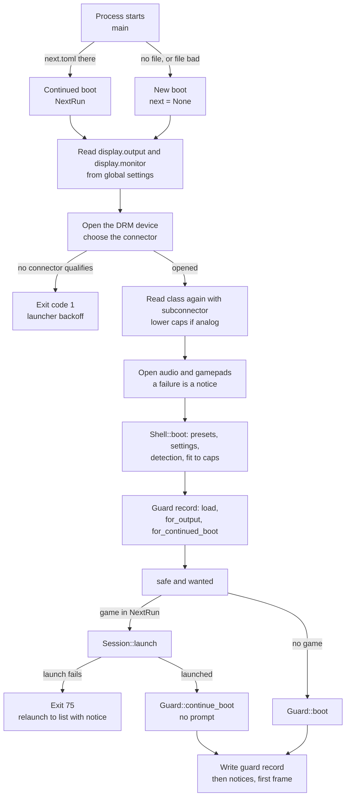
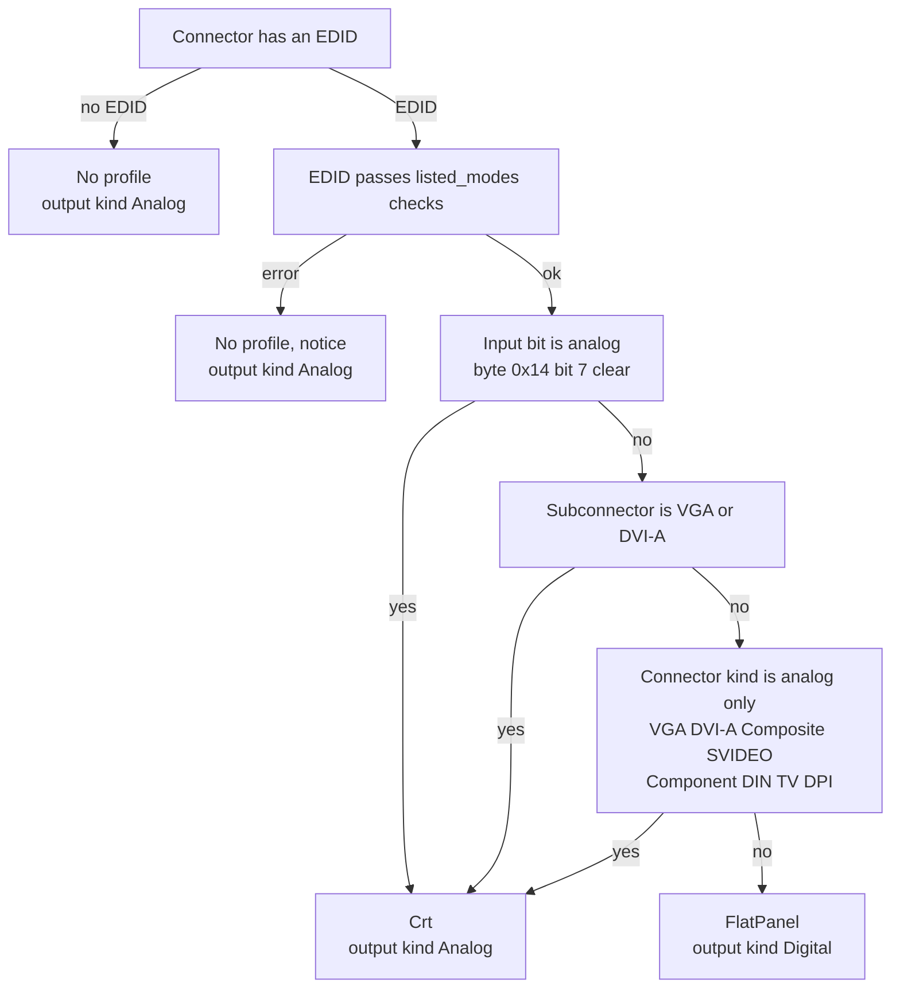
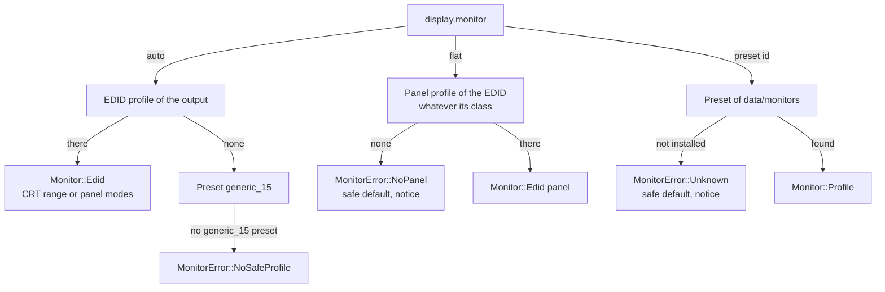
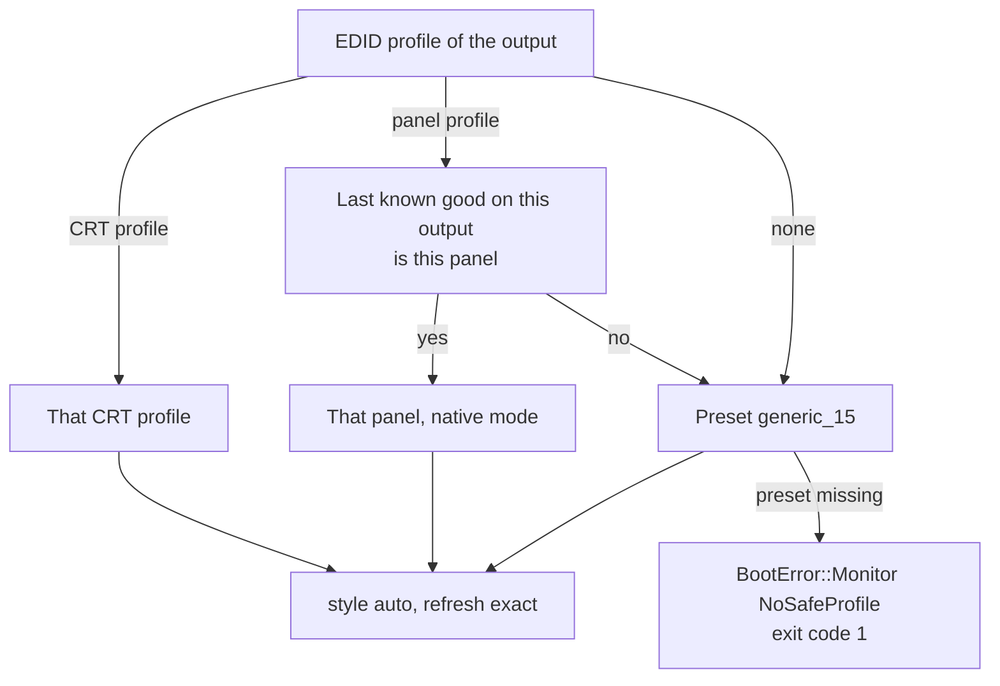
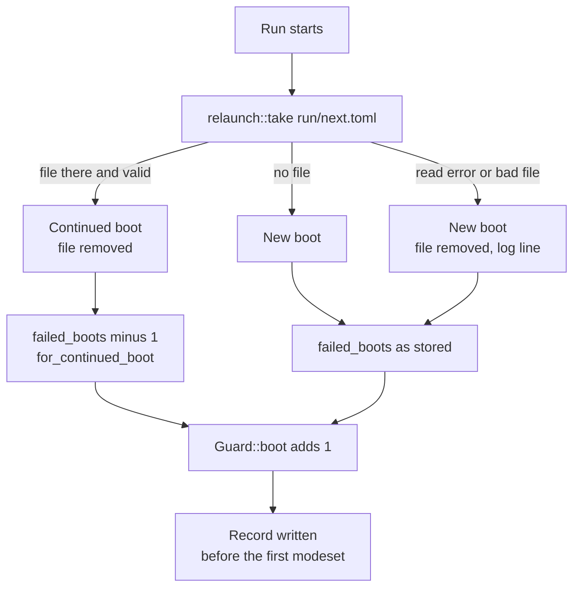

# 2. Frontend boot

This flow covers the start of one run of the frontend (`apps/neptron`), from the process start to the first frame. The run opens the display on the descriptor of the launcher, reads the settings and the monitor presets, finds out what display is on the wire (CRT or flat panel), picks the safe default and the wanted configuration, and starts the [guard](03-guard.md). The guard record is written before the first modeset, so a run that crashes later still counts as a boot. The launcher side (exit codes, backoff, relaunch) is in [Power-on to first picture](01-power-on.md). What happens after the first frame is in [ODREN](04-odren.md) and [The screens](07-screens.md).

## Diagrams

### The start of a run, in order

This is the order of `kms::run` and `Shell::boot` on the device (KMS backend).

### The class rule (`display_class`)

A `Crt` gets the profile of `profile_from_edid` (one range from the EDID range limits, id `edid_<manufacturer>_<product>`). A CRT whose EDID is digital (a DAC with its own EDID) gives no CRT profile, so the run uses the safe start. A `FlatPanel` gets the profile of `panel_profile_from_edid`: the progressive modes the EDID lists, preferred mode first, id `panel_<manufacturer>_<product>`.

### The monitor of `display.monitor` (`Detected::monitor`)

### The safe default (`Detected::safe`)

### New boot or continued boot

## States and screens

The boot shows no screen of its own. These are the outcomes of the boot and what the user sees on the first frames.

| Outcome | What the user sees |
| --- | --- |
| `Booted::Ready`, guard `Confirmed` | The game list (or the game) in the wanted configuration. Any boot issue shows as a notice. |
| `Booted::Ready`, guard `Pending` (the boot prompt) | The wanted configuration and the confirm dialog: title "Keep this picture?", text "Keep the new picture?\nNo answer brings the old one back." with "The old picture comes back in N s.", buttons "Revert" (focus) and "Keep". See [The guard](03-guard.md). |
| `Booted::Ready`, guard `Safe(reason)` | The safe default and a warning notice, for example "Safe mode: the last starts gave no confirmed picture." The display panel shows "(safe mode)" after the mode. |
| `Booted::Ready` after a failed record write | The safe default and the warning "Safe mode: the guard record cannot be written ({e}). This start uses the safe picture." No tone. |
| `Booted::Relaunch` (a game did not start) | Nothing from this run. The next run shows the game list with an error notice, for example "{name} did not start: {e}." |
| `BootError` | No picture from this run. The log line "neptron: the frontend cannot start: {e}". Exit code 1, and the launcher starts the frontend again after its backoff. |
| The display does not open | No picture from this run. The log line "neptron: cannot open the display: {e}". Exit code 69 when no connector qualifies (`ChoiceError::NoneConnected`), else exit code 1. With `display.output` = `auto`, the KMS backend first waits up to 15 s (`DISPLAY_WAIT_MAX_NS`) for a connector that qualifies, and looks every 250 ms (`DISPLAY_POLL_NS`). |

## Transitions

| Step | Condition | Constant = value | Effect on the wire or on disk |
| --- | --- | --- | --- |
| Take the relaunch file | `run/next.toml` exists, parses, has `version` = `RELAUNCH_VERSION` = 1, and its game passes `GameRef::check` | `RELAUNCH_VERSION` = 1 | The file is removed in every case where it existed. A bad file gives the log line "neptron: {e}; this start is a new boot". |
| Choose the connector | `display.output` names one: that one, or `ChoiceError::NotFound`. `auto`: the connected connectors, without analog connectors that report no EDID; an analog one first for a CRT monitor, a digital one first otherwise; else the first candidate | `ANALOG_TYPES` = DRM types 1, 2, 4, 5, 6, 8, 9, 13, 17 (VGA, DVI-I, DVI-A, composite, S-Video, component, 9-pin DIN, TV, DPI) | No modeset. The descriptor comes from the launcher. |
| Caps of the open | `Detected::backend_caps(display.monitor)`: digital caps only when the output is digital and the monitor is `auto` or `flat` | `CRT_BUFFER_WIDTH_PX` = 2560, `CRT_BUFFER_HEIGHT_PX` = 1200, `PANEL_WIDTH_MAX_PX` = 3840, `PANEL_HEIGHT_MAX_PX` = 2160, unknown GPU 165 MHz and 1920x1200 (`UNKNOWN_GPU_CAPS`) | Scanout buffers are made once at this size. |
| Lower the caps | After the open, the class of the driven connector with its `subconnector` is analog | Analog caps of the capability table | `KmsDisplay::lower_caps`: the policy and the validator get the analog pixel clock and mode size. The buffers stay. |
| Audio | `Sdl3Sink::open` fails | none | Notice "No sound: the audio device did not open ({e})." The run goes on silent. |
| Gamepads | `SdlGamepads::open` fails | none | Notice "No gamepads: they did not open ({e})." Keyboards only. |
| Presets | `data/monitors/*.toml` | none | A bad file is left out with a warning notice. A folder that cannot be read gives no preset. |
| Settings | `state/config` global layer, and for a game its system and game layers | none | A file that cannot be read or parsed is an empty layer and a warning. The boot never stops on bad settings. |
| Fit the panel | A panel profile and the display caps | `PANEL_WIDTH_MAX_PX` = 3840, `PANEL_HEIGHT_MAX_PX` = 2160 | Native mode too large: notice "The panel's native mode {native} is above what this system sends ({limits}). It runs at {shown}." No mode fits: notice "The panel lists no mode that this system sends ({limits})." and no panel profile. |
| Load the record | `state/video/guard.toml` | `RECORD_VERSION` = 1 | Missing file: the default record, no notice. Bad file: the default record and the warning "{e}; the guard starts with no last known good". |
| Drop a foreign last known good | The record's `output` is not the connector of this run, or the file has none | none | `last_known_good` = `None`. The counts stay. |
| Continued boot | A valid relaunch file | none | `failed_boots` minus 1, not below 0. |
| `wanted` | `display.monitor` maps to a monitor, and the global picture style and refresh policy map to the policy | none | A monitor error: the safe monitor and the error as a notice. A policy error: the safe settings and the notice "{e}; the safe picture style applies". |
| Launch a game | `NextRun.game` is set | none | Failure: `Booted::Relaunch` to the list with "{name} did not start: the system {system} is unknown." or "{name} did not start: {e}.". Exit 75. |
| `Guard::boot` | The game list run |  `SAFE_MODE_FAILED_BOOTS` = 2 | `failed_boots` plus 1. The engine gets the chosen inputs; no modeset yet. |
| `Guard::continue_boot` | The game run | `SAFE_MODE_FAILED_BOOTS` = 2 | As `Guard::boot`, but it never opens a prompt: the game list run had it. A `wanted` monitor that is not the last known good gives the revert target at once, with no event and no notice: the last known good monitor with the wanted settings (`Confirmed`), or the safe default (`Safe(NothingConfirmed)`). So a display that was not kept never reaches the wire in a game. |
| Write the record | Always after `Guard::boot` or `Guard::continue_boot` | none | `record::save` on the frame thread, before the first frame: temp file, fsync, rename. A failure starts this run in the safe default (`safe_for_this_run`). |
| Boot panel prompt | The boot opened a prompt, `auto` gives a panel, and `display.monitor` is `auto` | `PANEL_WINDOWS_PER_RUN` = 2 | `panel_windows` = 1 for this run. See [The guard](03-guard.md). |
| Game settings | The run is a game | none | `Guard::follow_settings` with the game's resolved policy. No prompt is open, so nothing reverts. In safe mode the safe settings stay. |
| Library scan | The run is the game list | none | The scan of `share/roms` starts. A failure is the warning "the game scan did not start: {e}". |

### What counts as a failed boot

- Every run that reaches `Guard::boot` or `Guard::continue_boot` adds 1 to `failed_boots` and writes it before the first mode.
- The count goes back to 0 when the user keeps a change (`Confirmed`), or when the confirmed configuration shows a picture for `GOOD_BOOT_PICTURE_NS` = 10 s (`GoodBoot`).
- A run in safe mode never reaches `GoodBoot`. Only a confirmation ends it.
- A run that starts from the relaunch file subtracts 1 first, so a planned relaunch does not add to the count of the run before. When the run before was already good (count 0), the new run still counts 1 until it is good itself.
- A crash, a hang killed by the launcher, a power cut, or a restart of the launcher leaves no relaunch file (it lives in `/run`, a RAM file system), so the next start counts.
- After `SAFE_MODE_FAILED_BOOTS` = 2 failed boots in a row, the next boot starts in safe mode.

### When the boot prompt appears

`Guard::boot` opens the confirm dialog at boot when all hold:

- `failed_boots` before this boot is below `SAFE_MODE_FAILED_BOOTS` = 2;
- the record is not in safe mode;
- the monitor of `wanted` is not the last known good of this output.

So the prompt appears on the first boot on any display, after the monitor moved to another connector, after a different EDID monitor is plugged in (its profile id differs), after a preset changed in the settings files, and after a preset file of the last known good was removed. With no answer it reverts after `CONFIRM_WINDOW_NS` = 10 s. A game run never opens it (`Guard::continue_boot`): it starts on the last known good, or in the safe default when nothing was kept, with no notice.

## What can go wrong

| Case | What the user sees | Way out |
| --- | --- | --- |
| A VGA (or other analog) connector with no EDID and `display.output` = `auto` | No picture from the frontend. The log line starts with "neptron: cannot open the display:" and carries the `ChoiceError` text "no connected display found; an analog connector that reports no EDID is used only when the settings name it; the connectors are: {available}". The frontend waits up to 15 s for a connector that qualifies, then exits with code 69. The run reaches no `Guard::boot`, so no boot is counted. The launcher restarts the frontend after 1 s, with no backoff. | Write `display.output` (for example `VGA-1`) in `state/config/global.toml`. |
| `display.output` names a connector that does not exist | No picture. The log line carries "no connector is named {name}; the connectors are: {available}". | Fix `display.output` in `global.toml`. |
| No EDID and no `generic_15` preset in `data/monitors` | No picture. Log: "neptron: the frontend cannot start: no safe monitor profile: no EDID and no generic_15 preset in the monitor folder". | Restore the preset (it is on the image). |
| The EDID of the named output is broken or gives no profile | Notice "The EDID of {connector} gives no profile ({e}); the safe start is used." `auto` gives `generic_15`. | Set a preset in `display.monitor`. |
| A DAC that shows its own digital EDID, with a CRT behind it, and no analog subconnector | It is taken for a flat panel. The panel mode is shown under the boot prompt for 10 s at most, then `generic_15`. | Set a CRT preset in `display.monitor`. A preset always wins. |
| A panel above the GPU limits | Notice "The panel's native mode ... is above what this system sends (...). It runs at ...". | None needed. The panel scales. |
| The settings files are damaged | A warning notice per file. The setting falls back to the level below. | Fix or delete the file. |
| `display.monitor` names a preset that is not installed | Notice `the monitor profile "{id}" is not installed; the safe default is used`. | Pick another monitor in the display panel. |
| `display.monitor` = `flat` with no panel modes | Notice `the monitor profile "flat" needs a display that lists its modes; the safe default is used`. | Pick another monitor. |
| The guard record cannot be written (full or read-only state partition) | The safe default and the warning "Safe mode: the guard record cannot be written ({e}). This start uses the safe picture." | Free or repair the state partition. |
| The guard record is damaged or has another version | Warning "{e}; the guard starts with no last known good". The boot prompt opens. | Keep the picture. The record is written again. |
| A game does not start | The game list with the error notice "{name} did not start: {e}.". | Choose another game. |
| No sound device | Notice "No sound: the audio device did not open ({e})." The run goes on silent. | Check the audio device. Restart. |

## Source

- [main.rs](../../apps/neptron/src/main.rs): `main`, `take_next`, `run_booted`, `end`, `relaunch`.
- [kms.rs](../../apps/neptron/src/kms.rs): `run` (settings read before the open, `KmsConfig`, `lower_caps`, audio and gamepads).
- [boot.rs](../../apps/neptron/src/shell/boot.rs): `Shell::boot`, `load_presets`, `load_record`, `launch`, `BootError`, `Booted`.
- [display.rs](../../apps/neptron/src/display.rs): `Detected::of`, `Detected::read`, `Detected::fit_to`, `Detected::safe`, `Detected::monitor`, `Detected::auto_is_panel`, `Detected::rebuild`, `Detected::output_for`, `Detected::policy_caps`, `Detected::backend_caps`, `Detected::is_crt`, `SAFE_START_PROFILE`, `AUTO`, `FLAT`, `MonitorError`.
- [record.rs](../../apps/neptron/src/record.rs): `load`, `save`, `decode`, `encode`, `for_output`, `for_continued_boot`, `MonitorRef`, `RECORD_VERSION`.
- [relaunch.rs](../../apps/neptron/src/relaunch.rs): `take`, `write`, `GameRef::check`, `RELAUNCH_EXIT_CODE`, `RELAUNCH_VERSION`.
- [config.rs](../../apps/neptron/src/config.rs): `Config::load`, `Config::policy`, `Config::global_policy`, `Config::monitor`.
- [presets.rs](../../apps/neptron/src/presets.rs): `Presets::load`, `PresetError`.
- [paths.rs](../../apps/neptron/src/paths.rs): `Paths::image`, `guard_record`, `relaunch`, `monitors`.
- [panel.rs](../../crates/neptron-platform/src/panel.rs): `display_class`, `profile_for_display`, `panel_profile_from_edid`, `ANALOG_CONNECTOR_KINDS`, `ANALOG_SUBCONNECTORS`.
- [connector.rs](../../crates/neptron-kms/src/connector.rs): `choose`, `ChoiceError`, `ANALOG_TYPES`.
- [ADR 0010](../adr/0010-output-kind-picks-the-gpu-limits.md): the output kind picks the GPU limits.

## Differences from docs/definition

- `05-crt-safety-model.md`, "First boot when the display is unknown": the definition describes `neptron.toml` on the boot partition and a blind probe (15 s at 15 kHz 240p, then 10 s at 31 kHz 480p, three rounds, then no signal). The code has neither. No code reads `neptron.toml`. With no EDID, `auto` is the preset `generic_15` under the boot prompt. The `apps/neptron/README.md` (connector paragraph) also says `display.output` "changes in `global.toml` or `neptron.toml`"; only `global.toml` is read.
- `05-crt-safety-model.md`, "Which output is used": the definition says that with none named and one connector connected, that one is used. The code (`choose`) never takes an analog connector that reports no EDID unless `display.output` names it, also when it is the only one. Then the display does not open and the run exits with code 1.
- `05-crt-safety-model.md`, row 7 "Supervisor": "the frontend's first action is to re-apply the last validated mode". The code does not re-apply a stored mode. It builds `wanted` from the settings and compares its monitor with the last known good monitor (`Guard::boot`); ODREN then decides a new mode for the source.
- `05-crt-safety-model.md`, row 5 "Last known good": the definition says the last confirmed configuration is stored. The record stores only the monitor (`MonitorRef`: a preset id or an EDID profile id) and the connector (`output`). It drops the last known good when the connector differs.
- `06-flat-panels-shaders-and-vertical-games.md`, "Flat-panel mode": "Starts in the panel's preferred EDID mode, up to 4K." In the code the panel is only `wanted` under the boot prompt until the user keeps it on this output. Until then the safe default is `generic_15`. The preferred mode is also cut to the GPU caps; a GPU with no digital limits in the table (all but `intel_gen9`) gets 165 MHz and 1920x1200.
- `06-flat-panels-shaders-and-vertical-games.md`: "Another listed mode can be chosen in the Display panel". The monitor row offers `auto`, `flat` (when a panel profile exists) and the presets. No row picks one listed panel mode.
- `08-frontend-and-ux.md`, "First-boot wizard": no wizard exists in the code. The first boot is the boot prompt.
- `05-crt-safety-model.md`, row 4 "Confirm or revert" covers "output". In the code the output connector is not under the guard. The display panel shows it read only, and a new connector takes effect at the next start, where the boot prompt opens because the record's `output` differs.
