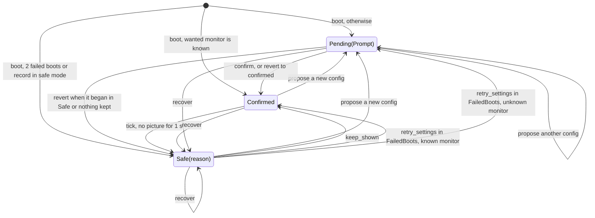
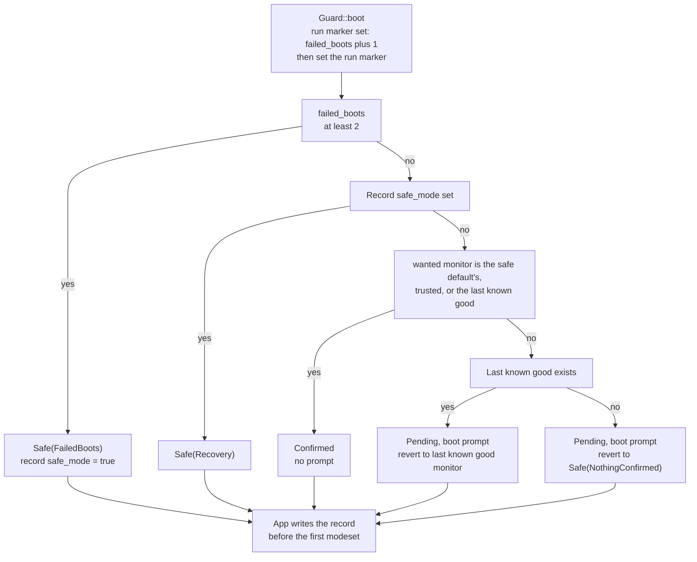
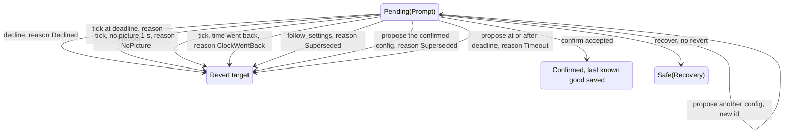
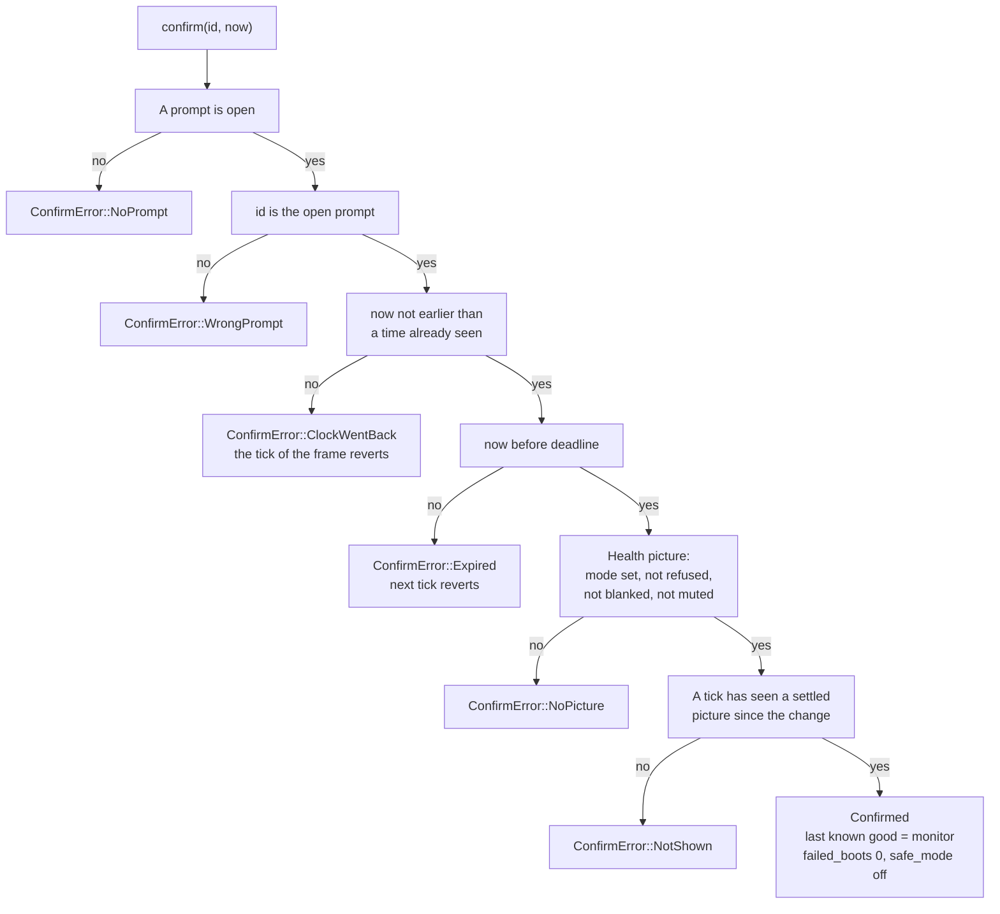
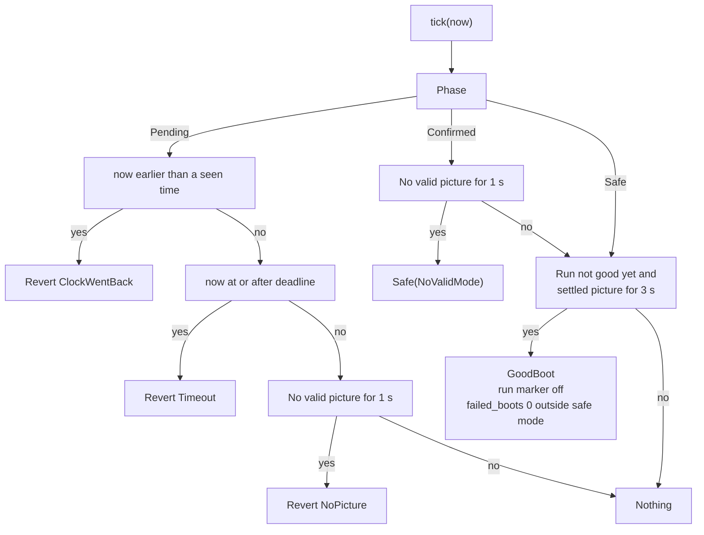

# 3. The guard

The guard (`Guard` in `neptron-video`) is the confirm-or-revert machine of the display. It owns the display configuration that the [ODREN](04-odren.md) engine gets: the monitor profile (a TV standard is a monitor) and the policy settings (picture mode, refresh rate and the TV picture width). It puts a display change on the screen at once, reverts it when the user does not keep it in time or when it gives no picture, keeps the last known good monitor across boots, counts failed boots, and runs safe mode and the blind recovery. It decides and does no I/O: it changes the display only through the engine inputs (`retry`, `set_monitor`, `set_settings`), and it gives the record to the app to write. This page also covers the app side (`apps/neptron/src/shell/guard_events.rs`, `intents.rs`): the dialog, the setting writes, the notices, the trust of a display by its class, and the record per place. `docs/spec/display-guard.md` holds the rules, and ADR 0013 the changes to the safety model.

## Diagrams

### Overview

A known monitor is the safe default's, one the app trusts by the class of the display (`Detected::trusts`: a TV output, or an EDID flat panel on a digital link with `display.monitor` `auto` or `flat`), or the last known good of this place.

A revert goes to what the pending chain replaced: `Confirmed` with the configuration confirmed before, or `Safe` with the same `SafeReason` as before. At boot with no last known good, the revert target is `Safe(NothingConfirmed)`.

### Detail: `Guard::boot`

### Detail: the ends of a pending change

### Detail: `Guard::confirm`

### Detail: `Guard::tick` once per frame

Before these checks, the first settled picture of a pending change moves its deadline to that tick plus 15 s, no later than 30 s after the first change of the chain.

## States and screens

| State | What the engine has | What the user sees |
| --- | --- | --- |
| `Confirmed` | The confirmed configuration, or the wanted one when its monitor is the last known good | The normal picture. No dialog. |
| `Pending(Prompt)` | The change, at once | The confirm dialog over any screen: title "Keep this picture?", text "Keep the new picture?\nNo answer brings the old one back.", then "The old picture comes back in N s." (N is the time left, rounded up to whole seconds), and at 0 "The old picture comes back now.". Buttons "Revert" (focus) and "Keep"; a fresh press of Right moves the focus at once. At 0 s only "Revert" shows. Hints "Accept: revert" and "Right, then Accept: keep". In the frame of an answer: "One moment." Goldens: `confirm-10s.ppm`, `confirm-3s.ppm`, `confirm-0s.ppm` in `crates/neptron-ui/tests/golden/screens`. |
| `Safe(FailedBoots)` | The safe default | Warning notice "Safe mode: the last starts gave no picture. Keep a picture in Settings, Display to leave it.", once per power cycle. The display panel shows "(safe mode)" after the mode, and the rows "Keep this picture" and "Try my settings again" (golden `display-safe-mode.ppm`). |
| `Safe(Recovery)` | The safe default | Warning notice "Safe mode: the picture was reset. Keep a picture in Settings, Display to leave it." After the hold: always, with a tone, in the game list and in a game. At a start: once per power cycle, with no tone. "(safe mode)" and the row "Keep this picture" in the display panel. |
| `Safe(NoValidMode)` | The safe default | Warning notice "Safe mode: the display settings gave no picture." "(safe mode)" and the row "Keep this picture". |
| `Safe(NothingConfirmed)` | The safe default | Reached as the revert target of a boot prompt or of a continued boot, so the notice is the revert notice, for example "Display change undone: not kept in time.", or none. "(safe mode)" and the row "Keep this picture". |

The safe default is the one of [Frontend boot](02-frontend-boot.md): the CRT profile of the EDID, or the panel in its native mode when the display is a trusted panel and `display.monitor` is `auto` or `flat`, else `generic_15`; style `auto`, refresh `exact`. On a TV output: the TV profile of NTSC, or of the first standard the output offers.

## Transitions

### Constants

| Constant | Value | Where | Meaning |
| --- | --- | --- | --- |
| `CONFIRM_WINDOW_NS` | 15 s | `guard.rs` | A change reverts unless kept in this time, counted from its first settled frame (until then, from the change). |
| `PENDING_LIMIT_NS` | 30 s | `guard.rs` | Changes with no confirmation, one after the other, revert at the latest this long after the first. |
| `SAFE_MODE_FAILED_BOOTS` | 2 | `guard.rs` | Failed boots in a row before the next boot starts in safe mode. |
| `GOOD_BOOT_PICTURE_NS` | 3 s | `guard.rs` | A settled picture of the confirmed configuration or of the safe default this long makes the run good. |
| `NO_PICTURE_LIMIT_NS` | 1 s | `guard.rs` | No valid picture this long makes the guard leave the configuration. |
| `BLIND_RECOVERY_HOLD_NS` | 5 s | `neptron-input` `hotkeys.rs` | Hold time of `BLIND_RECOVERY_COMBO` = Select + Start on one port. |
| `CUE_MS`, `CUE_HZ`, `CUE_LEVEL` | 200 ms, 880 Hz, 8192 (a quarter of full scale) | app `guard_events.rs` | The square-wave tone of the blind recovery. |
| `RECORD_VERSION` | 1 | app `record.rs` | Version of `state/video/guard.toml`. |
| `PLACES_MAX` | 8 | app `record.rs` | Places with a last known good that the record keeps. |

### Health: what is a picture

`Health::of(engine)` reads the engine after each present:

- `picture` = a mode is set, and it is not refused, the output is not blanked, and the engine is not muted (a modeset whose first flip has not completed is muted).
- `no_picture` = refused, or blanked, or no mode set. A mode that waits for its first flip is not "no picture", because a flip can be late.
- `decided` = `Odren::settled()`: no decision is due, a mode is set, and that mode was decided on the current inputs (its generation is the current one).

A picture counts for the guard only when `picture` and `decided` are both true. Every guard change ends in `retry`, `set_monitor` or `set_settings`, which raise the input generation or set a decision due. So the old mode never counts as a picture of the change, even when it passes the new inputs: not after a failed modeset, not after a decision with no winner, not after a restore. This is why a confirmation needs a shown picture (`NotShown`): the user must keep what they see, not the old mode.

### Calls and conditions

| From | To | Condition | Constant | Event and effect |
| --- | --- | --- | --- | --- |
| (boot) | `Safe(FailedBoots)` | `failed_boots` >= 2, after a run marker that the run before left set added one | `SAFE_MODE_FAILED_BOOTS` = 2 | `SafeMode(FailedBoots)`. Record `safe_mode` = true. |
| (boot) | `Safe(Recovery)` | The record has `safe_mode` | none | `SafeMode(Recovery)`. |
| (boot) | `Confirmed` | `wanted.monitor` is the safe default's, trusted, or the last known good here | none | No event. The engine gets `wanted`. |
| (boot) | `Pending` | Otherwise. The chain starts now and comes from the settings files | `CONFIRM_WINDOW_NS` = 15 s | `PromptOpened`. Revert target: the last known good monitor with the wanted settings, or `Safe(NothingConfirmed)`. |
| (continued boot) | `Confirmed` or `Safe` | Every run that follows a relaunch file: a game, or the game list after a game | none | As boot, but never `Pending`: the revert target with no event. No run marker, no count. |
| `Confirmed` or `Safe` | `Pending` | `propose(config)` with a config that is not the confirmed one | `CONFIRM_WINDOW_NS` = 15 s | `PromptOpened` with a new `PromptId`. The engine gets the change at once. |
| `Pending` | `Pending` | `tick`: the first settled picture of the change | `CONFIRM_WINDOW_NS` = 15 s | The deadline becomes now + 15 s, no later than the chain start + 30 s. Same id. |
| `Confirmed` | `Confirmed` | `propose` of the active config | none | No event, no change. |
| `Pending` | `Pending` | `propose` of another config before the deadline | Deadline = min(now + 15 s, chain start + `PENDING_LIMIT_NS` = 30 s) | `PromptOpened` with a new id. The revert target stays the one before the first change. |
| `Pending` | revert target | `propose` at or after the deadline | none | `Reverted(Timeout)`. The new config is not applied. |
| `Pending` | revert target | `propose` of the confirmed config | none | `Reverted(Superseded)`. |
| `Pending` | `Confirmed` | `confirm(id)` passes every check | none | `Confirmed`. Record: last known good = active monitor, `failed_boots` = 0, `safe_mode` = false, `run_open` = false. Saved. The app writes the waiting settings. |
| `Pending` | revert target | `decline(id)` with the open id | none | `Reverted(Declined)`. |
| `Pending` | revert target | `tick`: now >= deadline | `CONFIRM_WINDOW_NS` = 15 s, `PENDING_LIMIT_NS` = 30 s | `Reverted(Timeout)`. |
| `Pending` | revert target | `tick`: no valid picture for 1 s | `NO_PICTURE_LIMIT_NS` = 1 s | `Reverted(NoPicture)`. |
| `Pending` | revert target | `tick` with a time earlier than one already seen | none | `Reverted(ClockWentBack)`. |
| `Pending` | revert target | `follow_settings` (the settings of a game at launch) | none | `Reverted(Superseded)`, then the game settings apply if the target is `Confirmed`. |
| `Confirmed` | `Safe(NoValidMode)` | `tick`: no valid picture for 1 s | `NO_PICTURE_LIMIT_NS` = 1 s | `SafeMode(NoValidMode)`. Record unchanged. |
| `Confirmed` or `Safe` | the same | `tick`: the run is not good yet and a settled picture has lasted 3 s | `GOOD_BOOT_PICTURE_NS` = 3 s | `GoodBoot`. `run_open` = false; `failed_boots` = 0 unless the record is in safe mode. Saved when it changed. |
| `Safe` | `Confirmed` | `keep_shown`: the row "Keep this picture", with a settled picture | none | `Confirmed`. Record: last known good = the safe default's monitor, `failed_boots` = 0, `safe_mode` = false. The app writes the safe default to the global settings. |
| `Safe(FailedBoots)` | `Confirmed` or `Pending` | `retry_settings`: the row "Try my settings again". In any other state nothing happens | none | `safe_mode` = false, `failed_boots` = 0, `run_open` = true (the run counts again, and is not good until a good picture), saved. A known monitor: `Confirmed`, no event. Else `PromptOpened`, as the boot prompt. |
| any | the same | `close_run`: the run ends cleanly (`Shell::finish`) | none | `run_open` = false, saved when it changed. |
| `Confirmed` | `Confirmed` | `follow_settings` with other settings | none | The engine gets the settings. The picture watch starts again. |
| `Safe` | `Safe` | `follow_settings` | none | Nothing: the safe default keeps its settings. |
| any | `Safe(Recovery)` | `recover`: Select + Start held 5 s, or the record cannot be written at boot | `BLIND_RECOVERY_HOLD_NS` = 5 s | `SafeMode(Recovery)`. A pending change ends with no revert event. Record `safe_mode` = true, saved when it changed. |

### Revert reasons and their notices

| `RevertReason` | Cause | Notice (kind Info) |
| --- | --- | --- |
| `Timeout` | `CONFIRM_WINDOW_NS` = 15 s passed, or the chain reached `PENDING_LIMIT_NS` = 30 s | "Display change undone: not kept in time." |
| `Declined` | The user chose Revert, or pressed Back | "Display change undone." |
| `NoPicture` | No valid picture for `NO_PICTURE_LIMIT_NS` = 1 s | "Display change undone: no picture." |
| `Superseded` | `follow_settings` came, or the user chose the confirmed configuration again | none |
| `ClockWentBack` | A guard call had a time earlier than one seen before | "Display change undone: the clock went back." |

A revert whose target equals the change (`Reverted { changed: false }`) shows no notice.

### Confirm errors

| `ConfirmError` | When | What the app does |
| --- | --- | --- |
| `NoPrompt { asked }` | No change waits | Nothing. |
| `WrongPrompt { asked, open }` | The id is not the open prompt | Nothing. |
| `ClockWentBack { now_ns, latest_ns }` | The time of the Keep is earlier than a time the guard has seen | Log line "keep refused: ...". The tick of the same frame reverts with `ClockWentBack`. |
| `Expired { deadline_ns, now_ns }` | The Keep came at or after the deadline. The dialog shows no Keep at 0 s, so the UI never sends one: only a fault in the app gets here | Log line "keep refused: confirmation at ... after the deadline of ...". The next tick reverts with `Timeout`. |
| `NotSafe { phase }` | `keep_shown` outside safe mode | Log line "keep refused: ...". |
| `NoPicture { health }` | The engine shows no valid picture now | Log line "keep refused: no valid picture is on the display: ...". The guard does not change. |
| `NotShown` | No tick has seen a settled picture of the change | Log line "keep refused: no frame has shown the change yet". The guard does not change. |

The app takes the id from `Guard::pending()`, so `NoPrompt` and `WrongPrompt` do not come from the menu.

### The record and when it is saved

`GuardRecord` holds `last_known_good` (a monitor, `None` when nothing was kept at this place or the profile cannot be built again), `failed_boots`, `safe_mode` and `run_open` (the run marker). A TV profile is stored by its id `tv_<key>` (for example `tv_pal_60`) and is built again only on an output that offers that standard. The app file `state/video/guard.toml` (version 1) adds `[[places]]`: one entry per place, with `output` (the connector), `monitor` (`edid-` and a hash of the EDID, or `none` with no EDID) and `last_known_good`, at most `PLACES_MAX` = 8, the place used last at the end. The top fields `output`, `monitor` and `last_known_good` repeat the last entry, so a build from before the places reads the file. The boot reads the entry of its own place and writes every other entry back as it is.

| When | What changes | How it is written |
| --- | --- | --- |
| `Guard::boot` | `failed_boots` + 1 when `run_open` was set; `run_open` = true; `safe_mode` = true for `FailedBoots` | Always saved. `record::save` on the frame thread, before the first frame and the first modeset. Temp file, fsync, rename. |
| `Guard::continue_boot` | Nothing, unless safe mode sets `safe_mode` | Saved only when it changed. |
| `confirm`, `keep_shown` | Last known good of this place = active monitor, `failed_boots` = 0, `safe_mode` = false, `run_open` = false | Writer thread (`Outbox`, `Job::Record`). |
| `retry_settings` | `failed_boots` = 0, `safe_mode` = false, `run_open` = true | Writer thread. |
| `GoodBoot` | `run_open` = false; `failed_boots` = 0 outside safe mode | Writer thread. |
| `close_run` (clean exit) | `run_open` = false | Writer thread, joined by `Shell::finish`. |
| `recover`, or a safe entry that sets `safe_mode` | `safe_mode` = true | Writer thread, only when the record changed. |
| Any other step | Nothing | Not written. |

Last known good changes only when the user keeps a configuration. A long stable picture makes the run good but records no monitor.

### Settings and the guard (app side)

| Event | What the app does |
| --- | --- |
| A picture mode, refresh rate or TV picture width changes (schema safety `Validated`) while the guard is `Confirmed` | Written at once. The app calls `follow_settings` with the policy of the settings: no prompt. |
| A display setting changes (monitor, TV standard: `ConfirmOrRevert`; or a `Validated` setting in `Pending` or `Safe`) | The value changes in memory and goes on the list of waiting changes. The app builds the display config and calls `propose`. When the guard is `Confirmed` and the config equals the active one, the waiting changes are written at once and no prompt opens. In safe mode the config on screen opens a prompt, so it can be kept. |
| A setting with no effect on the signal (scanlines, scanline strength, Start hold) | Written at once and applied live. No guard. |
| `display.output` | Not changed from the menu or the protocol. |
| `PromptOpened` | The dialog goes in the snapshot. Key repeat stops, and a held key sends nothing (`Navigator::hold_back`). |
| `Confirmed` | Each waiting change is written to its file (global, system or game level). |
| `Reverted { reason, rewrite, changed }` | The waiting changes are taken back in memory, newest first. With `rewrite: Some(config)` (the chain began with the boot prompt), the monitor, style and refresh of that config are written to the global settings, so the next boot does not show the change again. For a TV profile the app writes `display.tv` and leaves `display.monitor` as it is. Info notice, except for `Superseded` and when `changed` is false. |
| `SafeMode(reason)` | The waiting changes are taken back. The dialog closes. Warning notice. At a start, the notice of `FailedBoots` and `Recovery` shows once per power cycle: the marker `run/safe-notice-shown` in the RAM folder says it showed. `Recovery` after the hold: the tone. In the game list the app writes it to its sink; in a game the audio pipeline mixes it into the next core frames (`Session::write_cue`), so it plays whole and the queue stays at its target. It bypasses the mute and the user volume does not scale it. In a frame where the core does not run (the quick menu, the output off), the session writes the next slice of the tone with silence up to the target level (`AudioPipeline::idle_frame`), so the tone confirms the recovery at any time. |
| `GoodBoot` | Nothing visible. |

### Trust by the class of the display

A boot drives a trusted display with no prompt (ADR 0013):

1. A TV output (a connector with the `TV mode` property): its modes are the fixed table modes of its standards. Any standard from the settings boots with no prompt. A change of the standard in the menu still opens the dialog.
2. A flat panel: the driven connector reports the EDID, the EDID gives a flat-panel profile, the output kind is digital (no analog connector or subconnector, no analog EDID input), and `display.monitor` is `auto` or `flat`. The panel is also the safe default of the run, so a revert and the blind recovery give the panel mode.
3. A named preset is never trusted. On a panel EDID it opens the boot prompt, and the safe default of the run is `generic_15`: a CRT can be behind an adapter with its own digital EDID.

## What can go wrong

| Case | What the user sees | Way out |
| --- | --- | --- |
| A display change gives a black or rolling screen | The change stays for at most 15 s after its picture settles, or 1 s when the engine reports no valid picture. Then the old picture and "Display change undone: ..." | Wait. Or press Accept: the focus is on Revert. Or Back. |
| The user presses Keep before the picture of the change is settled, or while a flip is late | The dialog shows "One moment." for one frame. The guard refused (`NotShown` or `NoPicture`) and the dialog is open again, with the focus on Keep. The refusal is logged as "keep refused: ...". With no accepted Keep the change reverts at the deadline with "Display change undone: not kept in time." | Press Accept again when the picture is on screen. |
| Several changes in a row with no Keep (a held key, the control protocol) | Each change opens a new prompt, but all revert at the latest 30 s after the first. | Keep the one you want. |
| The confirmed configuration stops giving a picture (the driver refuses, the output is blanked) | After 1 s, the safe default and "Safe mode: the display settings gave no picture." | Choose a working setting and keep it. |
| A wrong preset, black screen, user cannot see the menu | Nothing on screen. | Hold Select + Start on one pad for 5 s. The safe default comes back with "Safe mode: the picture was reset. Keep a picture in Settings, Display to leave it." and a tone. In a game the hold opens the quick menu at 0.5 s: the game is paused in the safe default, and the notice shows over the menu. The next boots also start in safe mode until a configuration is kept, also the picture on screen with "Keep this picture". |
| The safe default itself gives no picture (for example `generic_15` on a 31 kHz-only monitor) | No picture. The guard does nothing more: no signal is safe. | Name the right preset in `state/config/global.toml` and keep it at the next boot. |
| The frontend crashes, hangs or loses power before 3 s of settled picture | The next start counts the run as a failed boot (its run marker is still set). After 2 such runs the next starts in `Safe(FailedBoots)`. A clean exit (relaunch, quit, SIGTERM, reboot, power-off) and a power cut after a good picture count nothing. | "Keep this picture" or "Try my settings again" in Settings, Display. |
| A boot at another place (a monitor off at boot, the composite fallback of a Pi) | The boot uses the last known good of its own place, or none. The entries of the other places stay in the record. | None needed: the first place keeps its confirmation. |
| The monitor moved to another connector | That connector has its own entry, or none. With a monitor that is not known, the boot prompt opens; with no answer, the safe default. | Keep the picture. |
| A different monitor on the same connector, with `display.monitor` = a preset that is the last known good | The record holds the identity of the monitor of the confirmation. Another EDID (or an EDID where there was none, or none where there was one) is another place, so the boot prompt opens; with no answer, the safe default. A CRT with no EDID on both boots stays confirmed: two such monitors look the same. | Keep the picture, or let it revert. |
| A different EDID monitor on the same connector, `display.monitor` = `auto` | Its profile id differs, so the last known good does not rebuild. The boot prompt opens. | Keep the picture. |
| The system clock goes back | A pending change reverts: "Display change undone: the clock went back." | Make the change again. |
| A game launches while a display change is not kept (a boot prompt with no answer, or a launch through the control protocol while a prompt is open) | The game, and the game list after it, start on the last known good monitor, or in the safe default when nothing was kept. No prompt and no notice: every relaunch continues the boot (`Guard::continue_boot`). | Keep the setting in the game list first. |

## Source

- [guard.rs](../../crates/neptron-video/src/guard.rs): the constants `CONFIRM_WINDOW_NS`, `PENDING_LIMIT_NS`, `SAFE_MODE_FAILED_BOOTS`, `GOOD_BOOT_PICTURE_NS`, `NO_PICTURE_LIMIT_NS`.
- [machine.rs](../../crates/neptron-video/src/guard/machine.rs): `Guard::boot`, `continue_boot`, `propose`, `confirm`, `keep_shown`, `retry_settings`, `close_run`, `decline`, `follow_settings`, `recover`, `tick`, `clock`, `open_prompt`, `revert`, `enter_safe`, `apply`, `watch`; `Phase`, `Prompt`, `SafeReason`, `RevertReason`, `GuardEvent`, `GuardStep`, `ConfirmError`.
- [config.rs](../../crates/neptron-video/src/guard/config.rs): `DisplayConfig::apply_to`, `Health::of`, `Health::no_picture`.
- [record.rs](../../crates/neptron-video/src/guard/record.rs): `GuardRecord`.
- [odren.rs](../../crates/neptron-video/src/odren.rs): `Odren::settled`, `Odren::decision_due`, `Odren::blanked`.
- [guard_events.rs](../../apps/neptron/src/shell/guard_events.rs): `save_record`, `on_guard`, `recover`, `safe_for_this_run`, `roll_back`, `rewrite_global`, `play_cue`, `reverted_text`, `safe_text`.
- [intents.rs](../../apps/neptron/src/shell/intents.rs): `keep`, `change_setting`, `propose`, `display_config`, the `RevertMode` intent.
- [frame.rs](../../apps/neptron/src/shell/frame.rs): `list_frame`, `game_frame` (the order: recovery, panel offer, UI, present, `tick`).
- [view.rs](../../apps/neptron/src/shell/view.rs): `refresh_view`, `refresh_mode`, `CONFIRM_TEXT`.
- [boot.rs](../../apps/neptron/src/shell/boot.rs): `Shell::boot` (`boot_panel_prompt`, the record write).
- [record.rs](../../apps/neptron/src/record.rs) (app): `save`, `for_place`, `for_continued_boot`.
- [overlays.rs](../../crates/neptron-ui/src/screens/overlays.rs): `Confirm::handle`, `Confirm::draw`, `CONFIRM_BUTTONS`.
- [hotkeys.rs](../../crates/neptron-input/src/hotkeys.rs): `BLIND_RECOVERY_COMBO`, `BLIND_RECOVERY_HOLD_NS`, `Hotkeys::update`.

## Differences from docs/definition

- `05-crt-safety-model.md`, row 4 "Confirm or revert": "Any user-initiated change to output, profile or geometry applies for 10 seconds. No button press means automatic revert." ADR 0013 makes the window 15 s, counted from the first settled frame of the change. In the code the guard covers the monitor profile and the TV standard under a prompt; the picture mode, the refresh rate and the TV width prompt only when the monitor is not confirmed. The output is not under the guard (read only in the menu, refused by the protocol). Signal geometry does not exist. The code also reverts for a missing picture (1 s), a clock that goes back, and a superseding setting, and it caps a chain of changes at 30 s (`PENDING_LIMIT_NS`), which the definition does not name.
- `05-crt-safety-model.md`, row 5 "Last known good": "Two boots that never reach a confirmed picture trigger safe mode." ADR 0013 counts only a run that ended abnormally before a settled picture of 3 s (`GOOD_BOOT_PICTURE_NS`) in the confirmed configuration or a safe state. A relaunch does not count as a new boot. A boot on a trusted or safe-default monitor needs no confirmation. The last known good holds the monitor only, not the policy settings, and it is kept per place (connector and monitor).
- `05-crt-safety-model.md`, row 6 "Blind recovery": "at boot or at any time ... An audio cue confirms it." In the code the hold is read only from the first frame of the frontend (`list_frame` and the session's frame), not before. The combination is Select + Start (`BLIND_RECOVERY_COMBO`). The same buttons held for 0.5 s open the quick menu, so in a game a recovery hold opens the menu first. The tone plays in the game list and in a game; the safe start after a failed record write has none. The recovery also sets the record so the next boots start in safe mode until a setting is kept; the definition does not say this.
- `06-flat-panels-shaders-and-vertical-games.md`, "Flat-panel mode": "Starts in the panel's preferred EDID mode." The code now matches it for a trusted panel (ADR 0013).
- `crates/neptron-video/README.md` and the code agree on the state table. The README says `SafeMode(Recovery)` plays the audio cue; the app plays it in the game list and in a game.
