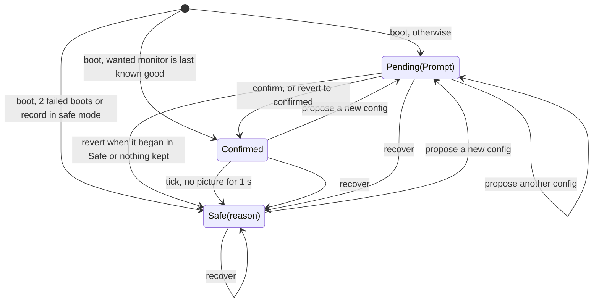
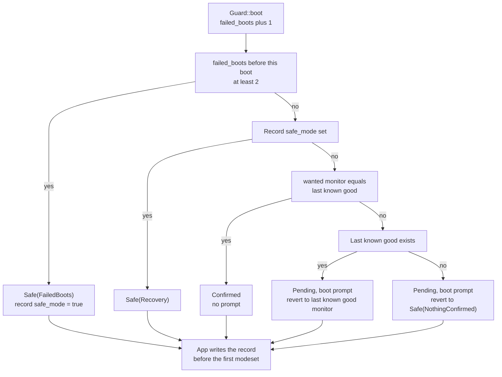
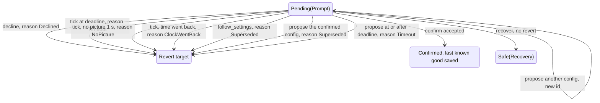
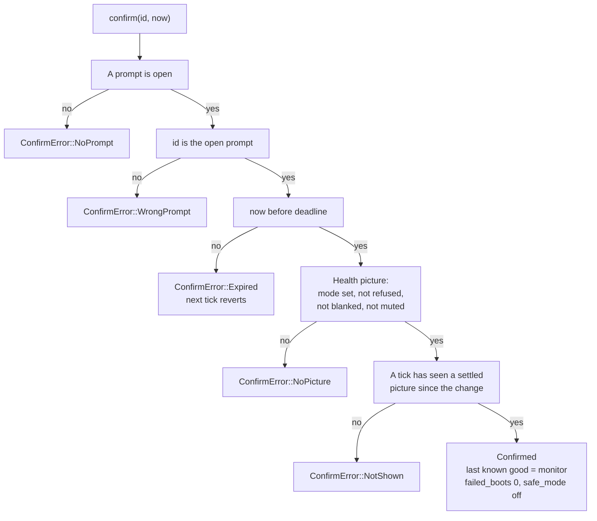
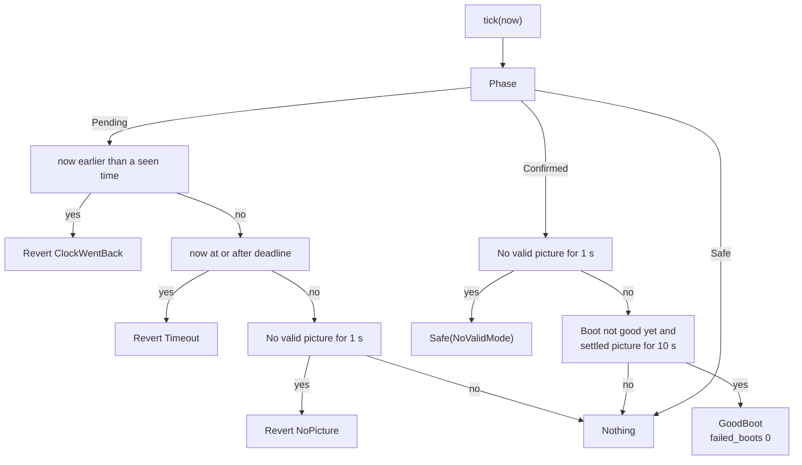
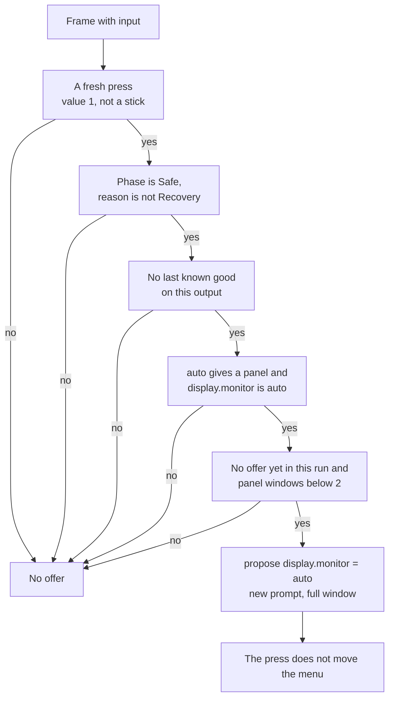

# 3. The guard

The guard (`Guard` in `neptron-video`) is the confirm-or-revert machine of the display. It owns the display configuration that the [ODREN](04-odren.md) engine gets: the monitor profile and the policy settings (picture style and refresh policy). It puts a display change on the screen at once, reverts it when the user does not keep it in time or when it gives no picture, keeps the last known good monitor across boots, counts failed boots, and runs safe mode and the blind recovery. It decides and does no I/O: it changes the display only through the engine inputs (`retry`, `set_monitor`, `set_settings`), and it gives the record to the app to write. This page also covers the app side (`apps/neptron/src/shell/guard_events.rs`, `intents.rs`): the dialog, the setting writes, the notices, and the flat panel first-boot rule.

## Diagrams

### Overview

A revert goes to what the pending chain replaced: `Confirmed` with the configuration confirmed before, or `Safe` with the same `SafeReason` as before. At boot with no last known good, the revert target is `Safe(NothingConfirmed)`.

### Detail: `Guard::boot`

### Detail: the ends of a pending change

### Detail: `Guard::confirm`

### Detail: `Guard::tick` once per frame

### Detail: the flat panel offer of the app (`offer_panel`)

## States and screens

| State | What the engine has | What the user sees |
| --- | --- | --- |
| `Confirmed` | The confirmed configuration, or the wanted one when its monitor is the last known good | The normal picture. No dialog. |
| `Pending(Prompt)` | The change, at once | The confirm dialog over any screen: title "Keep this picture?", text "Keep the new picture?\nNo answer brings the old one back.", then "The old picture comes back in N s." (N is the time left, rounded up to whole seconds), and at 0 "The old picture comes back now.". Buttons "Revert" (focus) and "Keep". Hints "Accept: revert" and "Right, then Accept: keep". In the frame of an answer: "One moment." Goldens: `confirm-10s.ppm`, `confirm-3s.ppm` in `crates/neptron-ui/tests/golden/screens`. |
| `Safe(FailedBoots)` | The safe default | Warning notice "Safe mode: the last starts gave no confirmed picture." The display panel shows "(safe mode)" after the mode. |
| `Safe(Recovery)` | The safe default | Warning notice "Safe mode: the picture was reset. Keep a display setting to leave it." A tone, in the game list and in a game. "(safe mode)" in the display panel. |
| `Safe(NoValidMode)` | The safe default | Warning notice "Safe mode: the display settings gave no picture." "(safe mode)". |
| `Safe(NothingConfirmed)` | The safe default | Reached only as the revert target of the boot prompt, so the notice is the revert notice, for example "The display change went back: it was not kept in time." "(safe mode)". |

The safe default is the one of [Frontend boot](02-frontend-boot.md): the CRT profile of the EDID, or the panel when it is the last known good on this output, else `generic_15`; style `auto`, refresh `exact`.

## Transitions

### Constants

| Constant | Value | Where | Meaning |
| --- | --- | --- | --- |
| `CONFIRM_WINDOW_NS` | 10 s | `guard.rs` | A change reverts unless kept in this time. |
| `PENDING_LIMIT_NS` | 30 s (3 x `CONFIRM_WINDOW_NS`) | `guard.rs` | Changes with no confirmation, one after the other, revert at the latest this long after the first. |
| `SAFE_MODE_FAILED_BOOTS` | 2 | `guard.rs` | Failed boots in a row before the next boot starts in safe mode. |
| `GOOD_BOOT_PICTURE_NS` | 10 s | `guard.rs` | A settled picture of the confirmed configuration this long makes the boot good. |
| `NO_PICTURE_LIMIT_NS` | 1 s | `guard.rs` | No valid picture this long makes the guard leave the configuration. |
| `BLIND_RECOVERY_HOLD_NS` | 5 s | `neptron-input` `hotkeys.rs` | Hold time of `BLIND_RECOVERY_COMBO` = Select + Start on one port. |
| `PANEL_WINDOWS_PER_RUN` | 2 | app `guard_events.rs` | Panel windows in one run: the boot prompt of a panel and one offer. |
| `CUE_MS`, `CUE_HZ`, `CUE_LEVEL` | 200 ms, 880 Hz, 8192 (a quarter of full scale) | app `guard_events.rs` | The square-wave tone of the blind recovery. |
| `QUIET_FRAMES_BEFORE_MOVE` | 60 frames | `neptron-ui` `overlays.rs` | The dialog ignores Left and Right until 60 frames in a row with no direction. |
| `RECORD_VERSION` | 1 | app `record.rs` | Version of `state/video/guard.toml`. |

### Health: what is a picture

`Health::of(engine)` reads the engine after each present:

- `picture` = a mode is set, and it is not refused, the output is not blanked, and the engine is not muted (a modeset whose first flip has not completed is muted).
- `no_picture` = refused, or blanked, or no mode set. A mode that waits for its first flip is not "no picture", because a flip can be late.
- `decided` = `Odren::settled()`: no decision is due, a mode is set, and that mode was decided on the current inputs (its generation is the current one).

A picture counts for the guard only when `picture` and `decided` are both true. Every guard change ends in `retry`, `set_monitor` or `set_settings`, which raise the input generation or set a decision due. So the old mode never counts as a picture of the change, even when it passes the new inputs: not after a failed modeset, not after a decision with no winner, not after a restore. This is why a confirmation needs a shown picture (`NotShown`): the user must keep what they see, not the old mode.

### Calls and conditions

| From | To | Condition | Constant | Event and effect |
| --- | --- | --- | --- | --- |
| (boot) | `Safe(FailedBoots)` | `failed_boots` before this boot >= 2 | `SAFE_MODE_FAILED_BOOTS` = 2 | `SafeMode(FailedBoots)`. Record `safe_mode` = true. |
| (boot) | `Safe(Recovery)` | The record has `safe_mode` | none | `SafeMode(Recovery)`. Tone in the game list. |
| (boot) | `Confirmed` | `wanted.monitor` == last known good | none | No event. The engine gets `wanted`. |
| (boot) | `Pending` | Otherwise. The chain starts now and comes from the settings files | `CONFIRM_WINDOW_NS` = 10 s | `PromptOpened`. Revert target: the last known good monitor with the wanted settings, or `Safe(NothingConfirmed)`. |
| `Confirmed` or `Safe` | `Pending` | `propose(config)` with a config that is not the confirmed one | `CONFIRM_WINDOW_NS` = 10 s | `PromptOpened` with a new `PromptId`. The engine gets the change at once. |
| `Confirmed` | `Confirmed` | `propose` of the active config | none | No event, no change. |
| `Pending` | `Pending` | `propose` of another config before the deadline | Deadline = min(now + 10 s, chain start + `PENDING_LIMIT_NS` = 30 s) | `PromptOpened` with a new id. The revert target stays the one before the first change. |
| `Pending` | revert target | `propose` at or after the deadline | none | `Reverted(Timeout)`. The new config is not applied. |
| `Pending` | revert target | `propose` of the confirmed config | none | `Reverted(Superseded)`. |
| `Pending` | `Confirmed` | `confirm(id)` passes every check | none | `Confirmed`. Record: last known good = active monitor, `failed_boots` = 0, `safe_mode` = false. Saved. The app writes the waiting settings. |
| `Pending` | revert target | `decline(id)` with the open id | none | `Reverted(Declined)`. |
| `Pending` | revert target | `tick`: now >= deadline | `CONFIRM_WINDOW_NS` = 10 s, `PENDING_LIMIT_NS` = 30 s | `Reverted(Timeout)`. |
| `Pending` | revert target | `tick`: no valid picture for 1 s | `NO_PICTURE_LIMIT_NS` = 1 s | `Reverted(NoPicture)`. |
| `Pending` | revert target | `tick` with a time earlier than one already seen | none | `Reverted(ClockWentBack)`. |
| `Pending` | revert target | `follow_settings` (the settings of a game at launch) | none | `Reverted(Superseded)`, then the game settings apply if the target is `Confirmed`. |
| `Confirmed` | `Safe(NoValidMode)` | `tick`: no valid picture for 1 s | `NO_PICTURE_LIMIT_NS` = 1 s | `SafeMode(NoValidMode)`. Record unchanged. |
| `Confirmed` | `Confirmed` | `tick`: the boot is not good yet and a settled picture has lasted 10 s | `GOOD_BOOT_PICTURE_NS` = 10 s | `GoodBoot`. `failed_boots` = 0. Saved. |
| `Confirmed` | `Confirmed` | `follow_settings` with other settings | none | The engine gets the settings. The picture watch starts again. |
| `Safe` | `Safe` | `follow_settings` | none | Nothing: the safe default keeps its settings. |
| any | `Safe(Recovery)` | `recover`: Select + Start held 5 s, or the record cannot be written at boot | `BLIND_RECOVERY_HOLD_NS` = 5 s | `SafeMode(Recovery)`. A pending change ends with no revert event. Record `safe_mode` = true, saved when it changed. |

### Revert reasons and their notices

| `RevertReason` | Cause | Notice (kind Info) |
| --- | --- | --- |
| `Timeout` | `CONFIRM_WINDOW_NS` = 10 s passed, or the chain reached `PENDING_LIMIT_NS` = 30 s | "The display change went back: it was not kept in time." |
| `Declined` | The user chose Revert, or pressed Back | "The display change went back." |
| `NoPicture` | No valid picture for `NO_PICTURE_LIMIT_NS` = 1 s | "The display change went back: it gave no picture." |
| `Superseded` | `follow_settings` came, or the user chose the confirmed configuration again | "The display change went back: a new setting replaced it." |
| `ClockWentBack` | A guard call had a time earlier than one seen before | "The display change went back: the clock went back." |

### Confirm errors

| `ConfirmError` | When | What the app does |
| --- | --- | --- |
| `NoPrompt { asked }` | No change waits | Nothing. |
| `WrongPrompt { asked, open }` | The id is not the open prompt | Nothing. |
| `Expired { deadline_ns, now_ns }` | The Keep came at or after the deadline | Dropped. The next tick reverts with `Timeout`. |
| `NoPicture { health }` | The engine shows no valid picture now | Log line "keep refused: no valid picture is on the display: ...". The guard does not change. |
| `NotShown` | No tick has seen a settled picture of the change | Log line "keep refused: no frame has shown the change yet". The guard does not change. |

The app takes the id from `Guard::pending()`, so `NoPrompt` and `WrongPrompt` do not come from the menu.

### The record and when it is saved

`GuardRecord` holds `last_known_good` (a monitor, `None` when nothing was kept or the profile cannot be built again), `failed_boots`, and `safe_mode`. The app file `state/video/guard.toml` adds `version` and `output` (the connector of the confirmation).

| When | What changes | How it is written |
| --- | --- | --- |
| `Guard::boot` | `failed_boots` + 1, and `safe_mode` = true for `FailedBoots` | Always saved. `record::save` on the frame thread, before the first frame and the first modeset. Temp file, fsync, rename. |
| `confirm` | Last known good = active monitor, `failed_boots` = 0, `safe_mode` = false. The app sets `output` to this connector. | Writer thread (`Outbox`, `Job::Record`). |
| `GoodBoot` | `failed_boots` = 0 | Writer thread. |
| `recover`, or a revert or safe entry that sets `safe_mode` | `safe_mode` = true | Writer thread, only when the record changed. |
| Any other step | Nothing | Not written. |

Last known good changes only on a confirmation. A long stable picture makes the boot good but records nothing. Only a confirmation clears `safe_mode`.

### Settings and the guard (app side)

| Event | What the app does |
| --- | --- |
| A display setting changes (monitor, picture style, refresh policy: schema safety `Validated` or `ConfirmOrRevert`) | The value changes in memory and goes on the list of waiting changes. The app builds the display config and calls `propose`. When no prompt is open and the config equals the active one, the waiting changes are written at once and no prompt opens. |
| A setting with no effect on the signal (scanlines, scanline strength, Start hold) | Written at once and applied live. No guard. |
| `display.output` | Not changed from the menu or the protocol. |
| `PromptOpened` | The dialog goes in the snapshot. Key repeat stops, and a held key sends nothing (`Navigator::hold_back`). |
| `Confirmed` | Each waiting change is written to its file (global, system or game level). |
| `Reverted { reason, rewrite }` | The waiting changes are taken back in memory, newest first. With `rewrite: Some(config)` (the chain began with the boot prompt), the monitor, style and refresh of that config are written to the global settings, so the next boot does not show the change again. Exception: when `auto` gives a panel, `display.monitor` is `auto`, and the target is `generic_15`, the monitor stays `auto`. Info notice. |
| `SafeMode(reason)` | The waiting changes are taken back. The dialog closes. Warning notice. `Recovery`: the tone. In the game list the app writes it to its sink; in a game the session writes it to its sink (`Session::write_cue`), after the audio already queued. |
| `GoodBoot` | Nothing visible. |

### The flat panel first-boot rule

A panel that the user has not kept on this output is never the safe default, because an adapter with its own digital EDID and a CRT behind it looks like a panel. So:

1. First boot on a panel with `display.monitor` = `auto`: the boot prompt shows the panel in its native mode (as fitted to the caps). The run counts one panel window.
2. Kept: the panel is the last known good on this output, and from then on also the safe default there. Later boots start in it with no prompt.
3. Not kept in 10 s: the guard goes to `generic_15` (`Safe(NothingConfirmed)`). A real panel then shows no signal, or the engine blanks when the driver refuses the mode. The revert does not write `generic_15` over `display.monitor` = `auto`, so the next boot asks again.
4. The way back: on the first fresh button press (value 1: not a key repeat, not a release, not a stick move) the app proposes `display.monitor` = `auto` again under a new prompt with a full 10 s window. Conditions: the guard is in `Safe` but not `Safe(Recovery)`; no last known good on this output; `auto` gives a panel; `display.monitor` is `auto` (a preset is never overridden); no offer yet in this run; fewer than `PANEL_WINDOWS_PER_RUN` = 2 panel windows in this run, the boot prompt included. That press does not also move the menu. After the one offer every press goes to the menu.
5. After a blind recovery there is no offer: `Safe(Recovery)` always stays in the safe start until the user keeps a configuration.
6. Two boots with no kept picture lead to `Safe(FailedBoots)` on the third boot. That boot has no boot prompt, so its one offer can still open a panel window.

## What can go wrong

| Case | What the user sees | Way out |
| --- | --- | --- |
| A display change gives a black or rolling screen | The change stays for at most 10 s, or 1 s when the engine reports no valid picture. Then the old picture and "The display change went back: ..." | Wait. Or press Accept: the focus is on Revert. Or Back. |
| The user presses Keep before the picture of the change is settled, or while a flip is late | The dialog shows "One moment." for one frame. The guard refused (`NotShown` or `NoPicture`) and the dialog is open again, with the focus on Keep. With no accepted Keep the change reverts at the deadline with "The display change went back: it was not kept in time." | Press Accept again when the picture is on screen. |
| Several changes in a row with no Keep (a held key, the control protocol) | Each change opens a new prompt, but all revert at the latest 30 s after the first. | Keep the one you want. |
| The confirmed configuration stops giving a picture (the driver refuses, the output is blanked) | After 1 s, the safe default and "Safe mode: the display settings gave no picture." | Choose a working setting and keep it. |
| A wrong preset, black screen, user cannot see the menu | Nothing on screen. | Hold Select + Start on one pad for 5 s. The safe default comes back with "Safe mode: the picture was reset. Keep a display setting to leave it." and a tone. In a game the hold opens no quick menu: the game goes on in the safe default, and the notice shows when the quick menu opens. The next boots also start in safe mode until a setting is kept. |
| The safe default itself gives no picture (for example `generic_15` on a 31 kHz-only monitor) | No picture. The guard does nothing more: no signal is safe. | Name the right preset in `state/config/global.toml` and keep it at the next boot. |
| The frontend crashes or hangs before the picture is good | The launcher restarts it. The start counts as a failed boot. After 2 such starts the third starts in `Safe(FailedBoots)`. | Keep a setting, or let the confirmed picture run for 10 s. |
| The monitor moved to another connector | The record's last known good is dropped. The boot prompt opens; with no answer, the safe default. | Keep the picture. |
| A different monitor on the same connector, with `display.monitor` = a preset that is the last known good | No prompt: the guard compares monitor profiles, not the physical monitor. The old preset goes to the new monitor. | Blind recovery (Select + Start, 5 s), then pick the right preset and keep it. |
| A different EDID monitor on the same connector, `display.monitor` = `auto` | Its profile id differs, so the last known good does not rebuild. The boot prompt opens. | Keep the picture. |
| The system clock goes back | A pending change reverts: "The display change went back: the clock went back." | Make the change again. |
| A game launches while a display change is not kept (a boot prompt with no answer, or a launch through the control protocol while a prompt is open) | The game starts on the last known good monitor, or in the safe default when nothing was kept. No prompt and no notice: the game run continues the boot (`Guard::continue_boot`). | Keep the setting in the game list first. |

## Source

- [guard.rs](../../crates/neptron-video/src/guard.rs): the constants `CONFIRM_WINDOW_NS`, `PENDING_LIMIT_NS`, `SAFE_MODE_FAILED_BOOTS`, `GOOD_BOOT_PICTURE_NS`, `NO_PICTURE_LIMIT_NS`.
- [machine.rs](../../crates/neptron-video/src/guard/machine.rs): `Guard::boot`, `continue_boot`, `propose`, `confirm`, `decline`, `follow_settings`, `recover`, `tick`, `clock`, `open_prompt`, `revert`, `enter_safe`, `apply`, `watch`; `Phase`, `Prompt`, `SafeReason`, `RevertReason`, `GuardEvent`, `GuardStep`, `ConfirmError`.
- [config.rs](../../crates/neptron-video/src/guard/config.rs): `DisplayConfig::apply_to`, `Health::of`, `Health::no_picture`.
- [record.rs](../../crates/neptron-video/src/guard/record.rs): `GuardRecord`.
- [odren.rs](../../crates/neptron-video/src/odren.rs): `Odren::settled`, `Odren::decision_due`, `Odren::blanked`.
- [guard_events.rs](../../apps/neptron/src/shell/guard_events.rs): `on_guard`, `offer_panel`, `recover`, `safe_for_this_run`, `roll_back`, `rewrite_global`, `play_cue`, `any_press`, `reverted_text`, `safe_text`, `PANEL_WINDOWS_PER_RUN`.
- [intents.rs](../../apps/neptron/src/shell/intents.rs): `keep`, `change_setting`, `propose`, `display_config`, the `RevertMode` intent.
- [frame.rs](../../apps/neptron/src/shell/frame.rs): `list_frame`, `game_frame` (the order: recovery, panel offer, UI, present, `tick`).
- [view.rs](../../apps/neptron/src/shell/view.rs): `refresh_view`, `refresh_mode`, `CONFIRM_TEXT`.
- [boot.rs](../../apps/neptron/src/shell/boot.rs): `Shell::boot` (`boot_panel_prompt`, the record write).
- [record.rs](../../apps/neptron/src/record.rs) (app): `save`, `for_output`, `for_continued_boot`.
- [overlays.rs](../../crates/neptron-ui/src/screens/overlays.rs): `Confirm::handle`, `Confirm::draw`, `CONFIRM_BUTTONS`, `QUIET_FRAMES_BEFORE_MOVE`.
- [hotkeys.rs](../../crates/neptron-input/src/hotkeys.rs): `BLIND_RECOVERY_COMBO`, `BLIND_RECOVERY_HOLD_NS`, `Hotkeys::update`.

## Differences from docs/definition

- `05-crt-safety-model.md`, row 4 "Confirm or revert": "Any user-initiated change to output, profile or geometry applies for 10 seconds. No button press means automatic revert." In the code the guard covers the monitor profile, the picture style and the refresh policy. The output is not under the guard (read only in the menu, refused by the protocol). Signal geometry does not exist. The code also reverts for a missing picture (1 s), a clock that goes back, and a superseding setting, and it caps a chain of changes at 30 s (`PENDING_LIMIT_NS`), which the definition does not name.
- `05-crt-safety-model.md`, row 5 "Last known good": "Two boots that never reach a confirmed picture trigger safe mode." In the code a boot is also good when the confirmed configuration shows a settled picture for 10 s (`GOOD_BOOT_PICTURE_NS`), with no key press. A planned relaunch does not count as a new boot. The last known good holds the monitor only, not the policy settings, and it is tied to the connector.
- `05-crt-safety-model.md`, row 6 "Blind recovery": "at boot or at any time ... An audio cue confirms it." In the code the hold is read only from the first frame of the frontend (`list_frame` and the session's frame), not before. The combination is Select + Start (`BLIND_RECOVERY_COMBO`). The same buttons open the quick menu at their release after a shorter press, so a recovery hold opens no menu. The tone plays in the game list and in a game; the safe start after a failed record write has none. The recovery also sets the record so the next boots start in safe mode until a setting is kept; the definition does not say this.
- `06-flat-panels-shaders-and-vertical-games.md`, "Flat-panel mode": "Starts in the panel's preferred EDID mode." In the code the panel is on screen only under the boot prompt until kept, with at most `PANEL_WINDOWS_PER_RUN` = 2 windows per run; the safe default is `generic_15` until then.
- `crates/neptron-video/README.md` and the code agree on the state table. The README says `SafeMode(Recovery)` plays the audio cue; the app plays it in the game list and in a game.
