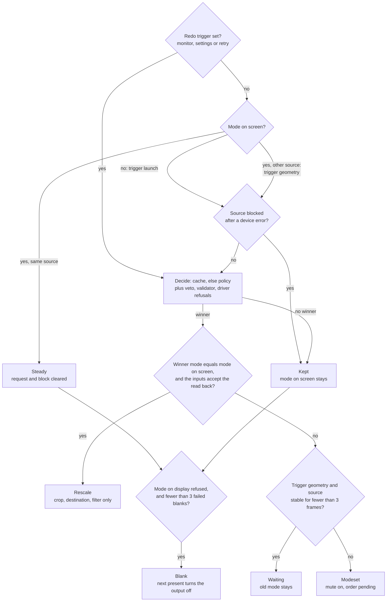
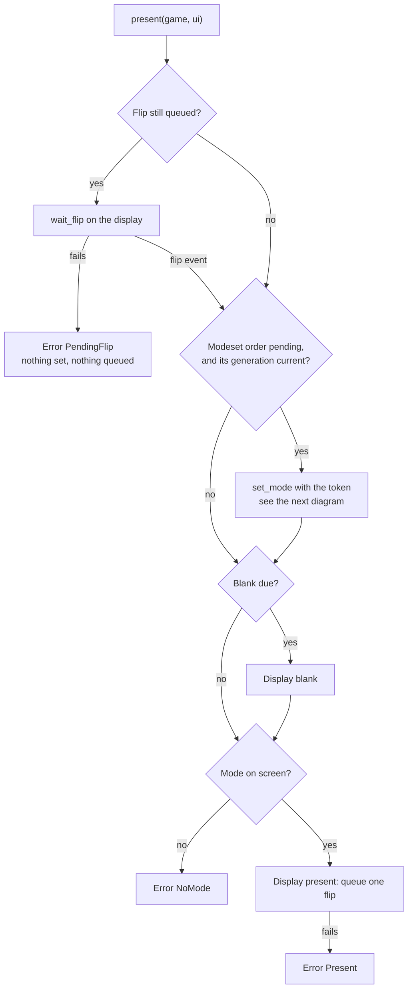
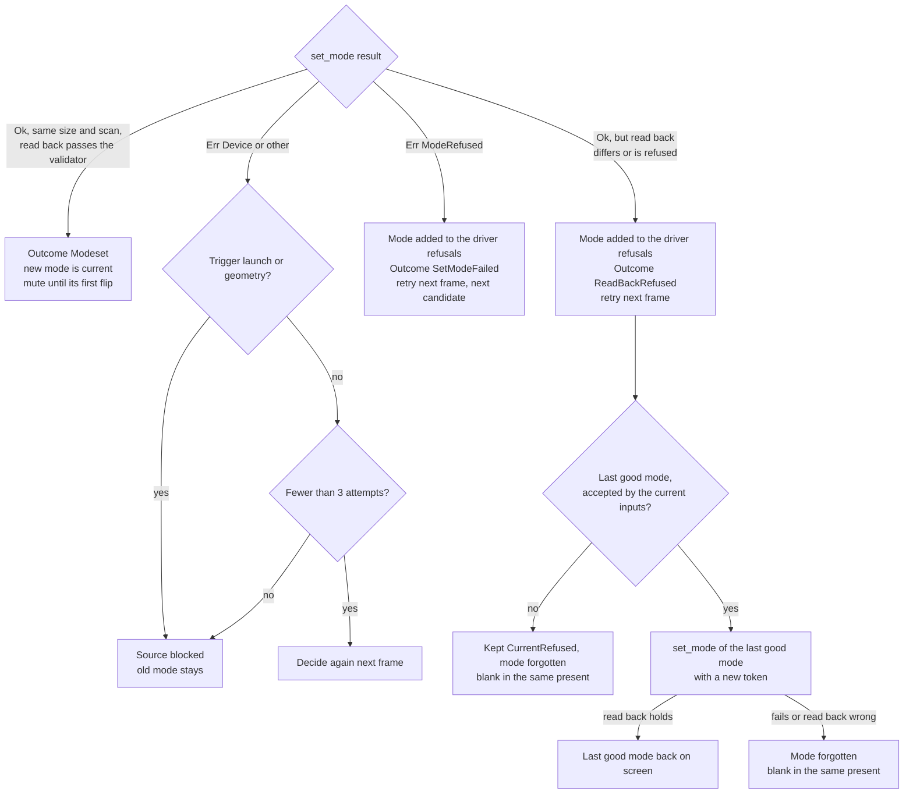
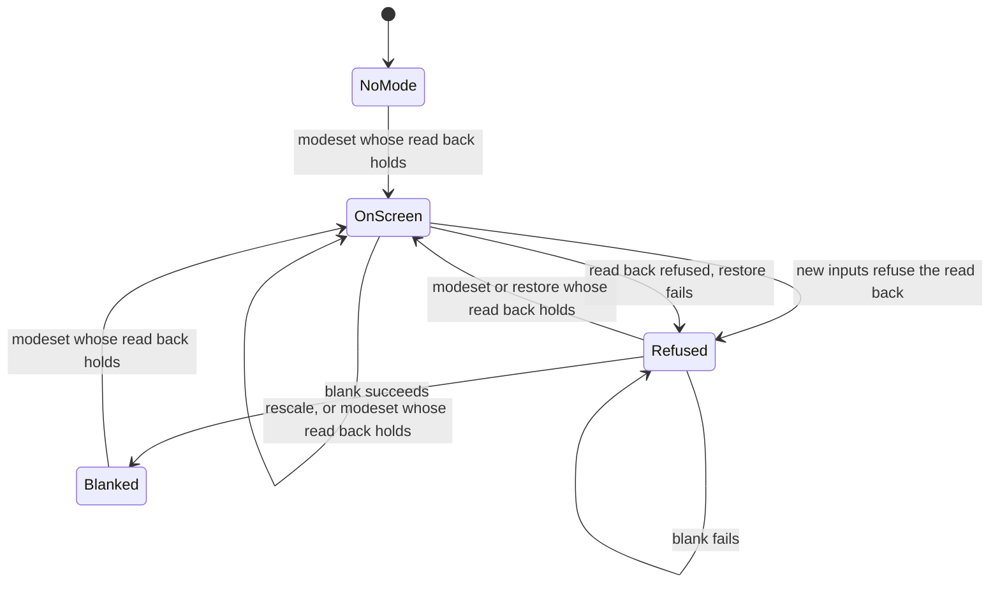

# 4. ODREN, the video engine

ODREN takes the source of each core frame (width, height, rate, aspect, scan) and decides what goes on the wire: nothing new, a new scale only, a wait, a modeset, or the output off. The state machine `Odren` decides and does no I/O. `VideoEngine` applies its decisions to a `Display` (KMS on the target). This page follows one core frame from the source to the wire, and every result of a modeset. How the policy picks the mode is in [the policy](05-policy.md). How the guard uses `current_refused`, `blanked` and `settled` is in [the guard](03-guard.md). How the session calls the engine each frame is in [the session](06-session.md).

## Diagrams

### The per-frame step (`Odren::on_frame`)

The session calls `begin_frame(source)` once per core frame. It makes no display call. It returns one `Directive`.

When `BK` is "no", the directive stays `Steady` or `Kept`.

### One present (`VideoEngine::present`)

The session calls `present` once per flip of a core frame (twice for double refresh), and `wait_flip` after each one.

A `set_mode` of a restore that fails returns `RestoreFailed` after the blank of the same present.

### The modeset result (`Odren::on_mode_set`, `on_restore`, `after_device_error`)

### The output (what is on the wire)

`Refused` is `current_refused()`. `Blanked` is `blanked()`. A refused read back with a good restore goes from `OnScreen` back to `OnScreen` with the last good mode.

## States and screens

### Directives (one per core frame)

| Directive | When | What the user sees |
| --- | --- | --- |
| `Steady` | No redo trigger, and the source equals the source of the mode on screen. | The game in the same mode and place. |
| `Rescale` | The winner's mode equals the mode on screen, and the inputs accept its read back. No debounce. | The same mode on the wire, no loss of sync. The game gets the new crop, destination and filter at once. |
| `Waiting { stable_frames }` | A geometry change needs a new mode, and the new source has been the same for fewer than `DEBOUNCE_FRAMES` frames. | The old mode. A frame of the new size is shown whole in the old destination, with sharp bilinear when the scale is not whole (`build_scene`). |
| `Modeset` | Launch, or a monitor, settings or retry trigger (no debounce), or a geometry change stable for `DEBOUNCE_FRAMES` frames. | Sound off. The monitor resyncs. The KMS backend draws a black buffer for the modeset commit, then the next flip shows the game. Sound on at the first flip in the new mode. |
| `Kept` | The source is blocked after a device error, the game is turned (`Rotated`), the policy gives no plan, or every proposal is refused. | The mode on screen stays. Before the first mode there is no picture (`present` returns `NoMode`). |
| `Blank` | The mode on the display is refused (`current_refused()`), the directive would be `Steady` or `Kept`, and fewer than `MODESET_ATTEMPTS` blanks failed. | No signal at all: no sync, no picture. The game is frozen (the session does not run the core while the output is off). |

### Engine flags

| Flag | Meaning | What the user sees |
| --- | --- | --- |
| `muted()` | A `Modeset` directive came, and the first flip in the new mode has not completed. | Silence. |
| `current_refused()` | The mode on the display is one the current inputs refuse, or one the engine does not know after a failed restore. | The session presents no game picture on it (`game` is `None`) and keeps the sound off. The UI canvas can still show. |
| `blanked()` | `Display::blank` succeeded. Stays until the next successful modeset. | No signal. |
| `decision_due()` | A redo trigger waits for the next frame, or a modeset order waits for its present. | Nothing visible. |
| `settled()` | No decision due, a mode is current, and it was placed by a decision on the current input generation. | Nothing visible. The guard needs it for a confirmation (see [the guard](03-guard.md)). |

## Transitions

### Triggers (`Trigger`, written in the trace as the lower-case word)

| Trigger | Set by | Debounce | Block check |
| --- | --- | --- | --- |
| `launch` | The first frame with no mode on screen (also after a blank or a forgotten mode). | No | Yes |
| `geometry` | A frame whose source differs from the source of the mode on screen. | `DEBOUNCE_FRAMES` = 3 core frames, none while `refused_on_screen` is on | Yes |
| `monitor` | `set_monitor` (the guard). Also clears the driver refusals. | No | No |
| `settings` | `set_settings` with different settings, or `set_veto`. | No | No |
| `retry` | `retry()`, or the driver refused a mode (`ModeRefused` or a refused read back). | No | No |

### The frame step

| From | To | Exact condition | Constant = value | On the wire |
| --- | --- | --- | --- | --- |
| any | `Steady` | No redo trigger, mode on screen, `current.source == source`. Clears the request and the block. | none | Same mode, one flip. |
| any | `Kept` | Trigger `launch` or `geometry`, and `blocked == Some(source)`. No trace record. | none | Same mode. |
| any | `Kept` | The decision for the source has no winner. A trace record `Kept(reason)` is pushed on the first frame of the request, or once for a redo trigger. | none | Same mode, or no mode. |
| any | `Rescale` | The winner's mode equals the requested mode on screen (`switch_for` gives `ScaleOnly`), and neither `refused_on_screen` nor a refusal of the read back by the current inputs. The current winner, source and generation are replaced. | none | Same mode, new scene. Trace `ScaleOnly`; consecutive ones share one record (`count`). |
| any | `Waiting` | Trigger `geometry`, `switch_for` gives `Modeset`, `request.stable < DEBOUNCE_FRAMES`, and `refused_on_screen` is off. A refused mode on screen is decided at once, so a source that changes every frame cannot keep it on the wire. | `DEBOUNCE_FRAMES` = 3 core frames | Old mode. |
| any | `Modeset` | `switch_for` gives `Modeset` (or no mode on screen, or the mode on screen is refused), and the trigger is not `geometry`, or the source is stable for `DEBOUNCE_FRAMES` frames, or `refused_on_screen` is on. | `DEBOUNCE_FRAMES` = 3 core frames | `muted` turns on now. The next `present` sets the mode. |
| `Steady` or `Kept` | `Blank` | `refused_on_screen` and `blank_failures < MODESET_ATTEMPTS`. | `MODESET_ATTEMPTS` = 3 | The next `present` calls `Display::blank`. |
| any | (next frame) | A modeset order was not consumed by a `present` (for example `PendingFlip`). A `monitor`, `settings` or `retry` trigger is set to redo. A `launch` or `geometry` one is not: its source asks again. | none | Nothing. |

### The decision (`Inputs::decide`, `Inputs::check`)

| Step | Condition | Result |
| --- | --- | --- |
| Rotation | `source.rotation != R0` | `Unshowable::Rotated`. The session always gives `R0` in the MVP. |
| Policy | `neptron_modeline::policy::decide` fails | `Unshowable::Policy(error)`. |
| Choose | `policy::choose` walks the plan's proposals in order. The first one that `check` accepts wins. | `Chosen` with the `ValidatedMode` token and the notice of the policy. |
| Check | 1. the veto, if set (refuse only). 2. `neptron_safety::validate` with the monitor profile and the caps. 3. the mode is not in `driver_refused`. | `Refusal::Validator(rejection)` or `Refusal::Driver`. |
| No winner | every proposal refused | `Unshowable::NoWinner`. |

The caps are the display's caps, lowered to the EDID pixel clock limit when the monitor comes from EDID (`Monitor::caps_for`). Decisions are cached per source: `CACHE_ENTRIES` = 8 sources. A change of the monitor, the settings, the veto or the driver refusals clears the cache.

### The input generation and `ModeOrder`

| Event | Generation | Pending order | Other effects |
| --- | --- | --- | --- |
| `set_monitor` | +1 | dropped | driver refusals cleared, cache cleared, block lifted, attempt counts 0, redo `monitor`, the mode on screen judged again |
| `set_settings` (changed) | +1 | dropped | cache cleared, block lifted, attempt counts 0, redo `settings`, the mode on screen judged again |
| `set_veto` | +1 | dropped | as `set_settings` |
| driver refusal | +1 | dropped | mode added to `driver_refused`, cache cleared, redo `retry` |
| `retry()` | no change | kept | block lifted, attempt counts 0, redo `retry` |

A modeset order carries the token and the generation it was validated for. `VideoEngine::set_mode` asks `Odren::authorize`, which gives the token only when the generation is still current. So a token from before an input change never reaches `Display::set_mode`. "The mode on screen judged again" means: when the new inputs refuse the read back, the trace gets `Kept(CurrentRefused)` and `current_refused()` turns on.

### The modeset result

| Result of `set_mode` | Condition | Constant = value | What happens |
| --- | --- | --- | --- |
| `Ok(read_back)`, holds | Same `hactive`, `vactive`, `interlace` and `doublescan` as the request, and the read back passes the veto and `validate`. The pixel clock can differ. | `READ_BACK_RATE_NOTICE_MHZ` = `REFRESH_MATCH_MHZ` = 5 mHz | Trace `Modeset` with the read back. When the field rate differs by 5 mHz or more, the record holds `rate_drift_mhz`. The mode becomes current, block lifted, counts 0, `refused_on_screen` off, `blanked` off. Mute stays until the first flip. |
| `Ok(read_back)`, does not hold | Another size or scan, or a read back the validator refuses. | none | The requested mode goes to `driver_refused`, redo `retry`. Trace `ReadBackRefused`. `refused_on_screen` on. Then the restore (next rows). |
| restore possible | A current mode exists, and `check` accepts its mode with the current inputs. | none | A second `set_mode` in the same present, with the new token. |
| restore holds | Its read back holds as for a modeset. | none | Trace `Restored` with the read back of the restore and the refused mode as `previous`; the first flip writes `shown_frame` and `gap_ns` to this record, not to the `ReadBackRefused` record. The last good mode is back, `refused_on_screen` off. The generation of the current mode stays old, so `settled()` is false until the retry decides. |
| restore fails or reads back wrong | | `MODESET_ATTEMPTS` = 3 (blank attempts) | Mode forgotten, `refused_on_screen` on, blank in the same present, mute off. A `set_mode` error of the restore gives `VideoError::RestoreFailed`. |
| no restore | No current mode, or `check` refuses it. | | Trace `Kept(CurrentRefused)` (when there was a current mode), mode forgotten, blank in the same present. |
| `Err(ModeRefused)` | The driver refused the mode (the test-only commit failed, or the clock is not whole kHz, or the plane rectangle does not fit). | none | The mode stays as it was. Mode added to `driver_refused`, redo `retry`: the next frame takes the next candidate of the same plan. Trace `SetModeFailed`. Mute off. |
| `Err(Device)` or other, trigger `launch` or `geometry` | | none | The mode stays. The source is blocked: no more `set_mode` for it until the source on screen comes back, an input changes, or `retry()`. Trace `SetModeFailed`. Mute off. |
| `Err(Device)` or other, trigger `monitor`, `settings` or `retry` | | `MODESET_ATTEMPTS` = 3 | Decided again on the next frame, up to 3 attempts in all. Then the source is blocked, and `current_refused()` tells whether the inputs refuse the old mode. |

The candidate walk: every driver refusal adds the mode to `driver_refused` and clears the cache, so the next decision skips it and takes the next proposal of the plan. The loop ends when the plan has no more proposals (`NoWinner`). A monitor change forgets the list.

### Flips and mute

| From | To | Condition | Constant = value | On the wire |
| --- | --- | --- | --- | --- |
| audible | muted | Directive `Modeset`. | none | The session writes silence for the frame. |
| muted | audible | The first completed flip after the modeset (`on_flip` with `awaiting_flip`), and no new modeset order. | none | The record of that modeset gets `shown_frame` and `gap_ns` (time from the last flip in the old mode to the first flip in the new one). |
| muted | audible | `set_mode` failed, or the restore failed. | none | |
| muted | audible | A frame whose directive is not `Modeset`, and no flip is awaited. | none | |
| flip queued | flip queued | A `present` or `wait_flip` finds a flip still queued and the wait fails. | `FLIP_WAIT_LIMIT_MS` = 500 ms (KMS) | `PendingFlip` (in `present`) or `WaitFlip` (in `wait_flip`). Nothing set, nothing queued. The flip is never dropped. |

The session also mutes while the quick menu is open, while `current_refused()` is on and while `blanked()` is on (`Session::must_mute`).

### The blank

| From | To | Condition | Constant = value | On the wire |
| --- | --- | --- | --- | --- |
| refused | blanked | `Display::blank` succeeds. | none | Output off: no sync, no picture. Trace `Blanked` ("output off: no valid mode"). Mode forgotten, `refused_on_screen` off, `blank_failures` 0. `present` returns `NoMode` from now on. |
| refused | refused | `Display::blank` fails. | `MODESET_ATTEMPTS` = 3 | Trace `BlankFailed`. The refused mode stays on the wire. The next frame tries again, up to 3 in all. An input change or `retry()` gives a new count. |
| blanked | on screen | A later decision with a winner (no mode is current, so trigger `launch`). | none | A real modeset commit, also for the mode that was there before the blank. |

### The switch trace

| Item | Value |
| --- | --- |
| Capacity | `TRACE_CAPACITY` = 64 records, the oldest goes first. |
| Record fields | `asked_frame`, `decided_frame`, `count`, `shown_frame`, `gap_ns`, `trigger`, `source`, `previous`, `winner`, `read_back`, `rate_drift_mhz`, `outcome`, `dropped`, `refused`. |
| Outcome words | `scale only`, `modeset`, `kept the mode: {reason}`, `set_mode failed: {error}`, `read back {w}x{h}{p or i} refused`, `last good mode set again`, `output off: no valid mode`, `blank failed: {error}`. |
| Reason words | `the game is turned ({rotation}) and the renderer does not rotate`, `no plan: {error}`, `every proposal was refused`, `the inputs refuse the mode on screen: {refusal}`. Refusal: `validator: {rejection}` or `the display driver refused it`. |
| Log line | `frame {decided} (asked {asked}): {trigger} {w}x{h}{p or i} at {mHz} mHz: {outcome}`, then `, {rung} {w}x{h}{p or i} at {mHz} mHz`, `, read back {drift} mHz off`, `, {count} decisions`, `, shown after {n} frames` when they apply. |
| Who reads it | The tests (`tests/golden/switch_trace.txt`), and the control protocol `video_state` (`switch_count`, the modesets among the records). |

## What can go wrong

| Case | What the user sees | Way out |
| --- | --- | --- |
| A core flickers between two sizes every frame. | No modeset. The frames of the other size show whole in the old destination. | None needed. Only a source stable for `DEBOUNCE_FRAMES` = 3 frames sets a mode. While a refused mode is on screen there is no debounce: the first frame of a new size decides, so the refused mode leaves the wire at once. |
| The driver refuses the winner (`ModeRefused`). | The old mode stays. On the next frame the engine sets the next candidate of the plan, with mute. | Automatic. When every candidate is refused, `Kept(NoWinner)`; a refused mode on screen is then blanked. |
| The driver reads back another size or scan. | A short sync change: the wrong mode, then the last good mode again in the same present. | Automatic. The next frame tries the next candidate. |
| The restore of the last good mode also fails. | No signal (blank). | The next decision with a winner sets a mode. The guard reverts or goes to safe mode after `NO_PICTURE_LIMIT_NS` = 1 s of no picture. Blind recovery works too. |
| A device error on a geometry modeset. | The old mode stays. The game picture of the new size shows whole in the old destination. | The block lifts when the old source comes back, or on `retry()`. `Session::resume` (closing the quick menu) calls `retry()` when the engine has a blocked source (`source_blocked()`), whatever the last trace record. |
| A device error on a monitor or settings change. | The old mode stays for up to 3 frames of attempts. | After `MODESET_ATTEMPTS` = 3 the source is blocked. If the old mode is refused by the new inputs, it is blanked, and the guard reverts after 1 s. |
| The flip never completes. | The picture freezes. `PendingFlip` on every frame. Sound off after a modeset. | The session ends the game after `FLIPLESS_FRAMES_LIMIT` = 10 frames with no flip: notice "The game stopped: no flip completed for 10 frames; the last error: {error}." The run relaunches to the game list, which opens the display again. |
| No mode exists for a game at launch (no winner, no mode on screen). | No picture. | `present` returns `NoMode` with no flip. After `FLIPLESS_FRAMES_LIMIT` = 10 frames the game ends with the same "The game stopped" notice. |
| The output is blanked during a game. | No signal. The game is frozen, with no sound. The loop paces itself at `UNPACED_FRAME_NS` = 16 666 667 ns. | Blanked frames are not a stall. The guard changes the inputs after 1 s, and the next valid decision sets a mode. |
| The read back field rate differs from the request by 5 mHz or more. | The game runs at the read-back rate (pacing and audio follow it). The video status can show `speed (X to Y Hz)`. | None. The trace record holds `rate_drift_mhz`. |

## Source

- [odren.rs](../../crates/neptron-video/src/odren.rs): `DEBOUNCE_FRAMES`, `MODESET_ATTEMPTS`, `Directive`, `Odren::on_frame`, `step`, `switch_to`, `on_mode_set`, `restore_order`, `on_restore`, `on_blank`, `on_flip`, `keep_trigger`, `after_device_error`, `invalidate`, `check_on_screen`, `refused_by_driver`, `read_back_holds`, `retry`, `set_monitor`, `set_settings`, `set_veto`, `authorize`, `current_refused`, `decision_due`, `settled`, `muted`.
- [engine.rs](../../crates/neptron-video/src/engine.rs): `VideoError`, `VideoEngine::begin_frame`, `present`, `wait_flip`, `drain_flip`, `modeset`, `blank_if_due`, `set_mode`.
- [decision.rs](../../crates/neptron-video/src/decision.rs): `Refusal`, `Chosen`, `Unshowable`, `Inputs::check`, `Inputs::decide`, `Decision::unshowable_reason`.
- [cache.rs](../../crates/neptron-video/src/cache.rs): `CACHE_ENTRIES`, `Cache::find_or_insert`.
- [trace.rs](../../crates/neptron-video/src/trace.rs): `READ_BACK_RATE_NOTICE_MHZ`, `TRACE_CAPACITY`, `Trigger`, `Outcome`, `SwitchRecord`, `SwitchTrace::push`.
- [scene.rs](../../crates/neptron-video/src/scene.rs): `build_scene`.
- [monitor.rs](../../crates/neptron-video/src/monitor.rs): `Monitor::caps_for`.
- [display.rs (backend)](../../crates/neptron-backend/src/display.rs): the `Display` trait, `DisplayError`.
- [kms/mode.rs](../../crates/neptron-kms/src/kms/mode.rs): `commit_mode`, `commit_blank`. [wire_mode.rs](../../crates/neptron-kms/src/wire_mode.rs): `WireMode::next_step` (a request for the mode already on the wire reuses its read back with no commit). [kms/display.rs](../../crates/neptron-kms/src/kms/display.rs): `FLIP_WAIT_LIMIT_MS`, `wait_flip`.
- [session/frame.rs](../../crates/neptron-session/src/session/frame.rs): `run_frame`, `show`, `must_mute`, `check_stall`. [session.rs](../../crates/neptron-session/src/session.rs): `FLIPLESS_FRAMES_LIMIT`, `Session::resume`.
- [shell/frame.rs](../../apps/neptron/src/shell/frame.rs): `game_frame` (the "The game stopped" notice). [shell.rs](../../apps/neptron/src/shell.rs): `MENU_SOURCE`, `UNPACED_FRAME_NS`.

## Differences from docs/definition

- `docs/definition/04-crt-video-pipeline.md`, "Decision procedure": "ODREN runs these steps at launch and whenever the core's geometry changes." The code also decides on a monitor change, a settings or veto change, and after a driver refusal (`Trigger::Monitor`, `Settings`, `Retry`), with no debounce for these.
- Same section, step 6: "The first candidate that validates wins." In the code a candidate must also pass the optional veto and must not be a mode the driver refused earlier (`Refusal::Driver`).
- Same section, step 7: "wait until the request has been stable for a few frames". The code waits `DEBOUNCE_FRAMES` = 3 core frames, and only for a geometry change. The first mode (launch) has no debounce in the engine. The session waits for a stable source before the first frame instead (`LAUNCH_STABLE_FRAMES` = 6, at most `LAUNCH_SETTLE_MAX_FRAMES` = 30, see [the session](06-session.md)).
- "Signal options": "Launch prediction: system, ROM region and recorded core traces decide the first mode before the core starts". The engine has no launch prediction. The first mode comes from the first source the session gives after the launch settle.
- "Switching": "The mode family for a game is computed at launch". The code decides per source, on demand, and caches up to `CACHE_ENTRIES` = 8 decisions.
- "Switching": "applied with an atomic commit at vertical blank, and audio is muted for the frames the monitor needs to resync". The KMS modeset is a blocking atomic commit with `ALLOW_MODESET`, after a test-only commit, and shows a black buffer. The mute lasts from the `Modeset` directive to the first completed flip in the new mode, with no extra resync frames.
- The definition has no read-back check, no restore of the last good mode, no candidate walk after a driver refusal, no device-error block and no blank of a refused mode. All of these exist in the code as described above.
- `docs/definition/05-crt-safety-model.md`, row 7 "Supervisor": "the frontend's first action is to re-apply the last validated mode". A new frontend process has an engine with no mode. It decides again from the first frame (trigger `launch`). It does not re-apply a stored mode.
