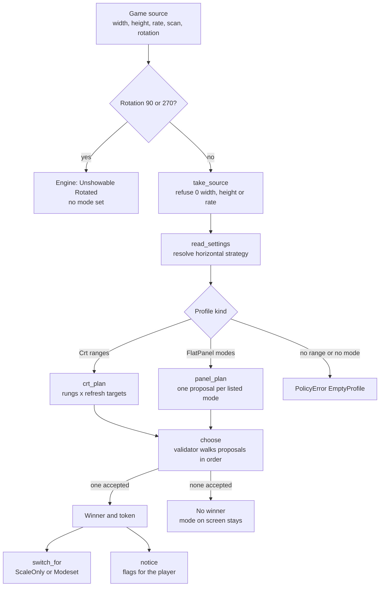
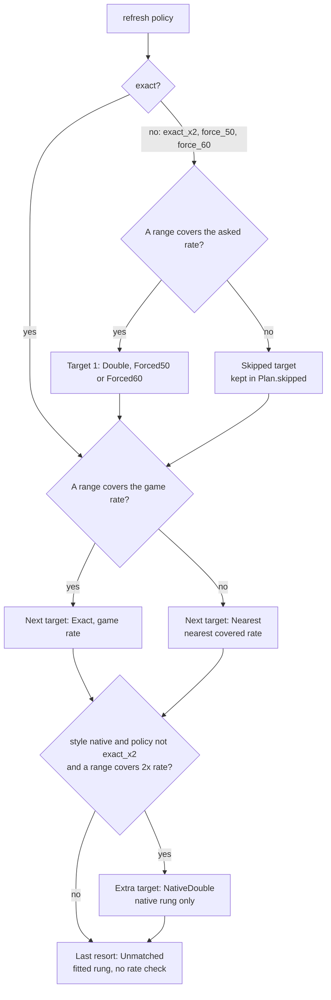
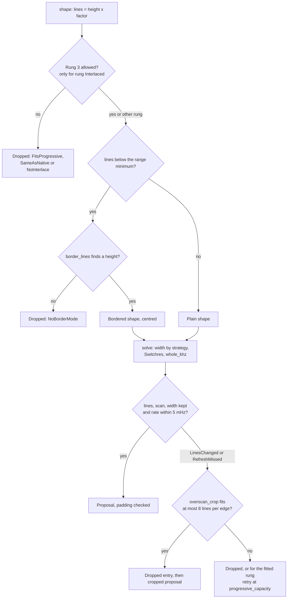
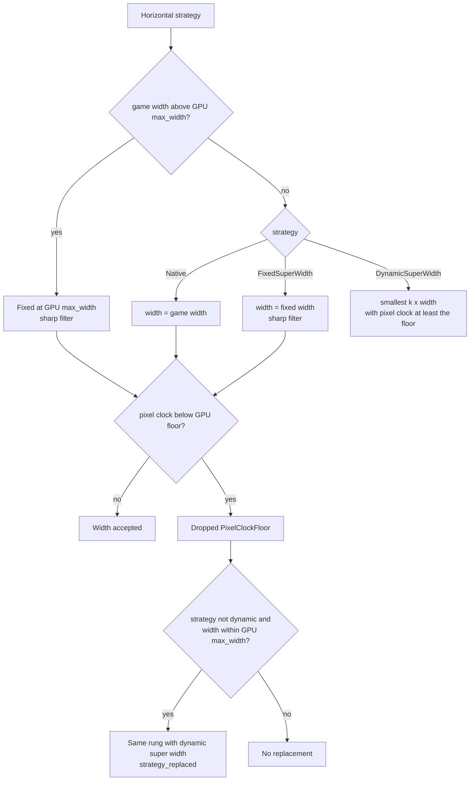
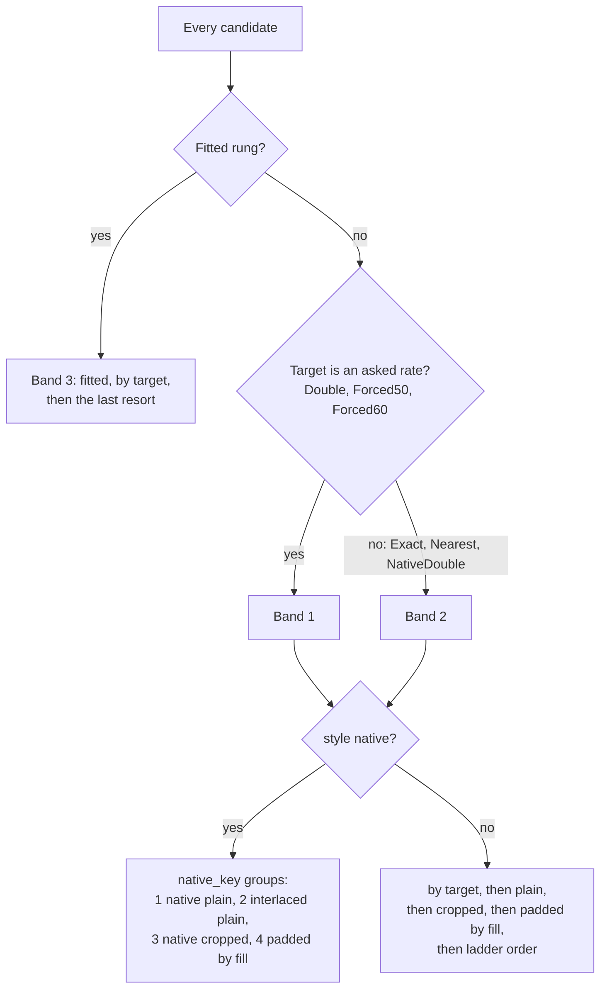
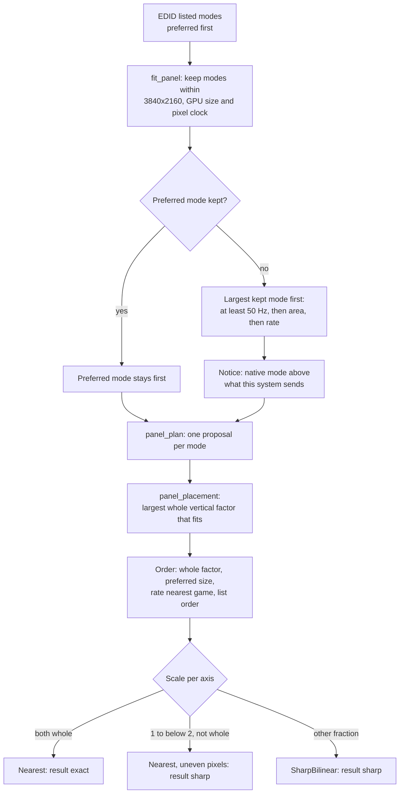

# 5. The policy: how a mode is chosen for a game

The policy is the pure part of [ODREN](04-odren.md). For one game source, one set of settings, one monitor profile and one GPU, it makes a list of candidate modes in order of preference, each with its reason. Then it gives that list to the validator, and the first mode that the validator accepts wins. The policy does no I/O and has no clock. It decides which rung, which refresh, which width and which fallback. Switchres calculates each modeline. This page follows one decision from the source to the winner, on a CRT and on a flat panel.

## Diagrams

### Overview: from a source to a winner

### CRT: which refresh targets the walk uses

### CRT: one rung at one target (steps 4 and 5)

### CRT: the width of the mode (step 5)

### CRT: the order of the candidates

### Flat panel: from the EDID modes to the winner

## States and screens

The policy has no screen of its own. Its result shows in two places: the Video block of the quick menu and the Display panel (see [Screens](07-screens.md)). The mode line ends with the short rung name of `write_rung`, and the result line holds the words of `write_result`.

### Picture styles and their ladders (`walk_ladder`)

The settings key is `display.style`. The values are `auto`, `native`, `2x`, `3x`, `4x`. The default is `auto`.

| Style | Rungs in walk order | Notes |
| --- | --- | --- |
| `auto` | native, 2x, 3x, 4x, interlaced 1:1, fitted | Takes the best exact result. In practice: native on 15 kHz, 2x on 31 kHz (the native mode on 31 kHz is padded, so it ranks after 2x). |
| `native` | native, interlaced 1:1, fitted | Never a multiple. Also gets the native rung at twice the game rate (`NativeDouble`) when a range covers it. |
| `2x` | 2x, interlaced 1:1, fitted | |
| `3x` | 3x, 2x, interlaced 1:1, fitted | Falls to the smaller multiple, never to native. |
| `4x` | 4x, 3x, 2x, interlaced 1:1, fitted | Falls to the smaller multiples, never to native. |

### The rungs (`Rung`)

| Rung | What it is | Mode line shows | Result words |
| --- | --- | --- | --- |
| `Native` | The game's own lines, progressive (interlaced for an interlaced source). Centred with black borders when the game has fewer lines than the range minimum. | `native` | `exact`, or `cropped N lines`, or `small picture N%` |
| `Multiple(n)` | n times the game's lines (2, 3 or 4), progressive. | `2x`, `3x`, `4x` | as above |
| `Interlaced` | Rung 3: the game's own lines, interlaced, only when its lines fit no progressive range at the rate. | `native` (the `i` of the mode gives the scan) | as above |
| `Fitted` | Rung 4: the mode Switchres fits to the source; the game fills the active area with a filter. The only rung that is not pixel exact. | `fit` | `[!] filtered` |
| `Panel` | A flat panel: one listed mode, the game at a whole vertical factor. | `panel` | `exact` or `sharp` |

### Refresh policies (`RefreshPolicy`) and refresh kinds (`RefreshKind`)

The settings key is `display.refresh_policy`. The values are `exact`, `exact_x2`, `force_50`, `force_60`. The default is `exact`.

| Kind | Where it comes from | Rate | Fields per game frame | Game speed |
| --- | --- | --- | --- | --- |
| `Exact` | the game rate, when a range covers it | game rate | 1 | same |
| `Double` | `exact_x2`, when a range covers twice the rate | 2 x game rate | 2 | same |
| `NativeDouble` | style `native`, policy not `exact_x2`, a range covers twice the rate | 2 x game rate | 2 | same |
| `Forced50` | `force_50`, when a range covers it | `FORCE_50_MHZ` = 50.000 Hz | 1 | changes by the ratio |
| `Forced60` | `force_60`, when a range covers it | `FORCE_60_MHZ` = 60.000 Hz | 1 | changes by the ratio |
| `Nearest` | no range covers the game rate | the covered rate nearest the game rate (the lower one on a tie) | 1 | changes by the ratio |
| `Unmatched` | the last resort | whatever rate Switchres reaches | 1 | changes when it differs |
| `Panel` | a flat panel | the rate of the panel mode | 1, or 2 when the mode is nearer twice the game rate | the core runs one frame per flip (see What can go wrong) |

### Result words in the Video block

`write_result` joins the words with `, ` in this order. `[!] ` (`ALERT_MARK`) starts the line when the result is `filtered` or a speed change.

| Word | When |
| --- | --- |
| `exact` | Not fitted, not sharp, no crop, not padded, no speed change. |
| `sharp` | Flat panel only: a filter other than nearest, or an axis that is not a whole scale. Never an alert. |
| `double refresh` | Fields per game frame is 2 (`Double`, `NativeDouble`, or a panel mode at twice the rate). |
| `cropped N lines` | An overscan crop hides N source lines, both edges together. |
| `small picture N%` | The winner is padded. N is the fill, rounded to whole percent. |
| `filtered` | The winner is the fitted rung on a CRT. Alert. |
| `speed (X to Y Hz)` | On a CRT, the shown rate per game frame differs from the game rate by `REFRESH_MATCH_MHZ` = 5 mHz or more. Alert. |

### Notice flags (`Notice`, step 8)

`notice` returns `Some` when any flag is set. A `Notice` holds flags and numbers only, no text.

| Flag | Set when |
| --- | --- |
| `fitted` | The winner is the fitted rung (also on a panel). |
| `game_mhz`, `shown_mhz` | Always filled. The notice exists for them when the speed changes on a CRT (`Timing::changes_speed` and the kind is not `Panel`). |
| `strategy_replaced` | The dynamic super width replaced the strategy of the settings. |
| `double_refresh` | The target is `NativeDouble` (not for `Double`, which the user asked for). |
| `style_fallback` | The winner is not on the style's first rung. Never for `auto`. On a panel, only when the rung is not `Panel`. |
| `cropped_lines` | Source lines that the overscan crop hides, both edges together. |
| `padded_fill_permille` | The fill of a padded winner, in per mille. |

The app turns the notice into one warning toast `Picture: <result>.` (the result words above) when the notice has `fitted` on a CRT, `cropped_lines` above 0, or a padded fill. It does this once per frontend run (see What can go wrong).

## Transitions

Each row is one decision of the policy, with its exact condition and its effect on the mode on the wire.

| Step | Decision | Condition (code) | Constant | Effect on the wire |
| --- | --- | --- | --- | --- |
| 1 | Refuse the source | width, height or refresh is 0 (`take_source`) | | `PolicyError::EmptySource`, no plan, no mode change |
| 1 | Turn the source | rotation `R90` or `R270`: swap axes, invert aspect | | The engine refuses any rotation other than `R0` before the policy runs (`Unshowable::Rotated`): no mode change |
| 2 | Default strategy | `horizontal` is `None` | | `DynamicSuperWidth` when the GPU `pclock_min_hz` > 0, else `Native` |
| 2 | Fixed width out of range | fixed width 0 or above GPU `max_width` | `FIXED_SUPER_WIDTHS` = 3840, 2560, 1920 px | the widest of these that the GPU sends, else the GPU `max_width` |
| 3 | Ladder | style | `walk_ladder` tables | the rungs to try, see the style table |
| 4 | Asked rate | `exact_x2`, `force_50`, `force_60`, and a range has `v_min <= rate <= v_max` | `FORCE_50_MHZ` = 50 000 mHz, `FORCE_60_MHZ` = 60 000 mHz | target before the game rate; else a `SkippedTarget` |
| 4 | Game rate | a range covers the game rate | | `Exact`; else `Nearest` at the nearest covered rate |
| 4 | Native double | style `native`, policy not `exact_x2`, a range covers 2 x rate | | an extra target for the native rung only, 2 fields per frame |
| 4 | Lines | rung factor: native and fitted 1, multiple n, interlaced 1 | | requested lines = height x factor; above GPU `max_height` gives `TallerThanGpu` |
| 4 | Rung 3 gate | source progressive, height above `progressive_capacity`, GPU sends interlace | | else `SameAsNative`, `FitsProgressive` or `NoInterlace` |
| 4 | Border | lines below the progressive (or interlaced) minimum of the covering ranges | `BORDER_LINES` = 224, 240 (times the factor) | mode height: the first standard height a range holds, else the smallest unpadded height in range; else `NoBorderMode`. Interlaced: the interlaced minimum. Width keeps the game's aspect (`border_width`). |
| 5 | Switchres checks | lines, scan, width kept; field rate within the target | `REFRESH_MATCH_MHZ` = 5 mHz | else `LinesChanged`, `ScanChanged`, `WidthChanged`, `RefreshMissed`. An interlaced source on a monitor with no interlaced range is shown progressive on the native rung. |
| 5 | Whole-kHz clock (ADR 0009) | the Switchres clock is not a whole kHz | `Modeline::PCLOCK_STEP_HZ` = 1000 Hz, `HTOTAL_CHANGE_MAX` = 8 px, `HORIZONTAL_MIN_PERCENT` = 90 %, `HSYNC_MAX_PERCENT` = 110 % | horizontal total moved by 0, +1, -1, ... up to 8 px, clock below and above for each; the first mode with the Switchres field rate to the millihertz wins, else the nearest; fallback: the nearest kHz at the Switchres total |
| 5 | Pixel clock floor | clock below GPU `pclock_min_hz` for a native or fixed width | | `PixelClockFloor`, then the same rung with the dynamic super width (`strategy_replaced`), unless the strategy is already dynamic or the game is wider than the GPU |
| 5 | Dynamic super width | smallest k with clock at least the floor | `DYNAMIC_STEPS_MAX` = 16 calls | mode width = k x game width, whole horizontal scale |
| 5 | Overscan crop | a progressive multiple (native = 1) dropped with `LinesChanged` or `RefreshMissed`, not bordered, game lines above `progressive_capacity` | `OVERSCAN_CROP_MAX_LINES_PER_EDGE` = 8 lines | `ceil((height - capacity / k) / 2)` source lines hidden at top and bottom; the width is never cropped; the cropped entry follows the dropped one |
| 5 | Fitted at capacity | fitted rung missed the rate | | ask again with `progressive_capacity` lines, progressive; used only when it succeeds |
| 5 | Padding | game lines per field below 75 % of the picture lines | `PADDED_FILL_MIN_PERCENT` = 75 % | `Proposal.padding` set; picture lines = max(active lines per field, `ceil(h_min / rate) - ceil(h_min x vertical blanking)`) |
| order | Bands | fitted rung, or asked rate (`Double`, `Forced50`, `Forced60`) | | asked-rate exact modes, then other exact modes, then every fitted mode, then the last resort |
| order | Within a band | not `native`: target, then rank (plain 0, cropped `CROPPED_RANK` = 1, padded by fill), then ladder place | | a padded native mode on 31 kHz loses to 2x at the same target |
| order | Within a band, `native` | `native_key` | | native plain at every target (game rate before `NativeDouble`), interlaced plain, native cropped, padded by fill |
| 6 | Choose | validator `neptron_safety::validate`, a veto, and modes the driver refused | | first accepted proposal; its token is the only mode the engine sets |
| 7 | Switch | winner mode equals current mode | | `ScaleOnly`: new crop, destination and filter, no modeset; else `Modeset` after the debounce of [ODREN](04-odren.md) |
| panel | Fit to the system | mode within `PANEL_WIDTH_MAX_PX` = 3840, `PANEL_HEIGHT_MAX_PX` = 2160, GPU size, GPU pixel clock range | `GAME_RATE_MIN_MHZ` = 50 000 mHz | modes that do not fit are left out; when the preferred mode is left out, the largest kept mode of at least 50 Hz goes first |
| panel | Placement | largest k with `height x k <= vactive` whose width at the game aspect fits `hactive` | | game centred at k x lines; no k: fitted height, rung `Fitted` |
| panel | Filter | an axis from 1 to below 2, not whole | | `Nearest`; both axes whole: `Nearest`; else `SharpBilinear` |
| panel | Order | (not whole factor, not preferred size, `abs(field - game x repeat)`, list index) | | whole factor first, then preferred size, then the nearest rate per game frame |
| panel | Repeat | `abs(field - 2 x game) < abs(field - game)` | | 2 fields per game frame |

## Examples from the golden file

The lines come from [`policy.toml`](../../crates/neptron-modeline/tests/golden/policy.toml). Each is the winner with the default settings: style `auto`, policy `exact`, the GPU default width (the CRT GPU of the file has no pixel clock floor, so the width is the game width). The format is: rung, refresh kind, mode, line rate, field rate, game rectangle (size + offset), filter, and `crop N` for N source lines hidden per edge.

`panel_1080` lists 1920x1080 at 60 Hz (preferred), 1920x1080 at 50 Hz and 1280x720 at 60 Hz. The golden file has no Mega Drive PAL H32 case: only `md_pal_h40`.

| System | `generic_15` | `pc_31_120` | `panel_1080` |
| --- | --- | --- | --- |
| NES NTSC | `"nes_ntsc generic_15" = "native exact 256x240p 15.625kHz 60.099Hz game 256x240+0+0 nearest"` | `"nes_ntsc pc_31_120" = "2x exact 256x480p 31.431kHz 60.099Hz game 256x480+0+0 nearest"` | `"nes_ntsc panel_1080" = "panel panel rate 1920x1080p 67.500kHz 60.000Hz game 1280x960+320+60 nearest"` |
| NES PAL | `"nes_pal generic_15" = "native exact 256x240p 15.652kHz 50.008Hz game 256x240+0+0 nearest"` | `"nes_pal pc_31_120" = "2x exact 256x480p 31.404kHz 50.007Hz game 256x480+0+0 nearest"` | `"nes_pal panel_1080" = "panel panel rate 1920x1080p 56.250kHz 50.000Hz game 1280x960+320+60 nearest"` |
| SNES NTSC | `"snes_ntsc generic_15" = "native exact 256x224p 15.625kHz 60.099Hz game 256x224+0+0 nearest"` | `"snes_ntsc pc_31_120" = "2x exact 256x448p 31.431kHz 60.099Hz game 256x448+0+0 nearest"` | `"snes_ntsc panel_1080" = "panel panel rate 1920x1080p 67.500kHz 60.000Hz game 1194x896+363+92 sharp"` |
| SNES PAL | `"snes_pal generic_15" = "native exact 256x239p 15.652kHz 50.008Hz game 256x239+0+0 nearest"` | `"snes_pal pc_31_120" = "2x exact 256x478p 31.404kHz 50.007Hz game 256x478+0+0 nearest"` | `"snes_pal panel_1080" = "panel panel rate 1920x1080p 56.250kHz 50.000Hz game 1274x956+323+62 sharp"` |
| Mega Drive NTSC H32 | `"md_ntsc_h32 generic_15" = "native exact 256x224p 15.639kHz 59.923Hz game 256x224+0+0 nearest"` | `"md_ntsc_h32 pc_31_120" = "2x exact 256x448p 31.459kHz 59.923Hz game 256x448+0+0 nearest"` | `"md_ntsc_h32 panel_1080" = "panel panel rate 1920x1080p 67.500kHz 60.000Hz game 1194x896+363+92 sharp"` |
| Mega Drive NTSC H40 | `"md_ntsc_h40 generic_15" = "native exact 320x224p 15.639kHz 59.923Hz game 320x224+0+0 nearest"` | `"md_ntsc_h40 pc_31_120" = "2x exact 320x448p 31.459kHz 59.923Hz game 320x448+0+0 nearest"` | `"md_ntsc_h40 panel_1080" = "panel panel rate 1920x1080p 67.500kHz 60.000Hz game 1194x896+363+92 sharp"` |
| Mega Drive PAL H40 | `"md_pal_h40 generic_15" = "native exact 320x240p 15.655kHz 49.701Hz game 320x240+0+0 nearest"` | `"md_pal_h40 pc_31_120" = "2x nearest in range 320x480p 31.400kHz 50.000Hz game 320x480+0+0 nearest"` | `"md_pal_h40 panel_1080" = "panel panel rate 1920x1080p 56.250kHz 50.000Hz game 1280x960+320+60 nearest"` |

How to read them:

- On `generic_15` (15.625 to 15.750 kHz, 49.5 to 65 Hz, 192 to 288 progressive lines) every game gets its own lines at its own rate: rung `native`, kind `exact`.
- On `pc_31_120` the 50 to 65 Hz range holds 400 to 512 progressive lines. A 224 or 240-line game is below 400 lines, so the native rung needs a border mode that is padded (below 75 %). The 2x rung fills the mode, so `auto` takes 2x. The 100 to 130 Hz range (200 to 256 lines) would hold the game at twice the rate, but only the style `native` (`NativeDouble`) or the policy `exact_x2` asks for it.
- Mega Drive PAL runs at 49.701 Hz. `pc_31_120` covers 50 to 65 Hz only, so the target is `Nearest` at 50.000 Hz: the game runs 0.6 % fast and the Video block shows `[!] speed (49.701 to 50.000 Hz)` in the form of `write_result`.
- On the panel, 240 lines fit 4 times in 1080 lines (960). NES and Mega Drive H40 get 1280 pixels, a whole 5x and 4x, so the filter is nearest and the result is `exact`. SNES and Mega Drive H32 at a 4:3 aspect get 1194 pixels for 256, not whole, so the filter is sharp bilinear and the result is `sharp`. PAL games take the 50 Hz mode of the same size, because the rate nearest the game wins after the size.

Other golden lines that show a rule:

| Rule | Line |
| --- | --- |
| Overscan crop | `"nes_ntsc arcade_31" = "2x exact 256x476p 31.431kHz 60.099Hz game 256x476+0+0 nearest crop 1"` |
| Border mode on 15 kHz | `"game_boy generic_15" = "native exact 249x224p 15.649kHz 59.729Hz game 160x144+44+40 nearest"` |
| Rung 3, interlaced 1:1 | `"donkey_kong generic_15" = "interlaced 1:1 exact 697x448i 15.666kHz 60.606Hz game 224x256+236+96 nearest"` |
| Fitted rung | `"pal_576i pc_31_120" = "fitted exact 720x512p 31.400kHz 50.000Hz game 720x512+0+0 sharp"` |
| Panel, scale 1 to 2 gives nearest | `"pal_576i panel_1080" = "panel panel rate 1920x1080p 56.250kHz 50.000Hz game 768x576+576+252 nearest"` |

## What can go wrong

| Case | What the user sees | Way out |
| --- | --- | --- |
| No exact placement at any target | The fitted rung wins. Mode line ends in `fit`, result `[!] filtered`. One toast `Picture: [!] filtered.` | Pick another picture style or another monitor profile in the Display panel. The Display panel greys out the styles whose winner is not on their own rung. |
| The game rate is outside every range | Kind `Nearest`. Result `[!] speed (X to Y Hz)`. No toast. | None in the policy: the monitor cannot show that rate. A profile with a wider range removes it. |
| `force_50` or `force_60` | Result `[!] speed (X to Y Hz)` when the forced rate differs from the game rate by 5 mHz or more. When no range covers the forced rate, the policy skips it silently and the game runs at its own rate. | Set `display.refresh_policy` to `exact`. |
| A few lines too many for a whole multiple | Result `cropped N lines` (N for both edges). One toast `Picture: cropped N lines.` | None needed: at most `OVERSCAN_CROP_MAX_LINES_PER_EDGE` = 8 lines per edge. A crop can hide real content on an arcade board that draws to the edge. |
| The game fills less than 75 % of the picture lines | Result `small picture N%`. One toast `Picture: small picture N%.` | Style `auto` or `2x` on 31 kHz. On 15 kHz a handheld stays small: that is the border rule. |
| The style cannot be shown | `notice.style_fallback` is set, the winner is a lower rung. The Display panel greys out the row. | Pick a style that is not greyed out. |
| The width strategy is below the GPU pixel clock floor | The dynamic super width replaces it (`strategy_replaced`). No word in the Video block. | None needed. |
| A rotated game (90 or 270 degrees) | The engine refuses the source (`Unshowable::Rotated`) and sets no mode. See [ODREN](04-odren.md). | None in the MVP: the renderer does not rotate. |
| The validator refuses every proposal | No winner. The mode on screen stays. See [ODREN](04-odren.md). | Another monitor profile. |
| A GPU with a fixed pixel clock (`pi_vc4_composite`, 13.5 MHz) | No mode for any game (`policy_gpus.toml` gives `none`). | None: Switchres does not calculate for a fixed clock. |
| The panel's preferred mode is above what the system sends | Notice `The panel's native mode <mode> is above what this system sends (<limits>). It runs at <mode>.` | None needed: the largest fitting mode of at least 50 Hz is used. |
| The panel lists no mode the system sends | Notice `The panel lists no mode that this system sends (<limits>).` and no panel profile. | Another output or display. |
| A 50 Hz game on a panel with no 50 Hz mode | The panel mode at 60 Hz wins (rate nearest the game among the modes of the preferred size). The core runs one frame per flip, so the game runs at the panel rate. The result has no `speed` word and no alert on a panel. | None in the policy. See the defect list of this task. |

## Source

- [policy.rs](../../crates/neptron-modeline/src/policy.rs): `decide`, `PolicyError`
- [source.rs](../../crates/neptron-modeline/src/policy/source.rs): `take_source`, `OrientedSource`
- [settings.rs](../../crates/neptron-modeline/src/policy/settings.rs): `PictureStyle`, `RefreshPolicy`, `HorizontalStrategy::default_for`, `HorizontalStrategy::fixed_for`, `read_settings`, `FIXED_SUPER_WIDTHS`
- [ladder.rs](../../crates/neptron-modeline/src/policy/ladder.rs): `Rung`, `walk_ladder`
- [refresh.rs](../../crates/neptron-modeline/src/policy/refresh.rs): `refresh_targets`, `native_double_target`, `game_target`, `covers`, `nearest_covered`, `REFRESH_MATCH_MHZ`, `FORCE_50_MHZ`, `FORCE_60_MHZ`, `RefreshKind`
- [crt.rs](../../crates/neptron-modeline/src/policy/crt.rs): `crt_plan`, `candidate`, `solve_replacing`, `fitted_at_capacity`, `entry`, `native_key`, `padded_rank`, `CROPPED_RANK`
- [shape.rs](../../crates/neptron-modeline/src/policy/shape.rs): `shape`, `overscan_crop`, `interlaced_rung`, `progressive_capacity`, `border_lines`, `BORDER_LINES`, `OVERSCAN_CROP_MAX_LINES_PER_EDGE`
- [solve.rs](../../crates/neptron-modeline/src/policy/solve.rs): `solve`, `Ask::dynamic`, `Ask::at_floor`, `Ask::check`, `proposal`, `DYNAMIC_STEPS_MAX`
- [clock.rs](../../crates/neptron-modeline/src/policy/clock.rs): `whole_khz`, `HTOTAL_CHANGE_MAX`, `HORIZONTAL_MIN_PERCENT`, `HSYNC_MAX_PERCENT`
- [padding.rs](../../crates/neptron-modeline/src/policy/padding.rs): `padding`, `forced_picture_lines`, `Padding::fill_permille`, `PADDED_FILL_MIN_PERCENT`
- [placement.rs](../../crates/neptron-modeline/src/policy/placement.rs): `crt_placement`, `panel_placement`, `panel_filter`, `filter_for`, `UI_CANVAS`
- [panel.rs](../../crates/neptron-modeline/src/policy/panel.rs): `panel_plan`
- [reason.rs](../../crates/neptron-modeline/src/policy/reason.rs): `Dropped`, `Dropped::rule`
- [choose.rs](../../crates/neptron-modeline/src/policy/choose.rs): `choose`, `switch_for`, `notice`, `style_rows`, `on_own_rung`
- [plan.rs](../../crates/neptron-modeline/src/policy/plan.rs): `Plan::proposals`, `Timing::repeat`, `Timing::changes_speed`
- [panel.rs (platform)](../../crates/neptron-platform/src/panel.rs): `EdidProfile::fit_panel`, `GAME_RATE_MIN_MHZ`
- [display.rs](../../apps/neptron/src/display.rs): `fit_to`, `PANEL_WIDTH_MAX_PX`, `PANEL_HEIGHT_MAX_PX`
- [decision.rs](../../crates/neptron-video/src/decision.rs): `Inputs::decide`, `Inputs::check`, `Inputs::style_rows`
- [settings.rs (video)](../../crates/neptron-video/src/settings.rs): `policy_settings`
- [config.rs](../../apps/neptron/src/config.rs): `policy`, `global_policy`
- [status.rs](../../crates/neptron-video/src/status.rs): `write_result`, `write_rung`, `ALERT_MARK`
- [frame.rs](../../apps/neptron/src/shell/frame.rs): `notice_picture`
- [policy.toml](../../crates/neptron-modeline/tests/golden/policy.toml): the golden winners
- [ADR 0009](../adr/0009-pixel-clock-in-whole-khz.md): the whole-kHz pixel clock

## Differences from docs/definition

1. `04-crt-video-pipeline.md`, picture style table: "Native" needs a "15 kHz capable monitor", and "Native, double refresh" is `native` with `exact_x2`. The code: `native` with `exact` takes double refresh by itself (`NativeDouble`) when a range covers twice the game rate, and orders it after the native rung at the game rate.
2. `04-crt-video-pipeline.md`, picture style table: a "Fixed mode" style (a mode the user picks, such as 1024x768). The code has no such style: only `auto`, `native`, `2x`, `3x`, `4x`.
3. `04-crt-video-pipeline.md`, picture style table: double refresh is "frame repeated or black frame inserted". The code only repeats the frame (`repeat` = 2); there is no black frame insertion.
4. `04-crt-video-pipeline.md`, horizontal strategy: "Each system definition names its preferred strategy", with fixed super width for PlayStation, SNES, Mega Drive, Amiga. The app always passes `None` (`config.rs` `policy` and `global_policy`), so every system gets the GPU default (dynamic super width with a floor, native width without). The fixed super width is reached only in tests.
5. `04-crt-video-pipeline.md`, decision procedure step 8: a notice when the winner is fitted or its refresh differs. The code also flags `strategy_replaced`, `double_refresh`, `style_fallback`, `cropped_lines` and `padded_fill_permille`. The app shows a toast only for fitted, cropped and padded, and none for a speed change (the Video block shows it).
6. `04-crt-video-pipeline.md`, sources that do not fit: fewer lines go into "a 224 or 240-line mode". The code tries 224 and 240 first, then any height a range holds at the rate (`border_lines`). Medium resolution gets "480p fit on 31 kHz"; the code gives a border mode (the game's lines centred), and the fit only as the last resort.
7. `04-crt-video-pipeline.md`, sources that do not fit, "More lines than progressive allows ... Interlace". The code also has an overscan crop of up to 8 lines per edge before it uses rung 3 or the fit. The Definition does not name the crop.
8. `04-crt-video-pipeline.md`, "Refresh matches the core to two decimals". The code reads this as less than `REFRESH_MATCH_MHZ` = 5 mHz.
9. `04-crt-video-pipeline.md`, force 50/60: "Where a core exposes a region option, NEPTRON sets it to match." The policy has no region logic; it only changes the rate.
10. `06-flat-panels-shaders-and-vertical-games.md`, scaling options "Integer (default)", "Integer, overscan", "Fit, sharp", "Stretch", and the aspect options. The code has one panel rule: the largest whole vertical factor, width at the core aspect. No setting chooses another.
11. `06-flat-panels-shaders-and-vertical-games.md`, refresh: "Audio rate control absorbs small differences." On a panel the code picks the listed mode nearest the game rate, but only after the whole-factor rule and the preferred size. With no 50 Hz mode, a 50 Hz game gets the 60 Hz mode and runs at the panel rate; the difference is not small and no alert shows.
12. `04-crt-video-pipeline.md` says the picture style and the refresh policy are settings at global, system and game level, with no exception for a panel. In the code a panel ignores `display.style` and `display.refresh_policy`: `panel_plan` does not read them, and every style row is available on a panel.
13. `06-flat-panels-shaders-and-vertical-games.md`, vertical games: rotated upright on a panel and on a 31 kHz CRT, with a one-time warning on 15 kHz. The policy swaps the axes, but the engine refuses every rotated source (`Unshowable::Rotated`), so a rotated game gets no mode in the MVP.
14. `crates/neptron-modeline/README.md`, "Picture styles": "`auto` takes ... native at twice the rate with `exact_x2` where a range covers it". `auto` takes `Double` only when the policy is `exact_x2`; with `exact` it never takes `NativeDouble` (only `native` does).
