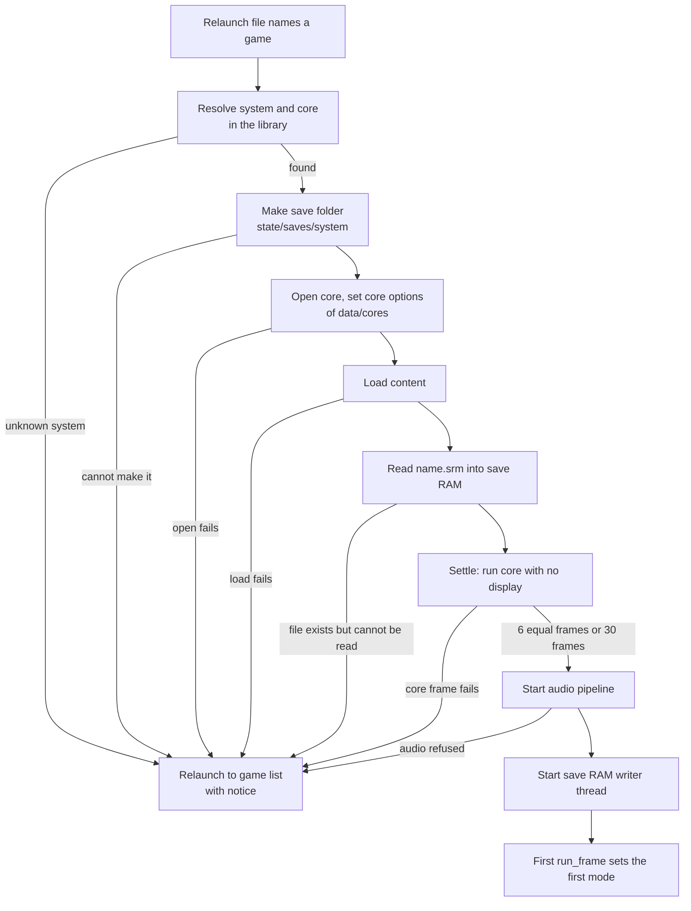
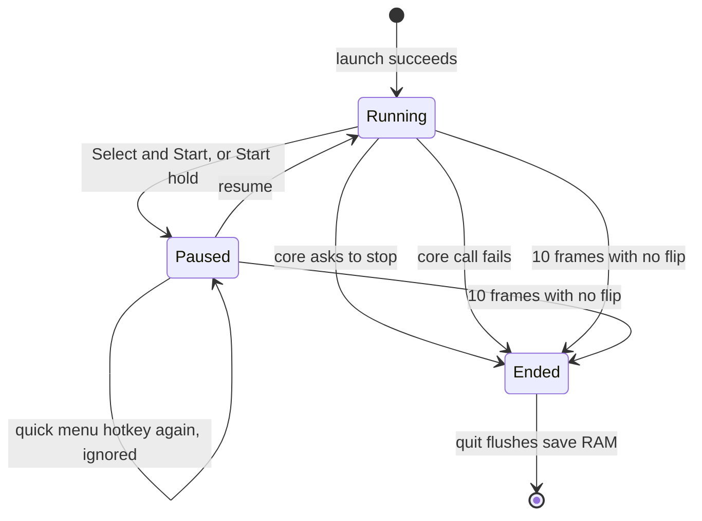
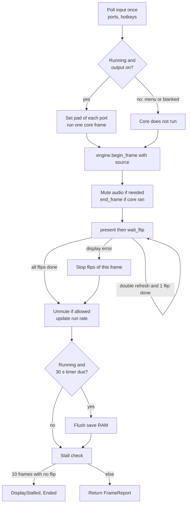
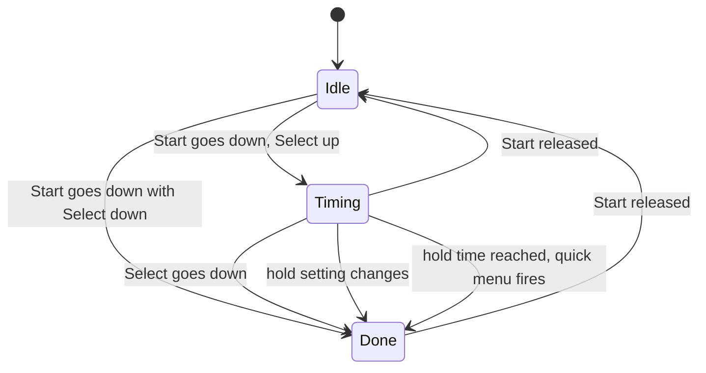
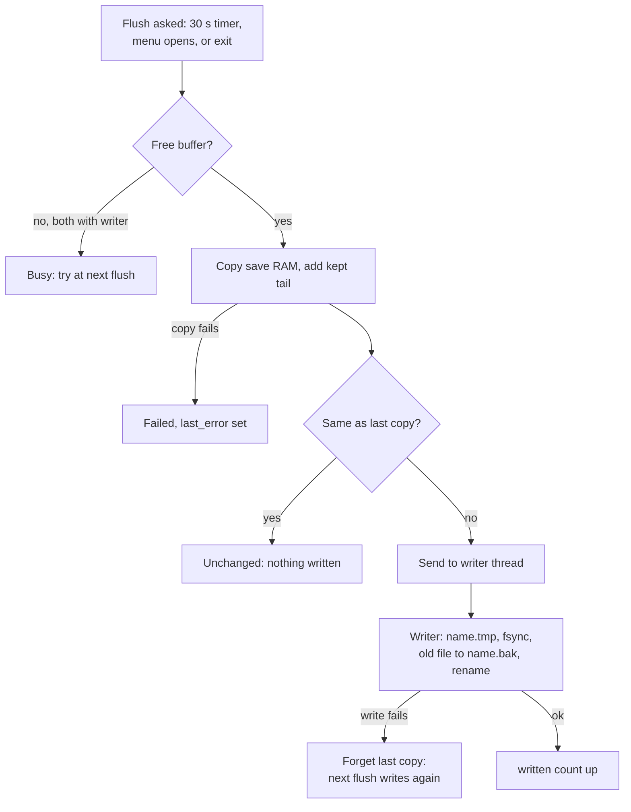
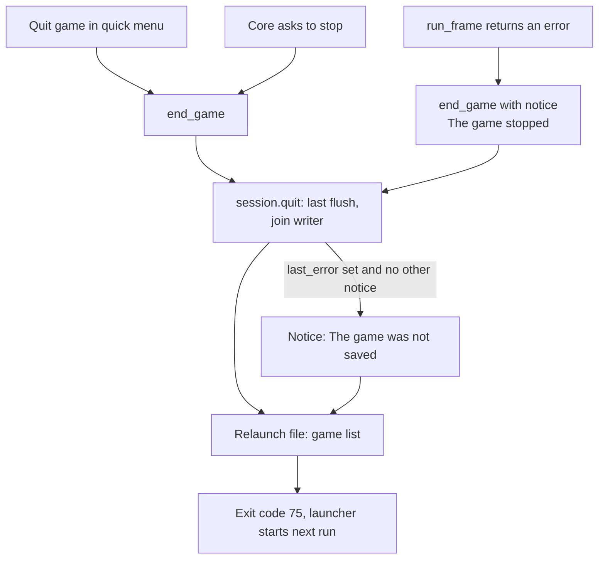

# 6. The session: one game from launch to exit

A session is one game in one frontend process. It opens the core, loads the content and the save RAM, settles the picture size before the first mode, then runs the display-locked frame loop: one core frame per flip, or per two flips for double refresh. It owns the quick menu pause, the hotkeys, the save RAM writer and the stall check of the display. The app (`apps/neptron`) starts it from a relaunch file and ends it with a relaunch to the game list. The video side of each frame is in [ODREN](04-odren.md), the display safety in [the guard](03-guard.md), the menus in [the screens](07-screens.md).

## Diagrams

### Launch

`Session::launch` runs before the frame loop. Every failure is a `LaunchError`. The app turns it into a notice and relaunches to the game list. A failed launch never writes the save file.

### Session states

The session has three states (`State` in `session.rs`). The engine adds one more condition, "output off" (`blanked`), which is not a session state but changes what a frame does.

### One frame of `run_frame`

### Hotkeys of one port

Select and Start together (`QUICK_MENU_COMBO`) fire the quick menu at their release, when the press lasted less than `BLIND_RECOVERY_HOLD_NS`. The same buttons (`BLIND_RECOVERY_COMBO`) held for `BLIND_RECOVERY_HOLD_NS` fire the blind recovery. So a recovery hold never opens the quick menu. `Session::resume` cancels a press held across the close (`Hotkeys::cancel_quick_menu`), so its release does not open the menu again. From the frame Select and Start are both down until both are up again, the core sees neither (`PadMask`), so the game does not act on the combination during the hold. The Start hold is a second way to the quick menu, with its own state per port:

### Save RAM flush

### How a game ends in the app

## States and screens

| State | What the user sees |
| --- | --- |
| Launch, settle | The picture of the run before stays until the first `run_frame` sets the game's mode. The core runs up to `LAUNCH_SETTLE_MAX_FRAMES` frames with no display, no sound and no input. |
| `Running` | The game, in the mode ODREN chose. A notice can show over it (for example "Picture: ..." when the first picture is fitted, cropped or small). |
| `Paused` | The quick menu over the frozen last frame, in the same video mode. Title: the game title, subtitle "Paused", hints "Accept: choose" and "Back: resume". Audio is muted. The core does not run. |
| Output off (`blanked`) | No signal. The core waits with the game frozen, audio is muted, the app paces the loop at `UNPACED_FRAME_NS`. |
| Refused mode (`current_refused`) | The mode stays on the wire but the session presents no game picture on it (only the UI, if any). Audio is muted. |
| `Ended` | Nothing more in this process. The next run shows the game list, with a notice when there is one. |

## Transitions

| From | To | Exact condition | Constant = value | What happens on the wire or on disk |
| --- | --- | --- | --- | --- |
| (none) | settle | `Session::launch` after the save file is loaded | | Core frames run, no present, audio of these frames is dropped, core reads no input. |
| settle | `Running` | The source (size, rate, aspect, interlace) is equal for N frames in a row, or the frame count reaches the maximum | `LAUNCH_STABLE_FRAMES` = 6 frames, `LAUNCH_SETTLE_MAX_FRAMES` = 30 frames | Audio pipeline starts at the core rate. Writer thread starts. Flush timer set to now + 30 s. The first `run_frame` sets the first mode with no debounce. |
| settle | `Ended` | The core sends `Shutdown` during settle | | Launch still succeeds, with the session ended. The first `run_frame` returns `SessionError::Ended`, and the app ends the game with notice "The game stopped: the session has ended." |
| `Running` | `Paused` | Select and Start both down on one port (fires once per press), or Start alone held for the hold time | `QUICK_MENU_COMBO` = Select + Start; `input.menu_hold_start_seconds` = 0 (off) to `MENU_HOLD_START_MAX_SECONDS` = 10 s, default 0 | Audio mutes. Save RAM flush. `FrameReport::menu_opened`; the app opens the quick menu on the next frame. |
| `Paused` | `Paused` | Quick menu hotkey again | | Nothing: the menu is never a toggle. |
| `Paused` | `Running` | UI intent Resume: "Resume" row, or Back (after the keep prompt, when the visit changed a setting) | | Every button held now is held back until its release. If the engine has a blocked source (`source_blocked()`), `engine.retry()`. A Select and Start press held now opens no menu at its release. Core runs from the next frame. |
| `Running` | `Ended` | Core event `Shutdown` (`RETRO_ENVIRONMENT_SHUTDOWN`) | | `FrameReport::ended = CoreShutdown`. The app ends the game. |
| `Running` | `Ended` | `host.run_frame` returns an error | | `SessionError::Core`. The app ends the game with a notice. |
| any | `Ended` | N loop frames in a row with no completed flip and the output on | `FLIPLESS_FRAMES_LIMIT` = 10 frames; KMS wait `FLIP_WAIT_LIMIT_MS` = 500 ms, so at most about 5 s | `SessionError::DisplayStalled`. The app ends the game with a notice. |
| any | any | Select and Start held on one port | `BLIND_RECOVERY_HOLD_NS` = 5 s | `FrameReport::blind_recovery`. The app calls `guard.recover`: the safe default goes to the engine. The session state does not change: a recovery hold opens no quick menu. The app plays the tone through the session (`Session::write_cue`): the pipeline mixes it into the next core frames, through the mute, with the queue at its target; a frame with no core run writes its next slice with silence up to the target level (`idle_frame`). |
| `Running` | `Running` | Clock reaches the flush time | `SAVE_RAM_FLUSH_INTERVAL_NS` = 30 s | Save RAM copy goes to the writer when it changed. Timer restarts. |
| `Ended` | (process) | `quit()` | | Last flush, writer joined, `ExitReport`. Relaunch file to the game list, exit code `RELAUNCH_EXIT_CODE` = 75. A reboot or a power-off from `Settings > System` is not possible in a game: both rows are disabled with `Not during a game`, so the player quits the game, and this flush, first. |

### Frame details

- **Source.** The size comes from the last frame the core sent, because some cores change size without an event. The rate and aspect come from the core's AV info. A frame with `INTERLACE_MIN_LINES` = 289 lines or more is interlaced. Rotation is always `R0`.
- **Double refresh.** Flips per core frame are `timing.repeat()` of the chosen mode (2 for double refresh). The same picture is presented on each flip.
- **Run rate for the audio.** On KMS (`RunRateSource::ReadBack`) it is the field rate of the read-back mode divided by the flips per core frame. In the window (`RunRateSource::Measured`) it is the measured flip rate. A rate the audio pipeline refuses (more than twice or less than half of the core rate) keeps the last good one and counts `refused_run_rates`.
- **Mute.** Audio is muted while the session is not `Running`, while the engine asks for it (a modeset is due or the new mode has not flipped yet), while the mode on screen is refused, and while the output is off. A modeset frame writes silence.
- **Core timing change.** A new AV info makes a new audio pipeline. A timing the pipeline refuses keeps the old one (`refused_timings`). A pipeline that cannot be made again loses the sound for the rest of the game (`audio_lost`).
- **App order around `run_frame`** (`Shell::game_frame`): open the quick menu if the last frame fired it; the panel offer; menu navigation with the input events of the last frame (only while the UI shows); UI update and draw; `run_frame` with the canvas; `guard.tick`; then the report (menu, blind recovery, first picture notice, end, pacing when blanked).

### Save RAM rules

- The save file is `<save_dir>/<content file stem>.srm`, with `save_dir` = `state/saves/<system folder>`.
- A core with no save RAM, or content with no file stem: no writer, `Flush::NoSaveRam`.
- A file longer than the save RAM: the core gets only its first bytes. The rest (the tail) is written back after the save RAM at every write, so the file never gets shorter (`kept_tail_bytes`).
- A file shorter than the save RAM grows to the save RAM size.
- Each write: `<name>.tmp` with fsync, the old file copied to `<name>.bak` (temp file, then rename), rename of `.tmp` over the file, fsync of the folder.
- The writer has `BUFFERS` = 2 buffers on two bounded channels. The frame thread never blocks: with no free buffer the flush is `Busy`.
- At exit, `quit()` waits for writes in flight, sends the last copy if it changed, joins the thread, and reports `Written`, `WriteFailed`, `Unchanged`, `Failed` or `NoSaveRam`.

## What can go wrong

| Case | What the user sees | Way out |
| --- | --- | --- |
| The system of the game is unknown | Game list with notice "`<game>` did not start: the system `<id>` is unknown." | Check the ROM folder and `data/systems`. |
| Core cannot open or load the content | Game list with notice "`<game>` did not start: cannot open the core: ..." or "... the core cannot load the content: ..." | Check the core file and the ROM. |
| Save file exists but cannot be read | Game list with notice "`<game>` did not start: cannot read the save file: ..." The save file is not touched. | Fix the file permissions or the file system. |
| Save folder cannot be made (state partition full or read only) | Game list with notice "`<game>` did not start: cannot make the save folder ...". | Free or repair the state partition. |
| Save folder exists but writes fail | The game runs. At exit, notice "The game was not saved: cannot write the save file: ...". A failed write is tried again at the next flush. Only the last flush decides the notice: a failure that a later write repaired gives none. | Free or repair the state partition. The `.bak` holds the file before the last good write. |
| No sound device at start | Notice "No sound: the audio device did not open (`<error>`)." The game runs with a silent sink (`MaybeSink::Silent`, `NULL_SINK_RATE_HZ` = 48 000 Hz). | Connect or fix the audio device and restart. |
| Audio pipeline refuses the core timing at launch | Game list with notice "`<game>` did not start: cannot start the audio: ...". | A core or data problem: report it. |
| Display stops flipping | Picture freezes, then after 10 frames the game ends: notice "The game stopped: no flip completed for 10 frames; the last error: ...". The run relaunches and opens the display again. | Automatic. |
| Core call fails in the loop | Notice "The game stopped: the core failed: ...", then the game list. | Automatic. Save RAM is flushed at quit. |
| Core crashes (signal) | The frontend process dies with the core. The launcher restarts it after its backoff (see [Power-on](01-power-on.md)). No relaunch file is left, so the start is a new boot with the game list. Save RAM is at most 30 s old. | Automatic. |
| Power cut during play | On the next boot the save file is the last one written: at most `SAVE_RAM_FLUSH_INTERVAL_NS` = 30 s old, or the state at the last quick menu open. A cut during a write leaves the old file or the new one, plus `.bak`. | Nothing to do. |
| Wrong picture or black screen during play | Hold Select and Start for 5 s. The safe default goes on the wire and the tone plays. The game goes on, with no quick menu. The notice "Safe mode: the picture was reset. Keep a display setting to leave it." shows when the quick menu opens. | Keep a display setting to leave safe mode. |
| Inputs refuse every mode | Output off, game frozen, no sound. | Blind recovery, or a guard revert, sets a mode again. |
| A modeset failed on the device | The engine keeps the old mode and blocks that source. | Open and close the quick menu: `resume()` calls `retry()`. |

## Source

- [session.rs](../../crates/neptron-session/src/session.rs): `Session`, `State`, `FLIPLESS_FRAMES_LIMIT`, `resume`, `reset`, `set_start_hold_ns`, `quit`, `finish_writer`, `Drop`.
- [session/launch.rs](../../crates/neptron-session/src/session/launch.rs): `Session::launch`, `settle`, `load_save_file`.
- [session/frame.rs](../../crates/neptron-session/src/session/frame.rs): `run_frame`, `run_core`, `read_input`, `pause`, `must_mute`, `show`, `flips_per_frame`, `update_run_rate`, `flush_save_ram`, `check_stall`, `retime`.
- [source.rs](../../crates/neptron-session/src/source.rs): `source_geometry`, `LaunchSettle::push`, `LAUNCH_STABLE_FRAMES`, `LAUNCH_SETTLE_MAX_FRAMES`, `INTERLACE_MIN_LINES`.
- [save.rs](../../crates/neptron-session/src/save.rs): `SaveRamWriter::start`, `flush`, `finish`, `copy_and_send`, `take`, `write_loop`, `SAVE_RAM_FLUSH_INTERVAL_NS`, `Flush`.
- [pads.rs](../../crates/neptron-session/src/pads.rs): `PadMask::hold_back_pressed`, `release`, `pad`.
- [report.rs](../../crates/neptron-session/src/report.rs) and [error.rs](../../crates/neptron-session/src/error.rs): `FrameReport`, `EndReason`, `Counters`, `ExitReport`, `LaunchError`, `SessionError`.
- [hotkeys.rs](../../crates/neptron-input/src/hotkeys.rs): `Hotkeys::update`, `ComboTimer::fires`, `StartHold::fires`, `QUICK_MENU_COMBO`, `BLIND_RECOVERY_COMBO`, `BLIND_RECOVERY_HOLD_NS`.
- [save.rs of the host](../../crates/neptron-libretro/src/save.rs): `save_file_path`, `read_save_file`, `write_save_file`.
- [shell/boot.rs](../../apps/neptron/src/shell/boot.rs): `launch` (the app side of a game start).
- [shell/frame.rs](../../apps/neptron/src/shell/frame.rs): `Shell::game_frame`, `notice_picture`, `UNPACED_FRAME_NS` in [shell.rs](../../apps/neptron/src/shell.rs).
- [shell/intents.rs](../../apps/neptron/src/shell/intents.rs): `intent` (`Resume`, `QuitGame`), `end_game`, `apply_live`.
- [shell/guard_events.rs](../../apps/neptron/src/shell/guard_events.rs): `recover`, `play_cue`, `safe_text`.
- [devices.rs](../../apps/neptron/src/devices.rs) and [kms.rs](../../apps/neptron/src/kms.rs): `MaybeSink`, the audio open.
- [quick_menu.rs](../../crates/neptron-ui/src/screens/quick_menu.rs): `QuickMenu::handle`, `ask`, `leave`.

## Differences from docs/definition

- `docs/definition/08-frontend-and-ux.md`, "Quick menu": says the combination is "configurable" and that on arcade panels the default is "holding Start for 2 seconds". The code has a fixed combination (`QUICK_MENU_COMBO` = Select + Start). The Start hold is the setting `input.menu_hold_start_seconds`, global only, 0 to 10 s, default 0 (off) on every machine.
- `docs/definition/08-frontend-and-ux.md`, "Quick menu": lists resume, save and load state, video, core options, controls, disc swap, reset, quit. The code has the rows "Resume", "Volume", "Video" (a page with "Picture style", "Refresh policy", "Scanlines" and "Scanline strength"), "Settings" (the global panels) and "Quit game" (`quick_menu_page`, `video_page`, `QUICK_MENU_KEYS`, `VIDEO_KEYS`). No save states, no core options editor, no controls, no disc swap, no reset row (`Session::reset` exists but nothing in the app calls it).
- `docs/definition/05-crt-safety-model.md`, layer 6 "Blind recovery": says "An audio cue confirms it." The app plays the cue (`CUE_MS` = 200 ms at `CUE_HZ` = 880 Hz) in the game list and, through `Session::write_cue`, in a game.
- `docs/definition/05-crt-safety-model.md`, "Burn-in protection": says the picture dims after five minutes without input in a menu, in the quick menu or while paused. No such code exists: the quick menu stays at full brightness.
- `docs/definition/02-feature-definition.md`, Emulation row: "SRAM flush on exit". The code also flushes every 30 s and when the quick menu opens.
- `docs/definition/14-risks-and-open-questions.md`, "Cores run in-process": says the supervisor "restarts into the game list with the last validated mode". After a crash the relaunch file is gone, so the next start is a new boot: the guard counts it and boots as described in [the guard](03-guard.md), not with a stored "last validated mode" of the crashed run.
- `crates/neptron-session/README.md`, "What the app must do", step 4: says the UI intent "reset" calls `reset()`. There is no reset intent in `neptron-ui`.
