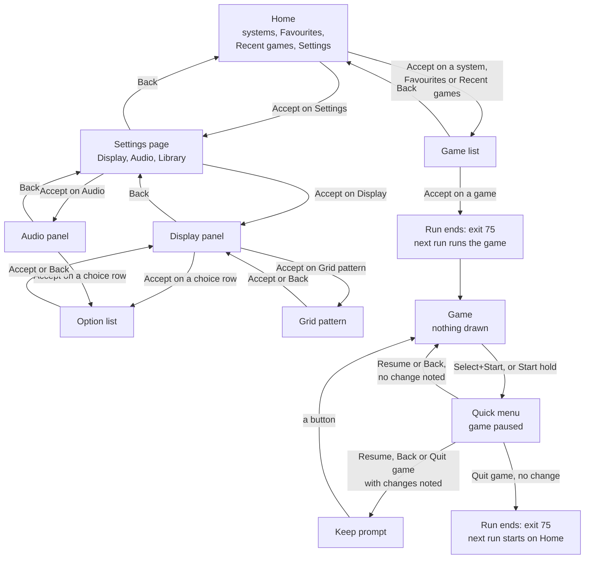
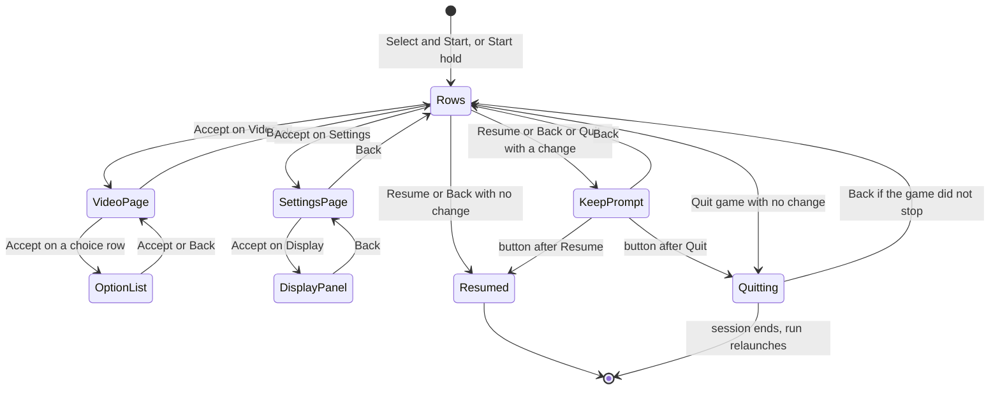
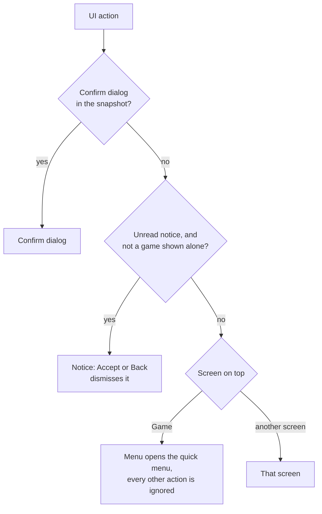
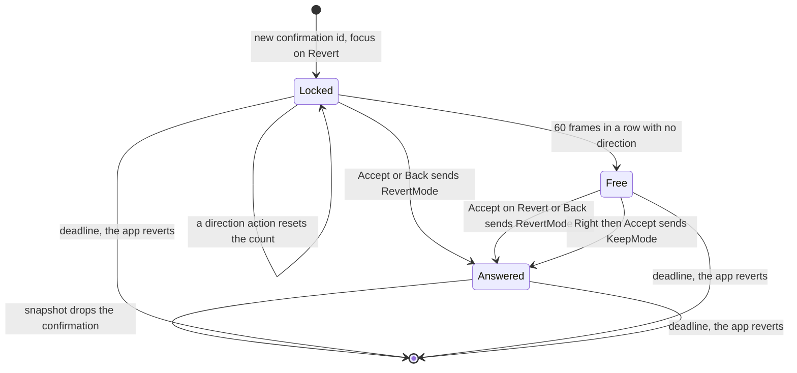
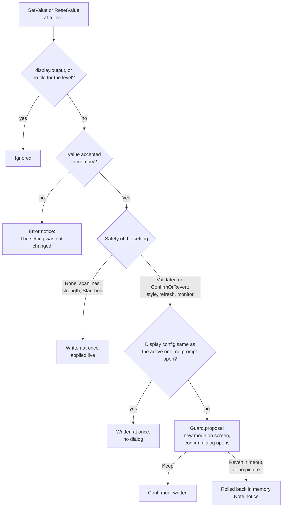

# 7. The screens and the UI flow

This flow covers everything the player sees and presses in the menus: the screens, the buttons that move between them, the rows of each settings page, the video block, the confirm dialog, the keep prompt and the notices. It also says when a change reaches its settings file. The UI (`neptron-ui`) decides nothing about the display. It sends intents, and the app (`apps/neptron/src/shell`) carries them out. A display change goes through [the guard](03-guard.md); the mode itself comes from [ODREN](04-odren.md) and [the policy](05-policy.md).

The menu canvas is 320x240. The golden pictures below are the reference renders of the screens. They use test fixtures (system names, row labels such as `Monitor` and `Refresh`, option labels such as `Auto` and `Exact`, and reasons such as `Needs a 15 kHz monitor`), so their texts are not always the texts of the real app. This file quotes the real texts from the code.

## Diagrams

### Overview: the screen stack

One run of the frontend is one process. A run shows the menus, or it runs one game. A launch and the end of a game end the run with exit code `RELAUNCH_EXIT_CODE` = 75, and the next run starts on Home. See [frontend boot](02-frontend-boot.md).

From the quick menu the player also reaches the video page, the Settings page with its panels, the option lists and the grid pattern. The detail is in the next diagram. Back on any screen closes the screen on top, and the screen under it gets the focus back on the row that opened the closed screen. Back on Home does nothing. With no games, Home has one row `Settings`, so the display and audio panels are reachable on a new stick.

### Detail: the quick menu

The grid pattern is reached from the display panel, also when that panel was opened from the quick menu (`Settings > Display`). The keep prompt sees only the changes at the game level (the first page and the video page), so a change on a panel of the Settings page never starts it. It also forgets a change that the app took back (the guard reverted a display change that was not kept): when the player leaves the video page, and when the prompt would open, a change whose row on the page that made it no longer shows that value at the game level is not asked about and not moved. The rows of a global panel never count. The UI takes no more actions in the frame of a change at the game level, so a back pressed in the same frame does not leave the page before the snapshot shows the change. The quick menu hotkey does nothing while the menu is open, at any depth: the session ignores it while the core is paused.

### Detail: who gets a button press

Each frame the router gives each action to one place only, in this order.

While the game is shown alone (top screen `Game`, no confirm dialog), the app drops every navigation action except the `Menu` action that it makes from the quick menu hotkey. So the X button does nothing during play. The session pauses itself at the hotkey. While a confirm dialog is on screen the app holds that `Menu` action back, because the dialog takes every action; the frame after the dialog closes, the action opens the quick menu. So a paused game always shows the dialog or the quick menu.

### Detail: the confirm dialog

`Locked` and `Free` are not names in the code. They stand for `quiet_frames < QUIET_FRAMES_BEFORE_MOVE` and `quiet_frames >= QUIET_FRAMES_BEFORE_MOVE` in `Confirm`. `Answered` is the field `answered`.

### Detail: what a settings change does

## States and screens

The screen id is the id in the widget tree (`out.tree.set_screen`).

| Screen | Screen id | What the user sees | Golden picture |
| --- | --- | --- | --- |
| Home | `home` | Title `NEPTRON`. A box with one row per system that has games (name, then `1 game` or `N games`), then `Favourites`, `Recent games`, `Settings`, each with an arrow. Hint `Accept: open`. | [home.ppm](../../crates/neptron-ui/tests/golden/screens/home.ppm) |
| Home with no games | `home` | The text `No games yet.` and where to copy games (`roms/nes   roms/snes   roms/megadrive`, plain files and `.zip` files), then one row `Settings` at the bottom, with its arrow. The tier 3 boot golden shows this screen under a notice. | [home-empty.ppm](../../crates/neptron-ui/tests/golden/screens/home-empty.ppm) |
| Settings page | `settings` | Title `Settings` (the breadcrumb). One row per panel of `SETTINGS_PANELS`: `Display`, `Audio`, `Library`. Hints `Accept: open`, `Back: return`. | [settings.ppm](../../crates/neptron-ui/tests/golden/screens/settings.ppm) |
| Library panel | `library` | Title `Settings > Library`. One action row, `Rescan games` (see the transitions). | [library-scanning.ppm](../../crates/neptron-ui/tests/golden/screens/library-scanning.ppm) |
| Audio panel | `audio` | Title `Settings > Audio`. The rows of the audio page. Hints of the focused row, `Back: return`. | [audio.ppm](../../crates/neptron-ui/tests/golden/screens/audio.ppm) |
| Game list | `games` | Title: the system name, `Favourites` or `Recent games` (`Games` if the system is not found). Right of the title: `N/total`. A list of titles, `*` after a favourite, `...` for a row not loaded yet. Under the list, the focused title in full on two lines. Hints `Accept: play` (only when the list has a game) and `Back: systems` (a system list) or `Back: home` (Favourites, Recent games). | [games-top.ppm](../../crates/neptron-ui/tests/golden/screens/games-top.ppm), [games-middle.ppm](../../crates/neptron-ui/tests/golden/screens/games-middle.ppm), [games-end.ppm](../../crates/neptron-ui/tests/golden/screens/games-end.ppm), [games-one.ppm](../../crates/neptron-ui/tests/golden/screens/games-one.ppm) |
| Empty game list | `games` | A text that says why: `This system has no games now.` plus where to put them, `No favourites yet.` plus `Press Menu on a game in a game list to add it here.`, or `No games played yet.` | [games-empty.ppm](../../crates/neptron-ui/tests/golden/screens/games-empty.ppm) |
| Display panel | `display` | Title `Settings > Display`. An info box: `Output`, `Mode`, `Monitor`. Under it the rows of the display page. Hints of the focused row, `Back: return`. | [display.ppm](../../crates/neptron-ui/tests/golden/screens/display.ppm) |
| Display panel in a game | `display` | The info box shows `Output` and `Monitor` only. Under it the video block (heading `Video`, lines `Game`, `Mode`, result). Then the rows. A skin with rows too tall keeps the three-line info box and no block. | [display-video.ppm](../../crates/neptron-ui/tests/golden/screens/display-video.ppm) |
| Option list | `options` | Title: the breadcrumb, which ends with the row label. One line per option with its detail. A small mark left of the option in use. A dim option shows its reason. Under the list, the detail of the focused option in full, or `Not available. ` and the reason. Hints `Accept: use`, `Back: cancel`. | [display-style.ppm](../../crates/neptron-ui/tests/golden/screens/display-style.ppm) |
| Grid pattern | `pattern/grid` | A fixed test picture: grey grid with a 16 px pitch, white border on the canvas edge, white centre cross, amber corner marks at the safe area, the caption `Back: return`. It ignores the skin. | [grid.ppm](../../crates/neptron-ui/tests/golden/pattern/grid.ppm) |
| Game | `game` | Nothing. The game picture only. Under a confirm dialog the UI draws its background over the game. | none |
| Quick menu | `quick-menu` | Title: the game name. Right of the title: `Paused`. The rows `Resume`, `Volume`, `Video`, `Settings`, `Quit game`. Hints of the focused row, `Back: resume`. | [quick-menu.ppm](../../crates/neptron-ui/tests/golden/screens/quick-menu.ppm), [quick-menu-volume.ppm](../../crates/neptron-ui/tests/golden/screens/quick-menu-volume.ppm) |
| Video page | `quick-menu/video` | Title `<game> > Video`. The video block (when a status exists and there is room), then the display rows of the game. Hints of the focused row, `Back: return`. | [quick-menu-video.ppm](../../crates/neptron-ui/tests/golden/screens/quick-menu-video.ppm), [quick-menu-video-filtered.ppm](../../crates/neptron-ui/tests/golden/screens/quick-menu-video-filtered.ppm), [quick-menu-video-long.ppm](../../crates/neptron-ui/tests/golden/screens/quick-menu-video-long.ppm), [quick-menu-panel.ppm](../../crates/neptron-ui/tests/golden/screens/quick-menu-panel.ppm), [breadcrumb-long.ppm](../../crates/neptron-ui/tests/golden/screens/breadcrumb-long.ppm) |
| Keep prompt | `quick-menu/keep` | A dialog over the quick menu. Title `Keep the changes?`. Message `Keep the new settings for this game only, for all games of this system, or for all games?`. Buttons `This game` (focus), `System`, `All games`. Hints `Accept: choose`, `Back: cancel`. | [quick-menu-keep.ppm](../../crates/neptron-ui/tests/golden/screens/quick-menu-keep.ppm) |
| Confirm dialog | `confirm` | A dialog over any screen, also over a running game. Title `Keep this picture?`. Message: `Keep the new picture?`, `No answer brings the old one back.`, an empty line, then `The old picture comes back in N s.` (N counts down, rounded up to whole seconds), or `The old picture comes back now.` at 0. Buttons `Revert` (focus), `Keep`. Hints `Accept: revert`, `Right, then Accept: keep`. In the frame of an answer the last line is `One moment.` and the hints are empty. | [confirm-10s.ppm](../../crates/neptron-ui/tests/golden/screens/confirm-10s.ppm), [confirm-3s.ppm](../../crates/neptron-ui/tests/golden/screens/confirm-3s.ppm) |
| Notice | `notice` | A dialog over any screen except a game shown alone. Title `Note`, `Warning` or `Error`, coloured by kind (see [Notices](#notices)). The text. One button `OK`. Hint `Accept: OK`. | [notice.ppm](../../crates/neptron-ui/tests/golden/screens/notice.ppm) (error), [notice-warning.ppm](../../crates/neptron-ui/tests/golden/screens/notice-warning.ppm) (warning) |

## Transitions

Buttons: the menus use the RetroPad. `nav.rs` maps D-pad to Up, Down, Left, Right, A to Accept, B to Back, X to Menu. Start and Select give no menu action: they are the hotkeys.

| From | To | Button or exact condition | Constant = value | What happens on the wire or on disk |
| --- | --- | --- | --- | --- |
| any list | same | Up, Down: one row. Left, Right: one page. Lists stop at their ends. | none | nothing |
| any menu | same | A held direction repeats | `REPEAT_DELAY_NS` = 400 ms, then `REPEAT_INTERVAL_NS` = 66 ms | nothing |
| Home | Game list | Accept on a system row, `Favourites` or `Recent games` | none | `LoadGames` asks for rows |
| Home, also with no games | Settings page | Accept on `Settings` | none | nothing: the UI shows the page |
| Settings page | Display, audio or Library panel | Accept on `Display`, `Audio` or `Library` | none | `LoadSettings` for `DISPLAY_PAGE`, `AUDIO_PAGE` or `LIBRARY_PAGE` |
| Settings page | Home or quick menu | Back | none | nothing |
| Game list | Home | Back | none | nothing |
| Game list | same | Scroll past the loaded rows | `WINDOW_ROWS` = 128, `PREFETCH_ROWS` = 32 | One `LoadGames` per frame, 128 rows centred on the visible rows, until the snapshot holds the visible rows plus 32 on each side |
| Game list | Game (next run) | Accept on a loaded game | `RELAUNCH_EXIT_CODE` = 75 | The run writes the relaunch file with the game and exits 75. The launcher starts the next run, which loads the core. See [the session](06-session.md). |
| Game list | same | Menu (X) on a game | none | `ToggleFavourite`. The app does nothing with it: favourites are not kept in the MVP. |
| Display panel | Option list | Accept on a choice row (Output, Monitor profile, Picture style, Refresh policy, Scanlines) | none | nothing until a choice |
| Display panel | Grid pattern | Accept on `Grid pattern` | none | nothing |
| Library panel | same | Accept on `Rescan games` (game list run only; disabled in a game with the reason `Not during a game`) | none | A full scan of `share/roms` starts on the scan thread. The row keeps its label and is disabled with the reason `Scanning...` until the scan ends. The lists stay usable with the old index. At the end, the index and the cache are replaced, a game list on show keeps its focused game (when it moved by at most `MOVED_GAME_MARGIN_ROWS` = 64 rows), and an Info notice says what changed. |
| Display panel | Settings page | Back | none | nothing |
| Display panel | same | Left, Right on a number row | step 5 for `Scanline strength`, 1 for `Hold Start for menu` | `SetValue` at the global level (see the change flow) |
| any settings page | same | Menu (X) on a row whose value comes from the page level | none | `ResetValue` at that level: the row inherits again |
| Option list | page under it | Accept on an enabled option | none | `SetValue` with that option, only when it is not the option in use and the row allows the page level. Then the list closes. |
| Option list | same | Accept on a dim option | none | nothing |
| Option list | page under it | Back | none | nothing |
| Grid pattern | page under it | Accept or Back | none | nothing. Other buttons do nothing, so the pad can be touched while the monitor is adjusted. |
| Game | Quick menu | Select and Start down together on one port | `QUICK_MENU_COMBO` = Select, Start | The session pauses the core, mutes the audio and flushes save RAM. The app sends `Menu` to the UI the next frame. |
| Game | Quick menu | Start held alone on one port | `input.menu_hold_start_seconds`, default 0 (off), max `MENU_HOLD_START_MAX_SECONDS` = 10 s | as above |
| Quick menu | Video page | Accept on `Video` | none | `LoadSettings` for `VIDEO_PAGE` |
| Quick menu | Settings page | Accept on `Settings` | none | nothing: the UI shows the page |
| Quick menu | same | Left, Right on `Volume` | step 5 | `SetValue` at the game level |
| Video page | Option list | Accept on `Picture style`, `Refresh policy` or `Scanlines` | none | nothing until a choice |
| Video page | Quick menu | Back | none | The quick menu forgets a noted change that the app took back |
| Quick menu | Game | Accept on `Resume`, or Back, no change noted | none | `Resume`: the core runs from the next frame. Buttons held now reach the core only after their release. A modeset that failed on the device is tried again. |
| Quick menu | Keep prompt | Resume, Back or `Quit game` after a change at the game level in this visit | `MAX_CHANGES` = 16 noted changes | nothing yet |
| Keep prompt | Game or quitting | Accept on `This game` | none | nothing more: the changes are at the game level already |
| Keep prompt | Game or quitting | Accept on `System` or `All games` | none | For each noted change whose row allows that level: `SetValue` at that level, then `ResetValue` at the game level |
| Keep prompt | Quick menu | Back | none | nothing |
| Quick menu | quitting | `Quit game` with no change, or after the keep prompt | none | `QuitGame`: the session ends, save RAM is written, the run exits 75 and the next run starts on Home. While it waits, the quick menu takes only Back. |
| any | Confirm dialog | The guard opens a prompt (a display change) | `CONFIRM_WINDOW_NS` = 10 s | The new mode is on the wire. Every held key is ignored until its release (`hold_back`). |
| Confirm dialog | screen under it | Accept with the focus on `Revert`, or Back | none | `RevertMode`: the guard declines, the old mode goes back on the wire, a Note notice |
| Confirm dialog | screen under it | Right, then Accept on `Keep` | `QUIET_FRAMES_BEFORE_MOVE` = 60 frames with no direction before Right works | `KeepMode`: the guard confirms, the waiting settings go to their files, the guard record is saved |
| Confirm dialog | screen under it | No answer before the deadline | `CONFIRM_WINDOW_NS` = 10 s | The guard reverts (`Timeout`), a Note notice |
| Notice | screen under it | Accept or Back | `NOTICES_MAX` = 8 notices kept, the oldest goes | `DismissNotice` removes it from the snapshot. The next notice shows. |
| any | safe mode | Select and Start held together on one port | `BLIND_RECOVERY_HOLD_NS` = 5 s | The guard puts the safe default on the wire. A Warning notice. Also a short tone, in the game list and in a game (`CUE_MS` = 200 ms at `CUE_HZ` = 880 Hz). See [the guard](03-guard.md). |

## The rows of each screen

A settings row shows: the label on the left, the value in the middle (with `<` and `>` around it on a focused number row), the source (`default`, `global`, `system` or `game`), and at the right edge an arrow when Accept opens something. The source is dim for `default` and in the accent colour for the others. A long choice shows its short form in the row (`HDMI/DP 1`) and its full label in the option list (`HDMI/DP 1 (HDA Intel PCH)`).

One rule for the rows of every list (`docs/spec/ui-navigation.md`): a row that opens a page, an option list or the grid pattern has the arrow; a row that changes in place keeps `< value >`; an action row (`Resume`, `Quit game`) has neither. The footer hint follows the focused row: `Accept: open`, `Accept: change` (a switch), `Left/Right: change` (a number), `Accept: choose` (an action), none for a disabled row.

A choice row never changes in place on these pages: Left and Right do nothing, Accept opens its option list. A number row steps with Left and Right. Accept on an action row runs it. Menu (X) on a row resets the value at the page level when the value comes from that level.

The title band shows a breadcrumb: `Settings > Audio > Audio output`, or `<game> > Video` in a game. A path too long for the band keeps its last two parts after `... > `, then cuts the second last part at its end with `...`, then keeps only the last part, cut the same way.

### Display panel rows (`DISPLAY_PAGE`, written at the global level)

| Row | Values | What it does |
| --- | --- | --- |
| `Output` | `auto`, then the connectors the run found, then the value in the file when the run did not find it | Read-only. The option list opens, but a choice sends nothing (`Scopes::NONE`), and the app also refuses `display.output`. Change it in the settings file. |
| `Monitor profile` | `auto`, `flat` (only when a panel was detected), the preset ids, then the value in the file when it is not among them | The detail of `auto` names what it drives: the EDID name and native mode, for example `NPT FHD 24  1920x1080 60 Hz`, `<name>  EDID ranges`, or `generic_15` when there is no EDID. `flat` shows the same for the panel profile. A change opens the confirm dialog. |
| `Picture style` | `auto`, `native`, `2x`, `3x`, `4x` | Each option shows what it gives on the monitor now, for example `15.73 kHz  59.94 Hz`. A style the monitor cannot show is dim with `Needs another monitor`. A change opens the confirm dialog. |
| `Refresh policy` | `exact`, `exact_x2`, `force_50`, `force_60` | A change opens the confirm dialog. |
| `Scanlines` | `auto`, `off`, `on` | Written at once, applied live. |
| `Scanline strength` | 0 to 100 `%`, step 5, default 75 | Written at once, applied live. |
| `Hold Start for menu` | 0 to 10 `s`, step 1, default 0 | Written at once, applied live. 0 turns the Start hold off. |
| `Grid pattern` | page | Opens the grid pattern. |

Info box: `Output` is the connector name (`none` with no display). `Mode` is the mode the driver read back, for example `640x480p 59.94 Hz`, with ` (safe mode)` after it while the guard is in safe mode. It is empty before the first read back. `Monitor` is the preset id that the guard gave the engine. A monitor of its EDID (`auto` with an EDID, or `flat`) shows the monitor name of the EDID (`DisplayInfo::monitor`), or its profile id when the EDID has no name, for example `NPT FHD 24`. `not set` shows only before the app gives a monitor.

The style details on the display panel come from the source on screen: the game in a game, the menu canvas (320x240 at 60 Hz) in the menus.

### Quick menu rows (`QUICK_MENU_PAGE`, written at the game level)

| Row | What it does |
| --- | --- |
| `Resume` | Leaves the menu (through the keep prompt when a change was made). |
| `Volume` | The volume of the game. Left and Right step 5. Written at once. |
| `Video` | Opens the video page. |
| `Settings` | Opens the Settings page. Its panels write the global level, not the game level, and the keep prompt does not see them. |
| `Quit game` | Ends the game (through the keep prompt when a change was made). |

### Video page rows (`VIDEO_PAGE`, written at the game level)

| Row | What it does |
| --- | --- |
| `Picture style` | As on the display panel, at the game level. A change opens the confirm dialog. |
| `Refresh policy` | As on the display panel, at the game level. A change opens the confirm dialog. |
| `Scanlines` | At the game level. Written at once. |
| `Scanline strength` | At the game level. Written at once. |

### The video block

The video block shows on the video page of the quick menu and in the display panel while a game runs and the driver has read a mode back. It has five lines of fixed layout: the heading `Video`, the `Game` line, the `Mode` line and two lines for the result. A result longer than two lines ends with an ellipsis. A block needs room for at least `MIN_PAGE_ROWS` = 2 rows under it, else it is not shown. The text comes from `write_video_status`; the UI draws it as it is.

| Line | Content | Example |
| --- | --- | --- |
| `Game` | What the core asks for: size padded to `STATUS_COLUMN_CHARS` = 10 characters, 10 spaces, field rate with 3 decimals | `256x224             60.099 Hz` |
| `Mode` | The read back mode: size with `p` or `i`, line rate, field rate, two spaces, the rung: `native`, `Nx`, `fit` or `panel` | `768x448p  30.05 kHz 60.099 Hz  2x` |
| result | The result words, joined with `, `, in this order | `exact`, `[!] cropped 2 lines, speed (60.099 to 59.940 Hz)` |

| Result word | When it shows |
| --- | --- |
| `exact` | Not fitted, not sharp, no crop, no padding and the speed did not change |
| `sharp` | Flat panel only: the filter is not nearest, or one axis has no whole scale. Never an alert. |
| `double refresh` | The mode shows each game frame two or more times (`repeat >= 2`) |
| `cropped N lines` | The overscan crop removes N lines in total (2 x the lines per edge) |
| `small picture N%` | Padding: the game lines fill N percent of the picture lines, rounded |
| `filtered` | CRT only: the winner is the fitted rung (`Rung::Fitted`). Alert. |
| `speed (X to Y Hz)` | CRT only: the shown rate (field rate divided by the repeat) differs from the game rate by `REFRESH_MATCH_MHZ` = 5 mHz or more. X is the game rate, Y the shown rate, 3 decimals. Alert. |
| `[!] ` | The start of the result when it is an alert (`filtered` or `speed`). The result is then drawn in the warning colour. |

When the first picture of a game is cropped, padded or (on a CRT) fitted, the app also adds one Warning notice `Picture: <result>.` It shows when the player opens the quick menu (see Notices).

### Notices

| Kind | Title | Title bar colour (default palette) | Examples from the code |
| --- | --- | --- | --- |
| Info | `Note` | accent `#50C8F0` | After a scan: `3 games added, 1 removed.`, `1 game changed.`, `No games added or removed.` (a rescan only). `The display change went back: it was not kept in time.`, `The display change went back.`, `The display change went back: it gave no picture.`, `The display change went back: a new setting replaced it.`, `The display change went back: the clock went back.` |
| Warning | `Warning` | warning `#FF8020` | `Safe mode: the last starts gave no confirmed picture.`, `Safe mode: the picture was reset. Keep a display setting to leave it.`, `Safe mode: the display settings gave no picture.`, `Safe mode: no display setting was kept.`, `Picture: <result>.`, `The game scan failed: <error>.` (the list keeps its games), `The game scan did not start: <error>.`, settings file issues and backend issues from the boot |
| Error | `Error` | error `#FF6060` | `The setting was not changed: <error>.`, `The display setting does not map to a picture.`, a failed write of the writer thread (for example `cannot write the guard record: <error>`), and the notice of the relaunch file: `The game stopped: <error>.`, `The game was not saved: <error>.`, or why a game did not start |

Notices show oldest first, one at a time. Only Accept or Back dismisses one, so a notice cannot be passed over by accident. A notice never shows over a game shown alone: it waits for the quick menu, where it takes the buttons first. The notices of a run live in memory only. A notice from a game run that the player did not see is lost when the run ends, except the one that the run writes into the relaunch file.

### Settings levels and when a setting reaches the disk

| Level | File | Written from |
| --- | --- | --- |
| global | `global.toml` | The display panel, the keep prompt (`All games`), the revert of a boot prompt |
| system | `systems/<system>.toml` | The keep prompt (`System`), only in a game run |
| game | `games/<system>/<game>.toml` | The quick menu, its video page and their option lists, only in a game run |

A value resolves game, then system, then global, then the built-in default. The source column shows where it comes from. For the folders see [on disk](08-on-disk.md).

| Setting | When it reaches its file |
| --- | --- |
| `Scanlines`, `Scanline strength`, `Hold Start for menu` (safety none) | At once, on the writer thread. Applied live. |
| `Picture style`, `Refresh policy` (safety validated), `Monitor profile` (confirm or revert) | Only on `Confirmed` (Keep). Taken back in memory on a revert or safe mode. Written at once, with no dialog, when the new display configuration equals the active one and no prompt is open. |
| `Output` | Never from the menu. |

All writes go to the writer thread (`outbox.rs`): temp file, fsync, rename. A failed write comes back as an Error notice.

## What can go wrong

| Case | What the user sees | Way out |
| --- | --- | --- |
| A display change that the player cannot see | The confirm dialog over a dark or wrong picture, counting down from 10 s. | Press nothing, or press Accept or Back: the old picture comes back. Only Right then Accept keeps, and Right works only after 60 frames with no direction. |
| A held direction when the dialog opens | The focus stays on `Revert`. | Release the key. Held keys are ignored until their release, and Right needs 60 quiet frames. |
| Keep refused by the guard (no valid picture now, or no frame of the change shown yet) | The dialog says `One moment.` for one frame, then shows the count again with the focus on `Keep`. | Press Accept again when the picture is on screen. With no accepted keep the change goes back at the deadline with `The display change went back: it was not kept in time.` |
| No answer in time | `The display change went back: it was not kept in time.` | Make the change again and keep it. |
| A style the monitor cannot show | The option is dim, with `Needs another monitor` in the row and `Not available. Needs another monitor` under the list. Accept does nothing. | Choose another style, or change the monitor profile. |
| A game the monitor cannot show exactly | The video block result is `[!] filtered` or `[!] speed (X to Y Hz)` in the warning colour, or `cropped N lines` or `small picture N%`. A Warning notice `Picture: <result>.` waits for the quick menu. | Try another picture style or refresh policy in the quick menu. See [the policy](05-policy.md). |
| A change on the in-game display panel (`Settings > Display`) has no visible effect | The row changes to `global`, no confirm dialog. | The game or its system has its own value, which wins over global. Change it on the video page of the quick menu, or reset the game row with Menu (X). |
| Output must change | The `Output` option list does not apply a choice. | Edit `display.output` in `global.toml`. A new connector at the next start opens the boot prompt. |
| A two-button pad | Reset to inherited and favourites need the Menu button (X). | Use a pad with X, or edit the settings file. |
| Favourites and Recent games | Both lists are always empty: `No favourites yet.`, `No games played yet.` | None in the MVP. |
| A settings write fails (read-only or full state partition) | An Error notice with the reason. The value stays in memory for this run. | Fix the storage. See [on disk](08-on-disk.md). |
| A game stops (core error, display stall) | The next run starts on Home with an Error notice `The game stopped: <error>.` | Dismiss it with Accept. |
| After `Quit game` the game does not stop | The quick menu takes only Back. | Back gives the quick menu back. |
| After the end of a game | The run starts on Home, not on the game list of the system. | Navigate again. |

## Source

- [crates/neptron-ui/src/screens/router.rs](../../crates/neptron-ui/src/screens/router.rs): `Screens::update`, `Screens::shows_ui`, `follow`, `handle`, `open`, `draw`, `MAX_DEPTH`.
- [crates/neptron-ui/src/screens.rs](../../crates/neptron-ui/src/screens.rs): `DISPLAY_PAGE`, `QUICK_MENU_PAGE`, `AUDIO_PAGE`, `GRID_PAGE`, `SETTINGS_PAGE`, `VIDEO_PAGE`, `LIBRARY_PAGE`, `SETTINGS_PANELS`, `RESUME`, `QUIT_GAME`, `RESERVED_ID_MIN`.
- [crates/neptron-ui/src/screens/settings.rs](../../crates/neptron-ui/src/screens/settings.rs): `SettingsMenu::handle`, `SettingsMenu::draw`.
- [crates/neptron-ui/src/screens/panel.rs](../../crates/neptron-ui/src/screens/panel.rs): `PagePanel`, the generic page screen, and `screen_id`.
- [crates/neptron-ui/src/screens/breadcrumb.rs](../../crates/neptron-ui/src/screens/breadcrumb.rs): `fit`, `SEPARATOR`.
- [crates/neptron-ui/src/screens/home.rs](../../crates/neptron-ui/src/screens/home.rs): `Home::handle`, `Home::draw`, `NO_GAMES`.
- [crates/neptron-ui/src/screens/game_list.rs](../../crates/neptron-ui/src/screens/game_list.rs): `GameList::handle`, `GameList::request`, `GameList::draw`, `empty_text`, `WINDOW_ROWS`, `PREFETCH_ROWS`.
- [crates/neptron-ui/src/screens/display.rs](../../crates/neptron-ui/src/screens/display.rs): `DisplayPanel::handle`, `DisplayPanel::sync`, `DisplayPanel::draw`.
- [crates/neptron-ui/src/screens/options.rs](../../crates/neptron-ui/src/screens/options.rs): `Options::handle`, `Options::draw`.
- [crates/neptron-ui/src/screens/quick_menu.rs](../../crates/neptron-ui/src/screens/quick_menu.rs): `QuickMenu::handle`, `record`, `forget_taken_back`, `ask`, `leave`, `keep_at`, `KEEP_BUTTONS`, `MAX_CHANGES`.
- [crates/neptron-ui/src/screens/overlays.rs](../../crates/neptron-ui/src/screens/overlays.rs): `Confirm::follow`, `Confirm::end_frame`, `Confirm::handle`, `Confirm::draw`, `Notices::current`, `Notices::handle`, `Notices::draw`, `QUIET_FRAMES_BEFORE_MOVE`.
- [crates/neptron-ui/src/screens/video.rs](../../crates/neptron-ui/src/screens/video.rs): `status`, `fits`, `draw`, `result`, `MIN_PAGE_ROWS`.
- [crates/neptron-ui/src/screens/pattern.rs](../../crates/neptron-ui/src/screens/pattern.rs): `handle`, `draw`, `GRID_PITCH_PX`.
- [crates/neptron-ui/src/widgets/settings_list.rs](../../crates/neptron-ui/src/widgets/settings_list.rs): `SettingsList::handle`, `SettingsList::kind`, `SettingsList::hint`, `intent_for`, `next_value`, `next_choice`, `source_label`.
- [crates/neptron-ui/src/widgets/list.rs](../../crates/neptron-ui/src/widgets/list.rs): `List::handle`.
- [crates/neptron-ui/src/screens/scenes.rs](../../crates/neptron-ui/src/screens/scenes.rs): the scenes of the golden pictures.
- [crates/neptron-video/src/status.rs](../../crates/neptron-video/src/status.rs): `write_video_status`, `write_result`, `write_rung`, `ALERT_MARK`, `STATUS_COLUMN_CHARS`.
- [apps/neptron/src/pages.rs](../../apps/neptron/src/pages.rs): `display_page`, `audio_page`, `quick_menu_page`, `video_page`, `row`, `names_of`, `short_label`, `DISPLAY_KEYS`, `QUICK_MENU_KEYS`, `VIDEO_KEYS`.
- [apps/neptron/src/nav.rs](../../apps/neptron/src/nav.rs): `action_of`, `Navigator::update`, `Navigator::hold_back`, `REPEAT_DELAY_NS`, `REPEAT_INTERVAL_NS`.
- [apps/neptron/src/shell/intents.rs](../../apps/neptron/src/shell/intents.rs): `intent`, `launch`, `end_game`, `keep`, `change_setting`, `propose`, `apply_live`.
- [apps/neptron/src/shell/view.rs](../../apps/neptron/src/shell/view.rs): `refresh_view`, `refresh_mode`, `refresh_profile`, `load_page`, `style_options`, `notice`, `CONFIRM_TEXT`, `NOTICES_MAX`.
- [apps/neptron/src/shell/guard_events.rs](../../apps/neptron/src/shell/guard_events.rs): `on_guard`, `offer_panel`, `recover`, `reverted_text`, `safe_text`, `write_setting`.
- [apps/neptron/src/shell/frame.rs](../../apps/neptron/src/shell/frame.rs): `list_frame`, `game_frame`, `update_ui`, `notice_picture`.
- [crates/neptron-input/src/hotkeys.rs](../../crates/neptron-input/src/hotkeys.rs): `Hotkeys::update`, `QUICK_MENU_COMBO`, `BLIND_RECOVERY_HOLD_NS`.
- [crates/neptron-settings/src/builtin.rs](../../crates/neptron-settings/src/builtin.rs): the seven settings with their labels, choices, levels and safety.

## Differences from docs/definition

Against `docs/definition/08-frontend-and-ux.md`:

1. Boundary table, row "In": the definition says the UI takes "a time step". The code has no time step: the UI has no clock, key repeat comes from the app, and the countdown comes from `PendingConfirm::remaining_ns`.
2. Screens table, "First-boot wizard": there is none. The first boot shows Home (or the boot prompt of the guard). Output, monitor and picture are set on the display panel.
3. Screens table, "Home": the definition lists "Settings". The code has `Settings`, also on the home with no games. `Favourites` and `Recent games` exist, but their lists are always empty in the MVP (`Library::window`, and `ToggleFavourite` does nothing).
4. Screens table, "Game list": no sort, filter or search. Menu (X) on a game sends a favourite toggle that the app ignores.
5. Screens table, "Game page": there is none. Accept on a game launches it.
6. Screens table, "Display panel": no geometry row. One test pattern (the grid). The panel also holds `Scanlines`, `Scanline strength` and `Hold Start for menu`. `Output` is read-only.
7. Screens table, "Settings" (full tree): the Settings page has three panels, `Display`, `Audio` and `Library`.
8. "Settings model", "offers reset to inherited": there is no row or option for it. The Menu button (X) on a row resets it. A pad with two buttons cannot reset.
9. "Quick menu", combination: Select+Start is fixed (`QUICK_MENU_COMBO`), not configurable. The Start hold exists but is off by default (`input.menu_hold_start_seconds` = 0, max 10 s); the definition says the arcade default is a 2 s hold.
10. "Quick menu", contents: the code has `Resume`, `Volume`, `Video` (`Picture style`, `Refresh policy`, `Scanlines`, `Scanline strength`), `Settings` (the global panels) and `Quit game`. No save states, interlace, position, shader, rotation, core options, controls, disc swap or reset.
11. "Quick menu", "Changes apply immediately": a picture style or refresh policy change applies at once but opens the confirm dialog, and goes back after 10 s with no Keep.
12. "Quick menu", keep prompt: the buttons are `This game`, `System`, `All games`, with the focus on `This game`. Back in the prompt returns to the quick menu. The prompt appears only when a game-level change was made in this visit.
13. "UX rules", "Everything works with a D-pad and two buttons": reset to inherited and favourites need the Menu button (X), and the quick menu needs Select and Start.

Against the READMEs and code comments:

14. `crates/neptron-ui/src/screens.rs`, doc of `DISPLAY_PAGE`, and `crates/neptron-ui/README.md` ("The display panel and the confirm dialog"): they name four setting rows and the grid row, and say "all five rows of the display page still fit". The app page has seven setting rows plus `Grid pattern` (`DISPLAY_KEYS` in `apps/neptron/src/pages.rs`).
15. `crates/neptron-ui/README.md` gives the reason example `Not available. Needs a 15 kHz monitor`. The app sends `Needs another monitor` for every style, so the help line reads `Not available. Needs another monitor`.
16. `crates/neptron-ui/src/intent.rs`, doc of `Intent::QuitGame`: "Stop the game and return to the game list". The next run starts on Home with the cursor on the first row, not on the list of the system.
17. The UI opens the grid pattern from any `Page(GRID_PAGE)` row, also on a page of the quick menu. The app has such a row on the display page only.
18. `apps/neptron/README.md`, "Resume, reset and quit go to the session": the quick menu has no reset.
19. `Intent::SelectProfile` exists and the app handles it, but no screen sends it. The monitor changes through the `Monitor profile` option list (`SetValue`).
