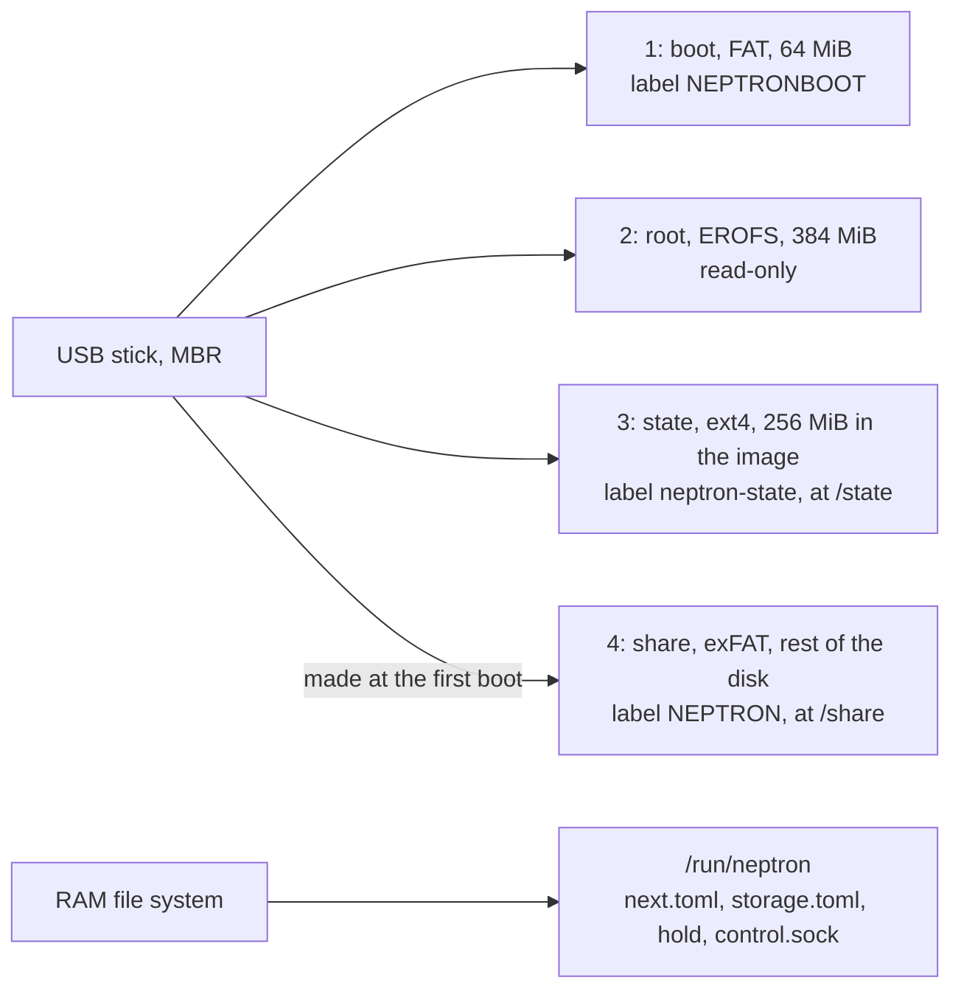
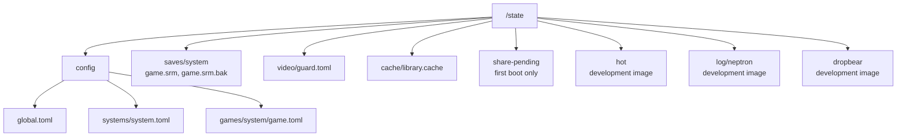
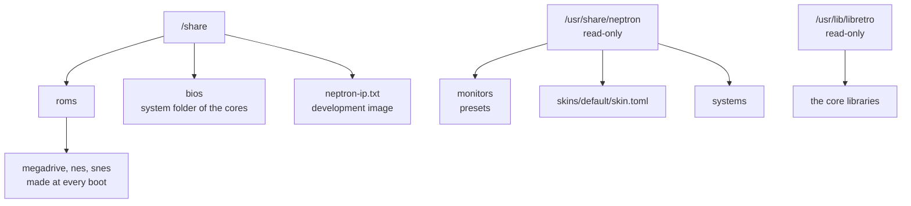
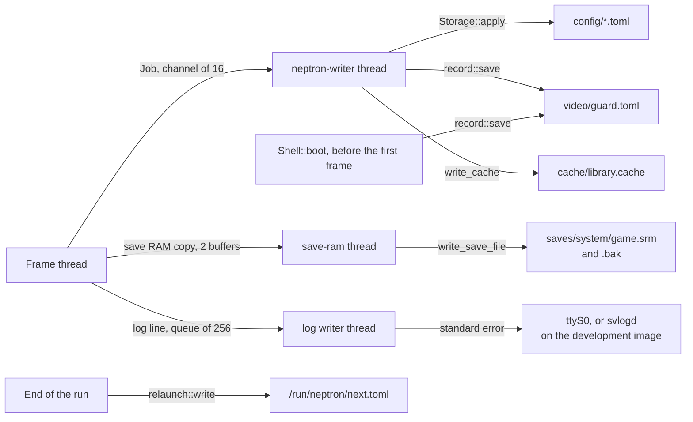

# 8. Settings and files on disk

This page says where NEPTRON keeps each file, who writes it, when, and how. It covers the four partitions of the PC stick, the RAM folders, the settings files and their three levels, the guard record, the relaunch file, the save RAM with its `.bak`, the library cache, and the log and the hot folder of the development image. How the partitions are mounted at boot, and when the first boot makes the share partition, is in [Power-on to first picture](01-power-on.md). How the menus change a setting, and the keep prompt, is in [The screens](07-screens.md).

## Diagrams

### The stick and the RAM folders

### The state partition

### The share partition and the image data

### Who writes what

No file write runs on the frame thread. Each write goes to a thread of its own over a bounded channel.

## States and screens

### Every file

| Path | What it holds | Written by | Write rule | Lost when deleted |
| --- | --- | --- | --- | --- |
| `/state/config/global.toml` | Settings at the global level | The writer thread, on a menu change | `Storage::apply`: read the file again, edit in place, temp file, fsync, rename, fsync of the folder | The settings go back to the built-in defaults |
| `/state/config/systems/<system>.toml` | Settings for one system | As above | As above | The system inherits the global values |
| `/state/config/games/<system>/<game>.toml` | Settings for one game. `<game>` is the ROM file name with no extension | As above | As above | The game inherits the system values |
| `/state/video/guard.toml` | The guard record: `version`, `failed_boots`, `safe_mode`, `last_known_good` (`kind` = `profile` or `edid`, `id`), `output`, `monitor` (the identity of the monitor of the confirmation: `edid-` and the FNV-1a 64 hash of its EDID in hex, or `none`) | `Shell::boot` before the first modeset; later the writer thread | `atomic::write`: temp file, fsync, rename, fsync of the folder | No last known good, no failed boots: the next boot opens the boot prompt (see [the guard](03-guard.md)) |
| `/state/saves/<system>/<game>.srm` | The save RAM of a game. `<system>` is the `folder` of the system file. `<game>` is the ROM file name with no extension (for a zip, the archive name), as RetroArch names it | The `save-ram` thread | `write_save_file`: write `.srm.tmp` and sync, copy the old `.srm` to `.srm.bak.tmp`, sync, rename to `.srm.bak`, rename `.srm.tmp` to `.srm`, sync the folder | The game's save is gone; the `.bak` holds the one before the last write |
| `/state/saves/<system>/<game>.srm.bak` | The save RAM before the last write | As above | As above | Only the backup |
| `/state/cache/library.cache` | The game index: games with their size, and the time of each folder the scan read (format version 2) | The writer thread, after a scan | Temp file, sync, rename, sync of the folder. At most `MAX_CACHE_BYTES` = 16 MiB | Nothing: the list is empty until the scan ends, then the scan fills it, and the next refresh reads every folder |
| `/state/share-pending` | The first-boot marker: `partition 4 made at <date>` | `S06neptron-storage` | `echo` and `sync` | Partition 4 is not formatted while it is empty. See [Power-on](01-power-on.md) |
| `/run/neptron/storage.toml` | What `S06neptron-storage` mounted at `/state` and `/share`: `state`, `share` (`partition` or `ram`), `state_reason`, `share_reason` | `S06neptron-storage` at boot | A plain write before the frontend starts | RAM only. No file: no notice |
| `/run/neptron/library-scanned` | An empty marker: a scan of every folder reached the library cache in this power cycle, so a return to the list may trust the folder times of the cache | The writer thread, after the cache write of a full scan | A plain write | RAM only. No file: the next return to the list reads every folder |
| `/run/neptron/next.toml` | The relaunch file: `version` = 1, the game (`system`, `path`) or none, a `notice` | The frontend at the end of a run, before exit 75 | `atomic::write` | RAM only. A start with no file is a new boot |
| `/run/neptron/hold` | Present: the launch script does not start the launcher | The `stop` script, the bench tools | `touch` | RAM only |
| `/run/neptron/control.sock` | The control socket (`DEFAULT_SOCKET_PATH`) | The frontend | | See [Control and bench](09-control-and-bench.md) |
| `/share/roms/<system>/` | The ROMs. The image makes `megadrive`, `nes` and `snes` | The user; `S06neptron-storage` makes the folders | NEPTRON never writes or deletes a ROM | |
| `/share/bios/` | BIOS files. The cores get it as their system folder | The user | Never written by NEPTRON | |
| `/usr/share/neptron/` | Monitor presets, the skin, the system definitions | The image | Read-only | |
| `/state/hot/` | Development image: `bin/neptron`, `bin/neptron-launch`, `bin/neptronctl`, `share/neptron` | `cargo xtask os push` | `.new` files moved in place, then `sync` | The image's own binaries run again |
| `/state/hot/DISABLED` | Development image: present, the hot folder is not used | The user | | |
| `/state/log/neptron/current` | Development image: the output of the launcher and the frontend | `svlogd` | A new file at 4 MiB (`s4194304`), 2 old files kept (`n2`) | Only the log |
| `/state/dropbear/` | Development image: the SSH host keys | Dropbear, at its first start | | A new host key at the next start |
| `/share/neptron-ip.txt` | Development image: the address of `eth0`, or `none` | `S41neptron-address` | `echo`, `sync` | |

### The three settings levels

| Level | File | Keys that the level allows |
| --- | --- | --- |
| Game | `games/<system>/<game>.toml` | `display.style`, `display.refresh_policy`, `display.scanlines`, `display.scanline_strength` |
| System | `systems/<system>.toml` | The same four keys |
| Global | `global.toml` | Every key: also `display.output`, `display.monitor`, `input.menu_hold_start_seconds` |

A value resolves in this order: game, then system, then global, then the built-in default. The built-in defaults are `display.output` = `auto`, `display.monitor` = `auto`, `display.style` = `auto`, `display.refresh_policy` = `exact`, `input.menu_hold_start_seconds` = 0, `display.scanlines` = `auto`, `display.scanline_strength` = 75. The key `display.style` is the key `style` in the table `[display]`. Each write adds `schema_version` = 1 at the top level. A new file gets mode `NEW_FILE_MODE` = `0o644`.

## Transitions

When each file is read and written.

| File | Read | Written | Constant = value |
| --- | --- | --- | --- |
| `global.toml` | Twice at each start: `kms::run` reads `display.output` and `display.monitor` before the display opens, then `Config::load` reads the whole layer | On a change in the menus, through the writer thread. See [The screens](07-screens.md) for which change writes at once and which waits for the keep prompt | `CHANNEL_JOBS` = 16 |
| `systems/<system>.toml`, `games/<system>/<game>.toml` | At the start of a game run only. The game list run reads the global layer only | As above | |
| `guard.toml` | At each start (`record::load`). A last known good confirmed on another connector or another monitor, or with no `output` or no `monitor` (a file from before that field: one boot prompt after the update), is dropped (`record::for_place`). After a relaunch, one failed boot is given back (`record::for_continued_boot`) | At each start, before the first modeset, when the guard step has a record to save. Later, through the writer thread, each time the guard step has a record to save | `RECORD_VERSION` = 1 |
| `next.toml` | At each start, then removed (`relaunch::take`). A file that does not parse, has another version, or names a game path outside the ROM folder is removed and the start is a new boot | At the end of a run that relaunches: a game launch, the end of a game, a game that did not start | `RELAUNCH_VERSION` = 1, `RELAUNCH_EXIT_CODE` = 75 |
| `<game>.srm` | At game launch, before the first frame. A file longer than the core's save RAM loads only the first part; the rest (the tail) is kept and written after the save RAM at each write | When the save RAM changed: every 30 s while the game runs, when the quick menu opens, and when the game ends (also on SIGTERM) | `SAVE_RAM_FLUSH_INTERVAL_NS` = 30 s, `MAX_SAVE_RAM_BYTES` = 16 MiB |
| `library.cache` | At each start (`Library::load`). A return to the list compares its folder times with the folders (`refresh`) | After a scan of `/share/roms`: at each start of the game list, and after `Rescan games` | `MAX_CACHE_BYTES` = 16 MiB, `CACHE_VERSION` = 2 |
| `/state/hot/*` | By the development launch script, at each launcher start | By `cargo xtask os push` | |

Hand edits: the files are plain TOML. A hand edit takes effect at the next start of the frontend. Each launch of a game and each return to the list is a new start. `Storage::apply` reads the file again before it writes, so a menu change to one key keeps a hand edit to another.

## What can go wrong

| Case | What the user sees | Way out |
| --- | --- | --- |
| A settings file does not parse, is not UTF-8 or cannot be read | A warning notice with the file and the error. The file reads as empty, so the level below applies. `Storage::apply` refuses to write the file, so the user's text stays | Fix the file by hand |
| An unknown key, a wrong type or a value out of range | A warning notice per issue, as `<path>: <issue>`. An unknown key is kept in the file. A bad value is skipped and the level below applies | Fix the key by hand |
| The guard record cannot be read or does not parse | Warning: `<error>; the guard starts with no last known good` | None needed. The next save writes a good file |
| The guard record has another version | Warning: `the guard record has version <n>; this build reads version 1; the guard starts with no last known good` | None needed |
| The guard record cannot be written at boot (full or read-only state) | `Safe mode: the guard record cannot be written (<error>). This start uses the safe picture.` | Free space on the state partition, or repair it |
| A later write fails (settings, record, cache) | An error notice with the writer's text, for example `cannot write the guard record: <error>` or `cannot write the library cache: <error>`. At most `FAILURE_MESSAGES` = 16 wait; more are dropped | Free space on the state partition |
| The writer thread stops | Error notice: `the writer thread stopped; changes are not saved` | Restart the machine |
| The save folder cannot be made | The game does not start. The list shows `<game> did not start: cannot make the save folder <path>: <error>.` | Free space, or repair the state partition |
| The save file cannot be read, or is over 16 MiB | The game does not start: `<game> did not start: cannot read the save file: <error>.` The core never writes over a save it did not load | Move the file away on a PC or over SSH |
| A save RAM write fails during play | When the last flush at the end of the game also fails, the list shows `The game was not saved: <error>.` On a stop by SIGTERM, the log gets `neptron: The game was not saved: <error>.` A failure that a later write repaired gives no notice. | Free space; the `.bak` holds the save before the last write |
| A power cut during play | The save RAM since the last flush is lost, at most 30 s of play. The `.srm` holds the old or the new content, never a broken one. `next.toml` is gone, so the next start is a new boot | None needed |
| The library cache is damaged or of a newer version | Warning: `library cache: <error>`. The list fills when the scan ends | None needed |
| The library cache is of an older version (the first start after an update) | No notice. The list fills when the scan ends | None needed |
| Games copied to the share while the list is on screen | The list does not change by itself (no file watch) | `Settings > Library`, `Rescan games`; or play a game and return: the return checks the folders |
| The games folder is gone or cannot be read at a scan | Warning: `The game scan failed: cannot read the ROM folder <path>: <error>.` The list keeps the games it had | Mount or repair the share, then `Rescan games` |
| A game file that a network copy still writes | The scan lists it with the size it has. A launch reads the part that is there: a zip that is cut does not open and the list shows why; a plain ROM that is cut runs badly or makes the core fail | Wait for the copy to end |
| `/state` is a RAM folder (e2fsck failed, no partition 3) | A Warning notice with the reason, until OK. The guard record in RAM still counts the failed boots of this power cycle, so the guard boots as usual: the boot prompt, then the safe default with nothing kept. Settings, saves, the guard record and the cache work in RAM and are lost at power off | Repair the ext4 partition on a Linux PC |
| `/share` is a RAM folder | A Warning notice with the reason, until OK. The game list is empty | See [Power-on](01-power-on.md), "What can go wrong" |
| A re-flash with `dd` | The state partition is new: settings, saves and the guard record are gone. The share is kept when it starts at the planned place (see [Power-on](01-power-on.md)) | Copy `/state/saves` off before a re-flash (development image: over SSH) |

## Source

- [paths.rs](../../apps/neptron/src/paths.rs): `Paths::image`, `config`, `saves`, `guard_record`, `library_cache`, `relaunch`, `skin`, `monitors`.
- [config.rs](../../apps/neptron/src/config.rs): `Config::load`.
- [kms.rs](../../apps/neptron/src/kms.rs): `run` (the early read of `display.output` and `display.monitor`).
- [record.rs](../../apps/neptron/src/record.rs): `load`, `decode`, `save`, `for_place`, `for_continued_boot`.
- [relaunch.rs](../../apps/neptron/src/relaunch.rs): `write`, `take`, `GameRef::check`.
- [atomic.rs](../../apps/neptron/src/atomic.rs): `write`.
- [outbox.rs](../../apps/neptron/src/outbox.rs): `Outbox::start`, `send`, `flush`, `failure`, `finish`, `write_jobs`, `write_cache`.
- [boot.rs](../../apps/neptron/src/shell/boot.rs): `Shell::boot`, `load_record`, `launch`.
- [logbook.rs](../../apps/neptron/src/logbook.rs): `LogLines::send`, `LogWriter`.
- [storage.rs](../../crates/neptron-settings/src/storage.rs): `Storage::path`, `Storage::load`, `Storage::apply`.
- [keys.txt](../../crates/neptron-settings/tests/fixtures/keys.txt): every key with its levels.
- [save.rs (session)](../../crates/neptron-session/src/save.rs): `SaveRamWriter`, `Flush`.
- [save.rs (libretro)](../../crates/neptron-libretro/src/save.rs): `save_file_path`, `read_save_file`, `write_save_file`.
- [cache.rs](../../crates/neptron-library/src/cache.rs): `write`.
- [launch (development)](../../os/board/pc/dev-overlay/usr/libexec/neptron/launch), [neptron-hot.sh](../../os/board/pc/dev-overlay/etc/profile.d/neptron-hot.sh), [S41neptron-address](../../os/board/pc/dev-overlay/etc/init.d/S41neptron-address), [S49neptron-ssh-keys](../../os/board/pc/dev-overlay/etc/init.d/S49neptron-ssh-keys).
- [S06neptron-storage](../../os/board/common/rootfs-overlay/etc/init.d/S06neptron-storage), [genimage.cfg](../../os/board/pc/genimage.cfg), [post-image.sh](../../os/board/pc/post-image.sh).

## Differences from docs/definition

1. `10-os-layer.md`, "Configuration": `config/` also holds `input/<controller>.toml`, `monitors/custom.toml` and `reference.toml`. Code: only `global.toml`, `systems/<system>.toml` and `games/<system>/<game>.toml`.
2. `10-os-layer.md`, "How it behaves": core options are keys under `[core.<name>]` in the three levels. Code: the schema has seven keys and no core keys. Core options come from `data/cores` in the image.
3. `10-os-layer.md`, "How it behaves": a hand edit takes effect at start and on "Reload settings" or `neptronctl settings reload`. Code: there is no reload. A hand edit takes effect at the next start of the frontend, which is also each game launch and each return to the list.
4. `10-os-layer.md`, "How it behaves": `neptron.toml` is copied into `global.toml` when it changed. Code: no code reads `neptron.toml`.
5. `10-os-layer.md`, "Folder layout": `state/states/<system>/` holds save states. Code: there are no save states.
6. `10-os-layer.md`, "Folder layout": `share/skins/<name>/` and `share/screenshots/`. Code: the skin comes from the image (`/usr/share/neptron/skins/default/skin.toml`); the share has `roms/` and `bios/` only.
7. `10-os-layer.md`, "Configuration" table: the last known good video lives in an internal part of the state partition, not shared. Code: it is `/state/video/guard.toml`. No part of the state partition is shared, because the image has no network share.
8. `10-os-layer.md`, "Folder layout": `state/saves/<system>/<game>.srm`. Code: the same name, plus `<game>.srm.bak` from each write, and the cache `state/cache/library.cache`, which the definition does not list.
9. `10-os-layer.md`, "Folder layout": `gamelist.xml` in a ROM folder is imported. Code: no code reads it.
10. `12-technology-choices.md`, "Logging": no constant writes to the card. Code: the development image writes the log to `/state/log/neptron` on the state partition, at most three files of 4 MiB.
