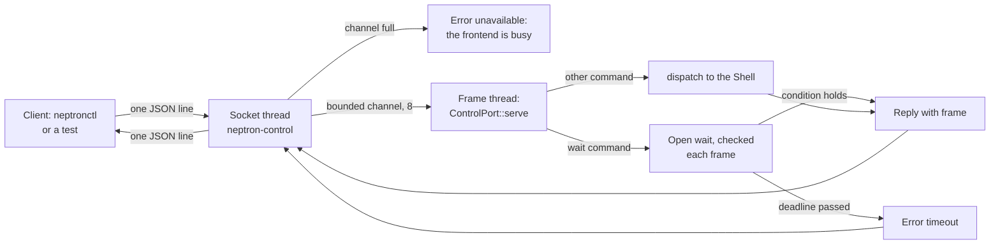
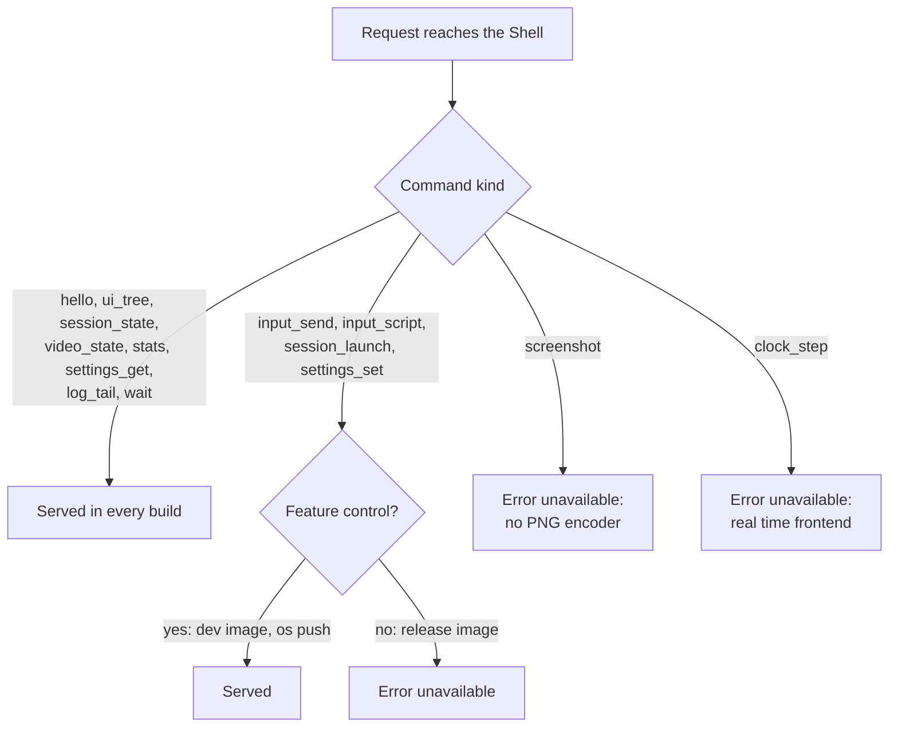
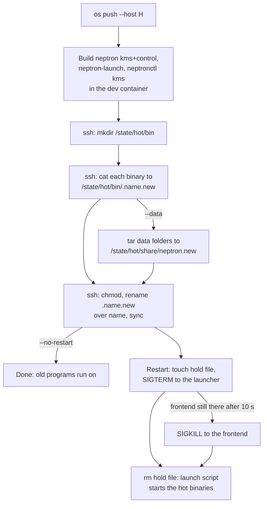
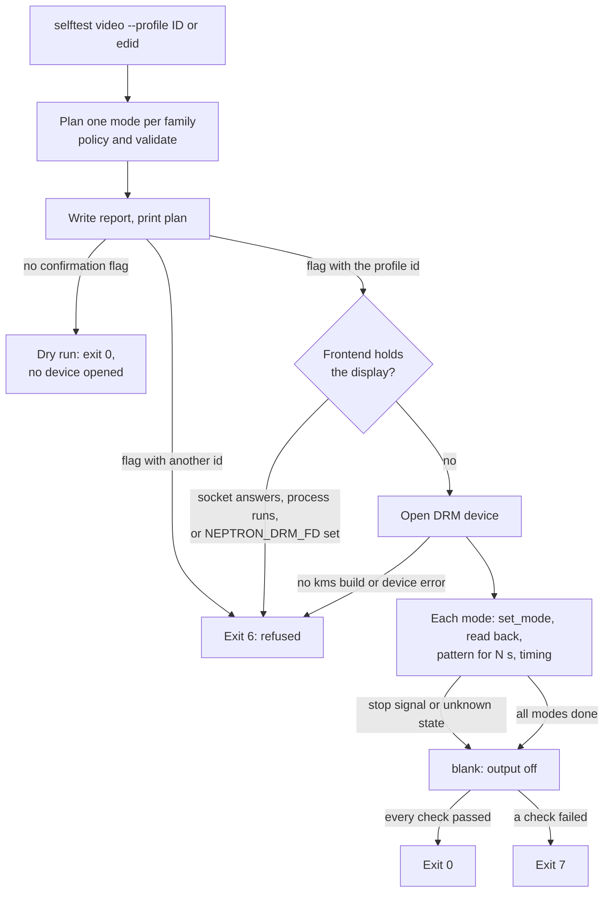

# 9. The control protocol and the bench tools

This page is for the person who tests NEPTRON on a bench. The frontend serves a control protocol on a Unix socket: JSON lines that read the UI, the session, the video state, the counters, the settings and the log. A development build adds the commands that change the frontend (input, launch, settings writes). On the host side, `cargo xtask os push`, `os logs` and `os ssh` put new binaries on a PC that runs the development image and read its log. `neptronctl selftest video` shows test modes on a monitor with the frontend stopped. The player never needs any of this.

## Diagrams

### A request through the control socket

The socket thread never touches the frontend. The frame thread answers between two frames and never waits on the socket.

### Which commands a build serves

### `cargo xtask os push`

### `neptronctl selftest video`

## States and screens

The bench tools have no screen of their own on the frontend. What shows on the monitor:

| Situation | What the user sees |
| --- | --- |
| A control command that reads | Nothing changes on screen. |
| `input_send`, `input_script` | The frontend reacts as to a gamepad on that port: menus move, a game gets the button. |
| `session_launch` | The game list run ends with a relaunch into the game, as from the menu. |
| `settings_set` of a display setting | The same as a menu change: the new picture and the keep prompt (see [the guard](03-guard.md)). |
| `os push` with restart | The picture goes away while the frontend stops, then the new frontend boots (a new boot, see [Frontend boot](02-frontend-boot.md)). |
| `selftest video`, dry run | Nothing on the monitor. |
| `selftest video` on a display | Each mode for `--seconds-per-mode` (default 10 s): a white border on the outermost pixels, a centre cross, eight colour bars at 75 %, four text lines (family, size and scan, line and field rates, pixel clock). At the end the output goes off. |

## Commands

### Control protocol (`apps/neptron`)

The socket is `--control-socket PATH`, else `$NEPTRON_CONTROL_SOCKET`, else `DEFAULT_SOCKET_PATH` = `/run/neptron/control.sock`. `--no-control` turns it off. The socket file gets mode 0600. The release image starts the frontend with no socket option, so the socket is there on the release image too, with the read commands only.

| Command | What it does in the frontend | Dev build only | Source |
| --- | --- | --- | --- |
| `hello` | Protocol version and server name (`neptron <version>`). | No | `neptron-ipc` `dispatch` |
| `ui_tree` | The screen id, the focused row and every row: label, value, setting key, level of the value, clipped flag, bounds. | No | `Handler::ui_tree` in `control.rs` |
| `session_state` | `idle` (game list), `running` or `quick_menu`, with core id, ROM path and frame counter. | No | `Shell::session_status` |
| `video_state` | The read-back mode, line and field rates in mHz, the active monitor profile id, the modeset count of the trace. `verdicts` is always empty. Error `unavailable` "the game has ended" after the game ended in this run. | No | `Handler::video_state` |
| `stats` | In a game: `frames_presented` = completed flips, `frames_repeated` = frames with no new picture, `frames_dropped` = frames with no completed flip, `audio_queued_frames` from the sink. `audio_underruns` and `input_to_frame_ns` are always 0. In the game list every field is 0. | No | `Shell::stats_now` |
| `settings_get` | The resolved value and its level, or the value of one level, or the default. Unknown key: `invalid_arguments`. | No | `Handler::settings_get` |
| `log_tail` | The last lines of the protocol log of the run, at most `LOG_LINES` = 64 kept. | No | `Shell::log_lines` |
| `wait` | Waits on the frame thread until the screen id, the session state or the frame number is reached. At most `WAITS_MAX` = 8 open waits; `timeout_ms` is cut to `WAIT_TIMEOUT_MAX_MS` = 60 000 ms. | No | `ControlPort::add_wait`, `Shell::holds` |
| `input_send` | Queues one event (port, control, value) for the next frame. Port N is input device N. | Yes | `Shell::queue_input` |
| `input_script` | Queues a list of events, each at the next frame plus its `frame`. | Yes | `Shell::queue_input` |
| `session_launch` | Launches a ROM of the library from the game list. Refused while a game runs ("a game runs; quit it first"), for a path outside a system folder, for a core that is not the system's core, and for a ROM not in the game list. | Yes | `Shell::launch_path` |
| `settings_set` | Sets a value at the game, system or global level, as a menu does. Display settings go through the guard. `display.output` is refused. The `default` level is refused ("the default level is not written"). | Yes | `Shell::set_from_protocol` |
| `screenshot` | Always `unavailable`: "this build has no PNG encoder; see the open points of the README". | (none) | `Handler::screenshot` |
| `clock_step` | Always `unavailable`: "clock_step steps simulated time; this frontend runs in real time". | (none) | `ControlPort::serve` |

Without the `control` feature, a dev-only command gets `unavailable` with "this server does not serve ..." from `neptron-ipc`.

Limits of the server, each a named constant in `control.rs`:

| Constant | Value | Meaning |
| --- | --- | --- |
| `REQUESTS` | 8 | Commands the channel to the frame thread holds. More gives "the frontend is busy". |
| `ANSWER_WAIT` | 30 s | How long the socket thread waits for the frame thread (plus the wait time for `wait`). Then `timeout` "the frontend did not answer in time". |
| `STREAM_TIMEOUT` | 2 s | Read and write timeout of a connection. An idle client is closed. |
| `ACCEPT_POLL` | 50 ms | How often the socket thread looks for a client and for the stop. |

At the end of a run, every open wait and queued command gets `unavailable` "the run has ended".

### `neptronctl` client

`neptronctl` sends one request and prints the `data` of the reply as one JSON line. It waits `DEFAULT_TIMEOUT_MS` = 10 000 ms for a reply, or `--timeout-ms`. A `wait` waits `DEFAULT_WAIT_MS` = 10 000 ms, or `--within-ms`, plus `WAIT_MARGIN_MS` = 5 000 ms for the server's answer. Exit codes: 0 success, 1 server error, 2 usage, 3 cannot connect, 4 no reply or bad reply, 5 local file, 6 self-test cannot start, 7 self-test check failed.

### `neptronctl selftest video`

| Command | What it does | Dev build only | Source |
| --- | --- | --- | --- |
| `selftest video --profile ID` or `--profile edid` | Dry run: plans one mode per family that the profile supports (policy, then `validate`), prints the plan, writes the report. Opens no device. | No. On the device it needs the `kms` feature; the PC and QEMU images install `neptronctl` with it. | `selftest::video` |
| the same with `--i-have-checked-the-monitor ID` | Shows each planned mode on the DRM device for `--seconds-per-mode` seconds, measures the vblank timing, blanks the output at the end, and writes the verdict in the report. | No, but it refuses to run while the frontend holds the display. | `selftest::on_device`, `show.rs`, `verdict.rs` |

Rules and limits:

- The families, in order: `240p`, `288p`, `240p_double_refresh`, `480i`, `576i`, `480p`, `2x`, `super_width_dynamic`, `super_width_fixed` (`FAMILIES`). A family with no matching winner is not tested. A family whose mode equals an earlier one is "the same mode as" that family.
- The confirmation `ID` must equal the profile id the dry run prints. Another id exits with 6.
- Refused while the frontend runs: the control socket accepts a connection, a process named `neptron` or `neptron-launch` runs (`FRONTEND_PROCESSES`), or `NEPTRON_DRM_FD` is set.
- `--seconds-per-mode` from `SECONDS_PER_MODE_MIN_S` = 1 to `SECONDS_PER_MODE_MAX_S` = 10, default 10.
- A mode passes when both commits passed, the read back equals the request and is valid, the pattern showed the whole time, at least `FLIPS_MIN` = 2 flips completed, the vblank period is within `VBLANK_PERIOD_TOLERANCE_PPM` = 10 000 ppm of the mode, and no display error came. A failed flip wait is tried `FLIP_WAIT_RETRIES` = 2 more times.
- SIGINT, SIGTERM and SIGHUP stop the run before the next flip; the output goes off.
- The report (`--report`, default `neptron-selftest-video.json`) is written before the device opens, as temp file, fsync, rename. `REPORT_VERSION` = 2.

### Bench commands on the host (`xtask`)

All three need `--host H`. `--user` defaults to `root`, `--port` to 22. Only the x86_64 PC image is supported. Every connection uses key or agent only (`BatchMode=yes`, `PasswordAuthentication=no`) and a known-hosts file of its own in the xtask cache (`bench_known_hosts`).

| Command | What it does | Dev build only | Source |
| --- | --- | --- | --- |
| `cargo xtask os push --host H` | Builds `neptron` (features `kms,control`), `neptron-launch` and `neptronctl` (`kms`) in the bench profile in the development container. Sends each to `/state/hot/bin/.<name>.new` over SSH (`cat >`, because Dropbear has no SFTP), renames it over the old file, then restarts the launcher and the frontend. | Yes: the PC needs the development image (SSH, hot folder). | `bench::run`, `push`, `install_script`, `RESTART_SCRIPT` |
| `... --data` | Also replaces `/state/hot/share/neptron` with `monitors`, `cores`, `systems`, `skins` and `hardware` from `data/` (`DATA_DIRS`). | Yes | `send_data`, `prepare_script` |
| `... --no-restart` | Copies and installs, but leaves the running programs alone. | Yes | `push` |
| `cargo xtask os logs --host H` | Prints the last 400 lines of `/state/log/neptron/current`, the last 100 lines of `dmesg`, and the hot folder. | Yes: the log file is only on the development image. | `logs_script` |
| `... --follow` | `tail -n 200 -f` of the log. | Yes | `logs_script` |
| `cargo xtask os ssh --host H -- command...` | Runs one command on the PC, with each word quoted. | Yes | `bench::run` |

The restart (`RESTART_SCRIPT`): it makes `/run/neptron/hold` (the launch script waits while it exists), sends SIGTERM to `neptron-launch`, which forwards it to the frontend, and waits up to 10 s (100 times 100 ms) for the launcher to end. If the frontend is still there it prints "fallback: the frontend did not end on SIGTERM in 10 s; SIGKILL" and kills it. Then it removes the hold file and prints "the launcher and the frontend start again".

### The development image

`cargo xtask os build --arch x86_64 --dev-key FILE` merges `os/configs/neptron_pc_x86_64_dev.fragment`: Dropbear SSH with one public key, DHCP on `eth0`, `BR2_PACKAGE_NEPTRON_CONTROL=y` (the `control` feature) and the overlay `os/board/pc/dev-overlay`. Its launch script takes `bin/neptron-launch`, `bin/neptron` and `share/neptron` from `/state/hot` when they exist, unless `/state/hot/DISABLED` exists. It pipes the output to `svlogd` in `/state/log/neptron`, which rotates at 4 MiB and keeps two old files. The release image has none of this: its launch script runs `/usr/bin/neptron-launch --power -- /usr/bin/neptron --backend kms`. Both launch scripts pass `--power`, so a launcher pushed to `/state/hot` must know the flag: push it with the frontend.

## What can go wrong

| Case | What the user sees | Way out |
| --- | --- | --- |
| Command needs `control`, release build | `{"error":{"code":"unavailable",...}}`, exit 1. | Use the development image or `os push`. |
| Frame thread busy (8 commands queued) | `unavailable` "the frontend is busy". | Send again. |
| Frontend hangs | `timeout` "the frontend did not answer in time" after 30 s. | `os logs`, then `os push` or a power cycle. |
| No frontend running | `neptronctl` exits 3 (`connect`). | Start it, or check the socket path. |
| `session_launch` in a game | `invalid_arguments` "a game runs; quit it first". | Quit the game first. |
| `settings_set display.output` | `invalid_arguments`: it changes at the next start, in the settings file. | Edit the settings file and restart. |
| `os push`, frontend ignores SIGTERM | The line "fallback: the frontend did not end on SIGTERM in 10 s; SIGKILL". | None needed: the new binaries start. |
| `os push`, launcher does not stop | "the launcher did not stop", exit 1. | `os ssh` to look, or power cycle. |
| `/state/hot/DISABLED` exists | `os push` prints "note: /state/hot/DISABLED exists, so the image runs its own binaries". | Remove the file to run the pushed binaries. |
| Bad pushed binary crashes | The launcher backoff and its relaunch limit apply (see [Power-on](01-power-on.md)). | Create `/state/hot/DISABLED` over `os ssh` and restart, or push a fixed build. |
| `selftest video` while the frontend runs | Exit 6, `selftest_setup`. Nothing shown. | Stop the launcher and the frontend first. |
| `selftest video` mode fails | Exit 7. The report names each failed check. | Read the report. See `docs/hardware-checklist.md`. |
| `selftest video` killed with SIGKILL | The last validated test mode can stay on the wire with no picture. | Start the frontend again. |

## Source

- [control.rs](../../apps/neptron/src/control.rs): `ControlServer::start`, `ControlServer::stop`, `ControlPort::serve`, `add_wait`, `close`, `Shell::holds`, `Shell::session_status`, the `Handler` impl, `Forward::call`, `accept_loop`, `REQUESTS`, `ANSWER_WAIT`, `STREAM_TIMEOUT`, `WAITS_MAX`, `WAIT_TIMEOUT_MAX_MS`.
- [shell/protocol.rs](../../apps/neptron/src/shell/protocol.rs): `game_reference`, `setting_key_of`, `stats_now`, `log_lines`, `queue_input`, `launch_path`, `set_from_protocol`.
- [main.rs](../../apps/neptron/src/main.rs): `run_booted` (starts and stops the socket).
- [options.rs](../../apps/neptron/src/options.rs): `parse` (`--control-socket`, `--no-control`).
- [apps/neptron/Cargo.toml](../../apps/neptron/Cargo.toml): the `control` feature.
- [neptron-ipc](../../crates/neptron-ipc/README.md): the wire format, `DEFAULT_SOCKET_PATH`, `SOCKET_PATH_ENV`, `Handler`, `dispatch`.
- [neptronctl run.rs](../../apps/neptronctl/src/run.rs) and [args.rs](../../apps/neptronctl/src/args.rs): exit codes, `DEFAULT_TIMEOUT_MS`, `WAIT_MARGIN_MS`, `DEFAULT_WAIT_MS`.
- [selftest.rs](../../apps/neptronctl/src/selftest.rs): `video`, `on_device`; [preflight.rs](../../apps/neptronctl/src/selftest/preflight.rs), [show.rs](../../apps/neptronctl/src/selftest/show.rs), [verdict.rs](../../apps/neptronctl/src/selftest/verdict.rs), [family.rs](../../apps/neptronctl/src/selftest/family.rs), [args.rs](../../apps/neptronctl/src/selftest/args.rs).
- [xtask os/bench.rs](../../xtask/src/os/bench.rs): `Bench::parse`, `run`, `push`, `send_data`, `prepare_script`, `install_script`, `RESTART_SCRIPT`, `logs_script`, `ssh_options`, `PUSHED`, `DATA_DIRS`.
- [dev launch script](../../os/board/pc/dev-overlay/usr/libexec/neptron/launch), [release launch script](../../os/board/common/rootfs-overlay/usr/libexec/neptron/launch), [dev fragment](../../os/configs/neptron_pc_x86_64_dev.fragment), [neptron.mk](../../os/package/neptron/neptron.mk).

## Differences from docs/definition

- `docs/definition/10-os-layer.md`, "When a hand edit takes effect": names "Reload settings" in the menu and `neptronctl settings reload`. Neither exists. `neptronctl` has `settings get` and `settings set` only; a hand edit takes effect at the next start.
- `docs/definition/11-monorepo-layout.md`, crate list: `neptronctl` "CLI: print a modeline, test a mode, self-test, diagnostics". There is no command to print a modeline or to test one mode. The only video command is `selftest video`. The first line of `apps/neptronctl/README.md` says the same and has the same gap.
- `docs/definition/15-decisions-and-open-points.md`, "Per-board performance list": names `neptronctl bench`. No such command exists.
- `docs/definition/03-system-architecture.md`, first paragraph: the control socket is "the single entry point for tools such as `neptronctl`". `neptronctl selftest video` does not use the socket for its work: it opens the DRM device itself and only uses the socket to check that the frontend is not running.
- `crates/neptron-ipc/README.md`, "Commands": a session `state` can be `idle`, `loading`, `running`, `paused`, `quick_menu` or `exiting`. The app reports only `idle`, `running` and `quick_menu`. A run ends in the frame that ends its game, and the protocol is served only between frames, so no reply can see the session close: the app never reports `exiting`. The `stats` fields `audio_underruns` and `input_to_frame_ns` are always 0, `video_state.verdicts` is always empty, and `screenshot` and `clock_step` are always `unavailable` in the app.
