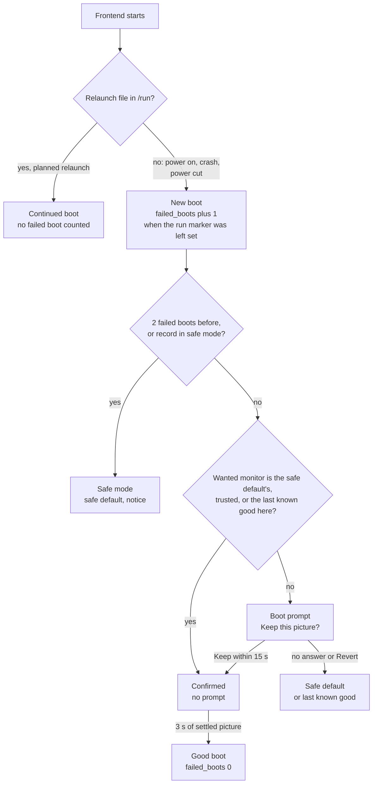
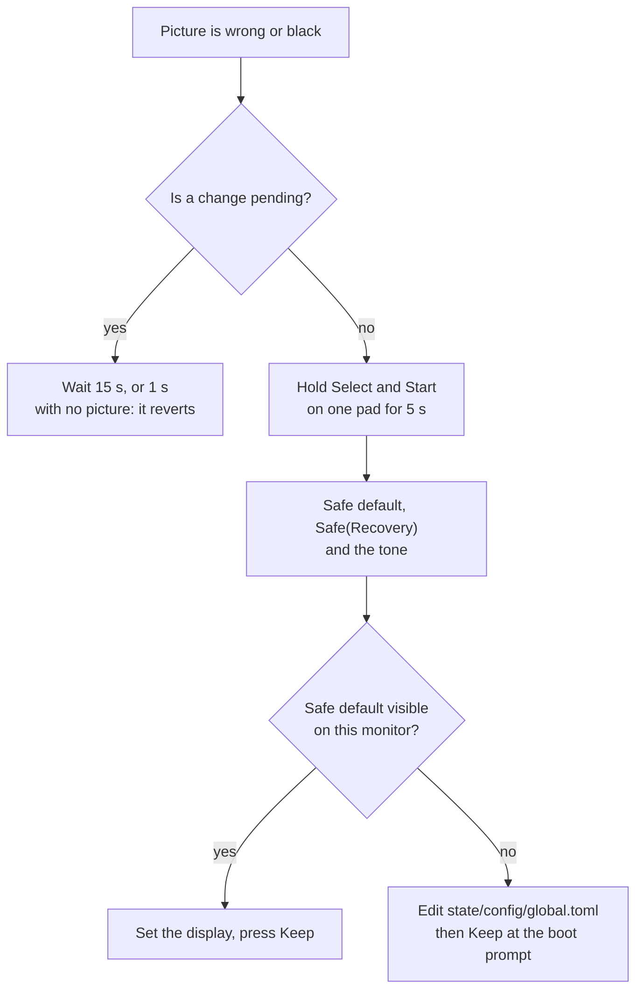

# 10. What happens when

For each real situation, this page says what the user sees and how the user gets out: the exact outcome, the texts of the code, and the constants. A link in each row points to the full detail.

## Diagrams

### Which picture comes first at a start

### Ways out of a bad picture

## Situations

Constants used on this page:

- `CONFIRM_WINDOW_NS` = 15 s: the time to press Keep, from the first settled frame of the change.
- `NO_PICTURE_LIMIT_NS` = 1 s: a pending change with no valid picture for this long reverts. A confirmed picture with none for this long goes to safe mode.
- `PENDING_LIMIT_NS` = 30 s: a chain of changes reverts at most this long after the first one.
- `GOOD_BOOT_PICTURE_NS` = 3 s of settled picture, confirmed or safe, makes a good run. Failed boots (runs that ended abnormally before it) before safe mode: `SAFE_MODE_FAILED_BOOTS` = 2.
- `BLIND_RECOVERY_HOLD_NS` = 5 s. The tone: `CUE_MS` = 200 ms at `CUE_HZ` = 880 Hz.
- `SAVE_RAM_FLUSH_INTERVAL_NS` = 30 s.
- Launcher: `BACKOFF_FIRST_NS` = 250 ms, `BACKOFF_MAX_NS` = 8 s, `STABLE_RUN_NS` = 30 s, `RELAUNCHES_MAX` = 10 in `RELAUNCH_WINDOW_NS` = 10 s. Relaunch exit code `RELAUNCH_EXIT_CODE` = 75. No-display exit code `NO_DISPLAY_EXIT_CODE` = 69, restart after `NO_DISPLAY_WAIT_NS` = 1 s.
- ODREN: `DEBOUNCE_FRAMES` = 3, `FLIPLESS_FRAMES_LIMIT` = 10 frames, `FLIP_WAIT_LIMIT_MS` = 500 ms, `MODESET_ATTEMPTS` = 3.
- Policy: `REFRESH_MATCH_MHZ` = 5 mHz, `OVERSCAN_CROP_MAX_LINES_PER_EDGE` = 8.

"The boot prompt" and "the confirm dialog" below are the dialog "Keep this picture?" with the focus on `Revert`: Right, then Accept keeps. A key held when the dialog opens is ignored until its release. [The screens](07-screens.md) has its texts.

| Situation | What happens | What the user sees | Way out | Detail |
| --- | --- | --- | --- | --- |
| First boot on a CRT with EDID | `display.monitor` = `auto` gives the EDID range profile. This profile is also the safe default, so the guard opens no prompt (ADR 0013). | The menus in the EDID mode. No dialog, no notice. | None needed. | [02](02-frontend-boot.md), [03](03-guard.md) |
| First boot with no EDID, digital connector or DP with a DAC | `auto` with no EDID gives the `generic_15` preset, the safe default: no prompt. | A 15 kHz picture. A 31 kHz-only monitor shows nothing. | On a 31 kHz monitor, set `display.monitor` to a preset in `state/config/global.toml` on another computer. The next boot opens the boot prompt for it; keep it within 15 s. | [02](02-frontend-boot.md) |
| First boot on a composite TV | The TV output is trusted, and `display.tv` = `auto` gives NTSC, the safe default. No prompt. A standard named in the settings boots with no prompt too. | The menus in NTSC 240p. No dialog, no notice. | None needed. A change of the standard in the menu opens the dialog. | [03](03-guard.md) |
| First boot with no EDID on a VGA connector | `choose` in `neptron-kms` never takes an analog connector with no EDID unless `display.output` names it. The display does not open: after the wait for a display (up to 15 s at the first run of a boot) the frontend exits with code 69. The launcher counts no crash and starts it again every 1 s. | No picture. The launcher starts the frontend again every second. | Set `display.output` = `VGA-1` (the connector name) in `state/config/global.toml`. | [02](02-frontend-boot.md), [01](01-power-on.md) |
| First boot on an HD panel | A digital link to an EDID flat panel with `auto` or `flat` is trusted: `auto` gives the panel's native mode, cut to the GPU caps, with no prompt. The panel is also the safe default of the run. A named preset on it is not trusted: the boot prompt, and `generic_15` as the safe default. | The panel picture. A mode that is too large gives a notice that names both modes. | None needed. | [03](03-guard.md) |
| A monitor or TV standard change that is not confirmed | The change shows at once under the confirm dialog. Nothing is written to the settings file before Keep. A picture mode, refresh rate or TV width on a confirmed monitor applies with no dialog. | The new picture and the countdown. | It reverts by itself: 15 s after its picture settles ("Display change undone: not kept in time."), after 1 s with no picture ("Display change undone: no picture."), or at once on Revert or Back ("Display change undone."). A new setting during the window replaces it with no notice. | [03](03-guard.md), [07](07-screens.md) |
| A wrong preset and a black screen | No change is pending, so nothing reverts by itself. | Black screen, or a picture the monitor cannot sync. | Hold Select and Start on one pad for 5 s, on any screen and also in a game. The safe default comes back with "Safe mode: the picture was reset. Keep a picture in Settings, Display to leave it." The tone plays, also in a game. In a game the hold opens the quick menu at 0.5 s: the game is paused, and the notice shows over the menu. Every later boot starts in `Safe(Recovery)` until a configuration is kept, also the picture on screen ("Keep this picture"); the notice of such a start shows once per power cycle. If the safe default is also invisible (for example `generic_15` on a 31 kHz-only monitor), edit `state/config/global.toml` on another computer. | [03](03-guard.md), [06](06-session.md) |
| The monitor moved to another connector between boots | `record::for_place` reads the entry of this start's connector and monitor; the entry of the old connector stays in the record. A monitor that is not known opens the boot prompt. | The boot prompt, or no prompt for a known monitor. | Keep, or let it revert. | [02](02-frontend-boot.md) |
| A different monitor on the same connector between boots | With `auto` and EDID, the new profile differs from the last known good, so the boot prompt opens. With a preset in `display.monitor` that is the last known good, the record's monitor identity (a hash of the EDID, or `none`) differs, so it is another place with no last known good, and the boot prompt opens too. Two monitors with no EDID look the same. | The boot prompt. | Keep or revert. | [03](03-guard.md) |
| The monitor is unplugged | If no connector qualifies, the frontend waits up to 15 s at the first run of a boot, then exits with code 69, and the launcher starts it again every 1 s with no backoff. | Nothing on any screen. | Plug the monitor in. The next restart picks it up. | [01](01-power-on.md), [02](02-frontend-boot.md) |
| Two failed boots | A run that crashes, hangs or loses power before 3 s of settled picture leaves its run marker set, and the next boot counts it. A clean exit or a good picture clears the marker. After 2 failed boots, the boot starts in `Safe(FailedBoots)`. | The safe default with "Safe mode: the last starts gave no picture. Keep a picture in Settings, Display to leave it.", once per power cycle. | In Settings, Display: "Keep this picture", or "Try my settings again". Or keep a display change. | [03](03-guard.md) |
| A game that changes resolution | A new geometry must hold for `DEBOUNCE_FRAMES` = 3 core frames. Then the policy decides again. If the winner is the mode on the wire, only the scale changes, with no modeset and no mute. Otherwise ODREN sets the new mode. | Until the switch, the new frame shows in the old picture area. During a modeset the sound goes off, the monitor gets a black frame, and the game and the sound come back at the first flip in the new mode. | None needed. | [04](04-odren.md), [05](05-policy.md) |
| A PAL game | On a range that covers 50 Hz (for example `generic_15`, 49.5 to 65 Hz) the game runs exact at its rate. On `pc_31_120` (50 to 65 Hz) a Mega Drive PAL game at 49.701 Hz gets the nearest covered rate: golden line `2x nearest in range 320x480p 31.400kHz 50.000Hz`. On a panel with a 50 Hz mode, that mode wins. | Exact: the Video block says `exact`. Nearest: "[!] speed (49.701 to 50.000 Hz)", because the rates differ by 5 mHz or more. | Set `force_50` or `force_60` if wanted. | [05](05-policy.md) |
| A PAL game on a panel with no 50 Hz mode | The game gets the 60 Hz mode with one core frame per flip, so it runs about 20 % fast. The Video block shows `[!] speed (50.000 to 60.000 Hz)`, because the rates differ by more than the audio rate control absorbs (`PANEL_SPEED_SILENT_PPM`, 0.5 %). A 60.099 Hz game on 60 Hz stays silent. | The game runs fast; the Video block says so. | None in the menus. | [05](05-policy.md) |
| A game the monitor cannot show exactly | The policy tries, in order: the style rungs, an overscan crop of up to 8 lines per edge, padded border modes, and last the fitted rung. If no candidate of the picture mode passes validation, the picture of `auto` shows, and where `auto` has none, the picture of Fill, with the notice "Fill picture: Auto has no picture for this game here.". If none passes, the mode on the wire stays. At launch there is then no mode: after 10 frames with no flip the game ends. | The Video block result, for example `cropped N lines`, `small picture N%` or "[!] filtered". A picture that is not exact gives one Warning notice, at the first picture and after a change of the picture mode or the refresh choice (`docs/spec/video-policy-cases.md`, section 8.9). With no mode at all: "The game stopped: no flip completed for 10 frames; the last error: no mode is set." | Try another picture mode. Pick another monitor profile. | [05](05-policy.md), [04](04-odren.md), [07](07-screens.md) |
| The driver refuses a mode | The old mode stays. The next frame tries the next candidate with no wait. A refused mode stays refused until the monitor changes. A wrong read back is followed by a restore of the last good mode. With no good mode, the output goes off. | A short freeze, or the old picture. With the output off, the game is frozen and the guard acts after 1 s with no picture. | Automatic. | [04](04-odren.md) |
| Power cut during play | Save RAM is flushed only when it changed: every 30 s, when the quick menu opens, and when the game ends. Each write is a temp file, fsync, the old file to `.srm.bak`, then rename. Settings and the guard record are atomic too. The relaunch file is in RAM and is gone. | At the next power on: a new boot to the menus, with at most 30 s of save progress lost. The boot counts as a failed boot unless a good boot reset the count. | None. If the `.srm` is bad, copy `.srm.bak` over it. | [06](06-session.md), [08](08-on-disk.md) |
| The frontend crashes (or a core crashes it) | Cores run in the frontend process. Any exit other than 0, 69, 75, 80 or 81, or a signal, is a crash. The launcher waits 250 ms, doubled for each crash in a row up to 8 s. 30 s of run resets the series. More than 10 relaunches in 10 s also count as crashes. No relaunch file is left, so the next start is a new boot. | A short black gap, then the menus on Home. Save RAM is at most 30 s old. | A game that crashes the frontend twice before a good boot leads to safe mode on the third start. Press Keep on a display setting to leave it. | [01](01-power-on.md), [03](03-guard.md) |
| A game stops in a controlled way | A core error or a display stall ends the session. Save RAM is flushed, and the run relaunches with exit code 75. | The menus with "The game stopped: <error>." If a save write failed: "The game was not saved: <error>." | Start the game again. | [06](06-session.md), [07](07-screens.md) |
| A game does not start | The launch fails before the first frame. The run relaunches to the menus. | "<game> did not start: <error>.", for example "cannot open the core: ...", or "<game> did not start: the system <id> is unknown." | Fix the core or the ROM. | [06](06-session.md) |
| Re-flash of the stick with ROMs on it | The image writes a new, empty state partition: settings, saves and the guard record are lost. The new MBR has no partition 4. At the first boot `S06neptron-storage` scans the free space after the state partition for an old exFAT boot sector. | If the old share starts at the planned sector, partition 4 is made again and mounts with no format: the ROMs are kept. If it starts elsewhere, the console line "neptron-storage: an old exFAT share starts at sector N, not at M; no share partition made, the disk is left untouched" and an empty game list (the share is a RAM folder). | Copy the ROMs off on another computer, then let the first boot make a new share. Back up `state` before a re-flash to keep saves. | [01](01-power-on.md), [08](08-on-disk.md) |
| The state partition is full | Atomic writes fail and the old files stay. | At boot: "Safe mode: the guard record cannot be written (<error>). This start uses the safe picture." In a game: "The game was not saved: <error>." Elsewhere: error notices such as "cannot write the guard record: <error>". | Free space on the state partition. | [08](08-on-disk.md) |
| The state partition is damaged or does not mount | `S06neptron-storage` runs `e2fsck -p`. With exit 4 to 7 it runs `e2fsck -fy` once; when that repairs, `/state` is mounted (`errors=remount-ro`) and a notice asks the player to check the saves and settings. When `-fy` fails, with an exit of 8 or more from `-p` (no repair runs), or with a mount failure, `/state` is a RAM folder, and the script writes so to `/run/neptron/storage.toml`. | A Warning notice with the reason stays until OK, and the log has the line. The guard record in RAM still counts the failed boots of this power cycle, so the guard boots as usual: the boot prompt, then the safe default with nothing kept. Nothing is kept at power off. | Repair the partition on another computer. | [01](01-power-on.md), [08](08-on-disk.md) |
| No sound device | The run uses a silent sink and the game runs with picture and input. | "No sound: the audio device did not open (<error>)." | Connect or fix the sound device, then start again. | [06](06-session.md) |
| No gamepads | Only keyboards work. | "No gamepads: they did not open (<error>)." | Connect a pad, then start again. | [06](06-session.md) |

## Source

- [boot.rs](../../apps/neptron/src/shell/boot.rs): `boot`, `launch`.
- [guard_events.rs](../../apps/neptron/src/shell/guard_events.rs): `reverted_text`, the safe mode texts, `play_cue`.
- [view.rs](../../apps/neptron/src/shell/view.rs): `CONFIRM_TEXT`.
- [overlays.rs](../../crates/neptron-ui/src/screens/overlays.rs): the confirm dialog title and countdown.
- [connector.rs](../../crates/neptron-kms/src/connector.rs): `choose`.
- [machine.rs](../../crates/neptron-video/src/guard/machine.rs): the guard.
- [kms.rs](../../apps/neptron/src/kms.rs) and [window.rs](../../apps/neptron/src/window.rs): the sound and gamepad notices.
- [S06neptron-storage](../../os/board/common/rootfs-overlay/etc/init.d/S06neptron-storage): the storage rules.

## Differences from docs/definition

The other pages list the differences in full. The ones that change the answer on this page:

1. `05-crt-safety-model.md`, "First boot when the display is unknown": no blind probe exists. `neptron.toml` is imported into `global.toml` when it changed, before the backend reads a setting. With no EDID, `auto` gives `generic_15`, and a VGA connector with no EDID is not used at all unless `display.output` names it.
2. `05-crt-safety-model.md`, layer 6: the recovery tone plays in the game list and in a game. The quick menu opens after 0.5 s of Select and Start, so in a game the recovery hold opens it first.
3. `05-crt-safety-model.md`, layer 7, and `14-risks-and-open-questions.md`: a crash does not re-apply the last validated mode. The new frontend decides again from its first frame, and the start counts as a new boot.
4. `06-flat-panels-shaders-and-vertical-games.md`: a vertical game is not turned upright on a horizontal screen. The policy plans for the turned source, and on a 15 kHz CRT or a TV its interlaced picture gets a one-time notice. A screen turned on its side (TATE) is not supported.
