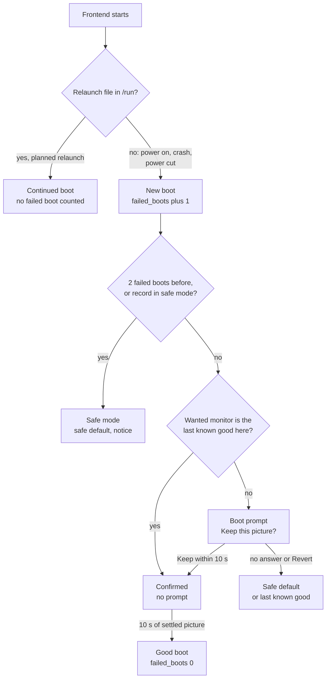
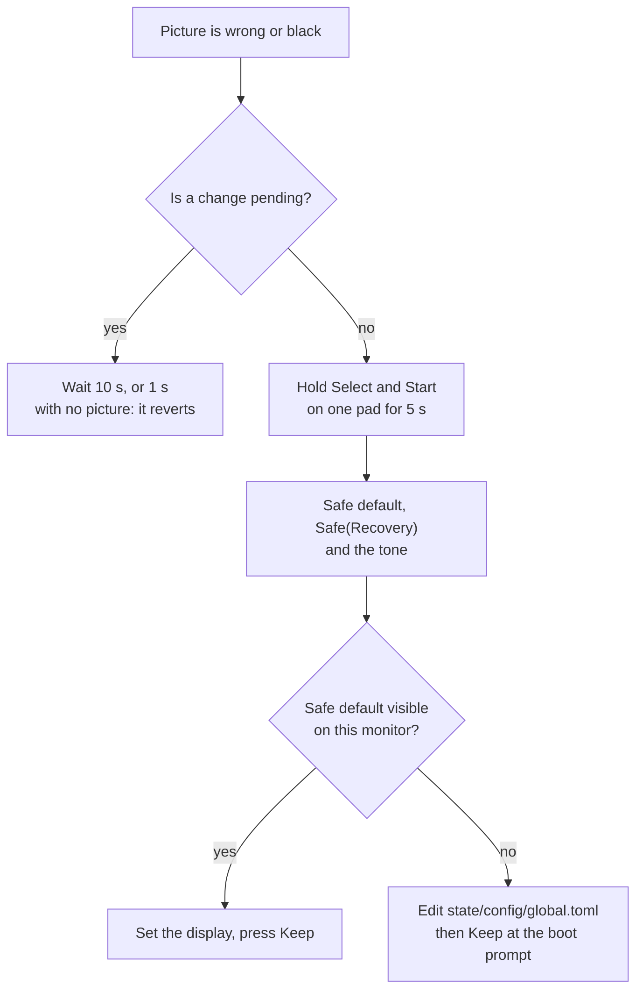

# 10. What happens when

This page answers one question for each real situation: what does the user see, and how does the user get out. Each row gives the exact outcome, the texts as the code has them, and the constants. The other flow pages give the full detail. A link in each row points to it.

## Diagrams

### Which picture comes first at a start

### Ways out of a bad picture

## Situations

Constants used on this page:

- `CONFIRM_WINDOW_NS` = 10 s: the time to press Keep.
- `NO_PICTURE_LIMIT_NS` = 1 s: a pending change with no valid picture for this long reverts. A confirmed picture with none for this long goes to safe mode.
- `PENDING_LIMIT_NS` = 30 s: a chain of changes reverts at most this long after the first one.
- `GOOD_BOOT_PICTURE_NS` = 10 s of steady confirmed picture makes a good boot. Failed boots before safe mode: `SAFE_MODE_FAILED_BOOTS` = 2.
- `BLIND_RECOVERY_HOLD_NS` = 5 s. The tone: `CUE_MS` = 200 ms at `CUE_HZ` = 880 Hz.
- `SAVE_RAM_FLUSH_INTERVAL_NS` = 30 s.
- Launcher: `BACKOFF_FIRST_NS` = 250 ms, `BACKOFF_MAX_NS` = 8 s, `STABLE_RUN_NS` = 30 s, `RELAUNCHES_MAX` = 10 in `RELAUNCH_WINDOW_NS` = 10 s. Relaunch exit code `RELAUNCH_EXIT_CODE` = 75. No-display exit code `NO_DISPLAY_EXIT_CODE` = 69, restart after `NO_DISPLAY_WAIT_NS` = 1 s.
- ODREN: `DEBOUNCE_FRAMES` = 3, `FLIPLESS_FRAMES_LIMIT` = 10 frames, `FLIP_WAIT_LIMIT_MS` = 500 ms, `MODESET_ATTEMPTS` = 3.
- Policy: `REFRESH_MATCH_MHZ` = 5 mHz, `OVERSCAN_CROP_MAX_LINES_PER_EDGE` = 8.

The confirm dialog that the rows below call "the boot prompt" or "the confirm dialog" has the title "Keep this picture?", the message "Keep the new picture?" and "No answer brings the old one back.", and the countdown "The old picture comes back in N s." (at 0: "The old picture comes back now."). The buttons are `Revert` (focused) and `Keep`. `Right` moves to `Keep` only after `QUIET_FRAMES_BEFORE_MOVE` = 60 frames with no direction press. See [the screens](07-screens.md).

| Situation | What happens | What the user sees | Way out | Detail |
| --- | --- | --- | --- | --- |
| First boot on a CRT with EDID | `display.monitor` = `auto` gives the EDID range profile. This profile is also the safe default. There is no last known good, so the guard opens the boot prompt. | The menus in the EDID mode, under the boot prompt. | Press Keep: the monitor becomes the last known good on this connector, and later boots have no prompt. No answer in 10 s: `Safe(NothingConfirmed)` with the same monitor, style `auto` and refresh `exact`, and the notice "The display change went back: it was not kept in time." | [02](02-frontend-boot.md), [03](03-guard.md) |
| First boot with no EDID, digital connector or DP with a DAC | `auto` with no EDID gives the `generic_15` preset under the boot prompt. | A 15 kHz picture under the boot prompt. A 31 kHz-only monitor shows nothing. | Keep on a 15 kHz CRT. Otherwise set `display.monitor` to a preset in `state/config/global.toml` on another computer and keep it at the next boot prompt. | [02](02-frontend-boot.md) |
| First boot with no EDID on a VGA connector | `choose` in `neptron-kms` never takes an analog connector with no EDID unless `display.output` names it. The display does not open and the frontend exits with code 1. The launcher counts a crash and restarts it with its backoff (250 ms up to 8 s). | No picture. The launcher keeps restarting the frontend. | Set `display.output` = `VGA-1` (the connector name) in `state/config/global.toml`. | [02](02-frontend-boot.md), [01](01-power-on.md) |
| First boot on an HD panel | `auto` gives the panel's native mode, cut to the GPU caps, under the boot prompt. Until a panel is kept on this output, the safe default stays `generic_15`. | The panel picture with the boot prompt. A mode that is too large gives a notice that names both modes. | Keep: the panel becomes the last known good and the safe default on this output. No answer: `generic_15`, so the panel shows no signal. The next fresh button press offers the panel again with a full 10 s window, once per run, at most 2 panel windows per run counting the boot prompt, never after a recovery, only with `display.monitor` = `auto`. | [03](03-guard.md) |
| A monitor or picture change that is not confirmed | The change shows at once under the confirm dialog. Nothing is written to the settings file before Keep. | The new picture and the countdown. | It reverts by itself: after 10 s ("The display change went back: it was not kept in time."), after 1 s with no picture ("The display change went back: it gave no picture."), or at once on Revert or Back ("The display change went back."). A new setting during the window gives "The display change went back: a new setting replaced it." | [03](03-guard.md), [07](07-screens.md) |
| A wrong preset and a black screen | No change is pending, so nothing reverts by itself. | Black screen, or a picture the monitor cannot sync. | Hold Select and Start on one pad for 5 s, on any screen and also in a game. The safe default comes back with "Safe mode: the picture was reset. Keep a display setting to leave it." The tone plays, also in a game. A hold that long opens no quick menu: in a game the game goes on, and the notice shows when the quick menu opens. Every later boot starts in `Safe(Recovery)` until a display setting is kept. If the safe default is also invisible (for example `generic_15` on a 31 kHz-only monitor), edit `state/config/global.toml` on another computer. | [03](03-guard.md), [06](06-session.md) |
| The monitor moved to another connector between boots | `record::for_place` drops the last known good when its connector is not this start's connector. | The boot prompt with the safe default for the new output. | Keep, or let it revert. | [02](02-frontend-boot.md) |
| A different monitor on the same connector between boots | With `auto` and EDID, the new profile differs from the last known good, so the boot prompt opens. With a preset in `display.monitor` that is the last known good, the record's monitor identity (a hash of the EDID, or `none`) differs, so the last known good is dropped and the boot prompt opens too. Two monitors with no EDID look the same. | The boot prompt. | Keep or revert. | [03](03-guard.md) |
| The monitor is unplugged | If no connector qualifies, the display does not open, the frontend exits with code 1, and the launcher restarts it with its backoff. | Nothing on any screen. | Plug the monitor in. The next restart picks it up. | [01](01-power-on.md), [02](02-frontend-boot.md) |
| Two failed boots | Each new boot adds 1 to `failed_boots` before the first modeset. Keep, or 10 s of steady confirmed picture, sets it to 0. With 2 failed boots before it, the boot starts in `Safe(FailedBoots)`. | The safe default with "Safe mode: the last starts gave no confirmed picture." | Set a display setting and press Keep. Only Keep leaves safe mode. | [03](03-guard.md) |
| A game that changes resolution | A new geometry must hold for `DEBOUNCE_FRAMES` = 3 core frames. Then the policy decides again. If the winner is the mode on the wire, only the scale changes, with no modeset and no mute. Otherwise ODREN sets the new mode. | Until the switch, the new frame shows in the old picture area. During a modeset the sound goes off, the monitor gets a black frame, and the game and the sound come back at the first flip in the new mode. | None needed. | [04](04-odren.md), [05](05-policy.md) |
| A PAL game | On a range that covers 50 Hz (for example `generic_15`, 49.5 to 65 Hz) the game runs exact at its rate. On `pc_31_120` (50 to 65 Hz) a Mega Drive PAL game at 49.701 Hz gets the nearest covered rate: golden line `2x nearest in range 320x480p 31.400kHz 50.000Hz`. On a panel with a 50 Hz mode, that mode wins. | Exact: the Video block says `exact`. Nearest: "[!] speed (49.701 to 50.000 Hz)", because the rates differ by 5 mHz or more. | Set `force_50` or `force_60` if wanted. | [05](05-policy.md) |
| A PAL game on a panel with no 50 Hz mode | The game gets the 60 Hz mode with one core frame per flip, so it runs about 20 % fast. The Video block shows `[!] speed (50.000 to 60.000 Hz)`, because the rates differ by more than the audio rate control absorbs (`PANEL_SPEED_SILENT_PPM`, 0.5 %). A 60.099 Hz game on 60 Hz stays silent. | The game runs fast; the Video block says so. | None in the menus. | [05](05-policy.md) |
| A game the monitor cannot show exactly | The policy tries, in order: the style rungs, an overscan crop of up to 8 lines per edge, padded border modes, and last the fitted rung. If no candidate passes validation, the mode on the wire stays. At launch there is then no mode: after 10 frames with no flip the game ends. | The Video block result, for example `cropped N lines`, `small picture N%` or "[!] filtered". The first picture of a run that is cropped, padded or fitted gives one notice "Picture: <result>." at most once per run. With no mode at all: "The game stopped: no flip completed for 10 frames; the last error: no mode is set." | Try another picture style. Pick another monitor profile. | [05](05-policy.md), [04](04-odren.md), [07](07-screens.md) |
| The driver refuses a mode | The old mode stays. The next frame tries the next candidate with no wait. A refused mode stays refused until the monitor changes. A wrong read back is followed by a restore of the last good mode. With no good mode, the output goes off. | A short freeze, or the old picture. With the output off, the game is frozen and the guard acts after 1 s with no picture. | Automatic. | [04](04-odren.md) |
| Power cut during play | Save RAM is flushed only when it changed: every 30 s, when the quick menu opens, and when the game ends. Each write is a temp file, fsync, the old file to `.srm.bak`, then rename. Settings and the guard record are atomic too. The relaunch file is in RAM and is gone. | At the next power on: a new boot to the menus, with at most 30 s of save progress lost. The boot counts as a failed boot unless a good boot reset the count. | None. If the `.srm` is bad, copy `.srm.bak` over it. | [06](06-session.md), [08](08-on-disk.md) |
| The frontend crashes (or a core crashes it) | Cores run in the frontend process. Any exit other than 0 or 75, or a signal, is a crash. The launcher waits 250 ms, doubled for each crash in a row up to 8 s. 30 s of run resets the series. More than 10 relaunches in 10 s also count as crashes. No relaunch file is left, so the next start is a new boot. | A short black gap, then the menus on Home. Save RAM is at most 30 s old. | A game that crashes the frontend twice before a good boot leads to safe mode on the third start. Press Keep on a display setting to leave it. | [01](01-power-on.md), [03](03-guard.md) |
| A game stops in a controlled way | A core error or a display stall ends the session. Save RAM is flushed, and the run relaunches with exit code 75. | The menus with "The game stopped: <error>." If a save write failed: "The game was not saved: <error>." | Start the game again. | [06](06-session.md), [07](07-screens.md) |
| A game does not start | The launch fails before the first frame. The run relaunches to the menus. | "<game> did not start: <error>.", for example "cannot open the core: ...", or "<game> did not start: the system <id> is unknown." | Fix the core or the ROM. | [06](06-session.md) |
| Re-flash of the stick with ROMs on it | The image writes a new, empty state partition: settings, saves and the guard record are lost. The new MBR has no partition 4. At the first boot `S06neptron-storage` scans the free space after the state partition for an old exFAT boot sector. | If the old share starts at the planned sector, partition 4 is made again and mounts with no format: the ROMs are kept. If it starts elsewhere, the console line "neptron-storage: an old exFAT share starts at sector N, not at M; no share partition made, the disk is left untouched" and an empty game list (the share is a RAM folder). | Copy the ROMs off on another computer, then let the first boot make a new share. Back up `state` before a re-flash to keep saves. | [01](01-power-on.md), [08](08-on-disk.md) |
| The state partition is full | Atomic writes fail and the old files stay. | At boot: "Safe mode: the guard record cannot be written (<error>). This start uses the safe picture." In a game: "The game was not saved: <error>." Elsewhere: error notices such as "cannot write the guard record: <error>". | Free space on the state partition. | [08](08-on-disk.md) |
| The state partition is damaged or does not mount | `S06neptron-storage` runs `e2fsck -p`. With an exit code of 4 or more, or a mount failure, `/state` is a RAM folder. The frontend does not know. | Everything works, but nothing is kept at power off. The only trace is a line on the serial console. No notice on screen. | Repair the partition on another computer. | [01](01-power-on.md), [08](08-on-disk.md) |
| No sound device | The run uses a silent sink and the game runs with picture and input. | "No sound: the audio device did not open (<error>)." | Connect or fix the sound device, then start again. | [06](06-session.md) |
| No gamepads | Only keyboards work. | "No gamepads: they did not open (<error>)." | Connect a pad, then start again. | [06](06-session.md) |

## Source

- [boot.rs](../../apps/neptron/src/shell/boot.rs): `boot`, `launch`.
- [guard_events.rs](../../apps/neptron/src/shell/guard_events.rs): `reverted_text`, the safe mode texts, `offer_panel`, `play_cue`.
- [view.rs](../../apps/neptron/src/shell/view.rs): `CONFIRM_TEXT`.
- [overlays.rs](../../crates/neptron-ui/src/screens/overlays.rs): the confirm dialog title and countdown.
- [connector.rs](../../crates/neptron-kms/src/connector.rs): `choose`.
- [machine.rs](../../crates/neptron-video/src/guard/machine.rs): the guard.
- [kms.rs](../../apps/neptron/src/kms.rs) and [window.rs](../../apps/neptron/src/window.rs): the sound and gamepad notices.
- [S06neptron-storage](../../os/board/common/rootfs-overlay/etc/init.d/S06neptron-storage): the storage rules.

## Differences from docs/definition

The other pages list the differences in full. The ones that change the answer on this page:

1. `05-crt-safety-model.md`, "First boot when the display is unknown": no blind probe and no `neptron.toml` exist. With no EDID, `auto` gives `generic_15`, and a VGA connector with no EDID is not used at all unless `display.output` names it.
2. `05-crt-safety-model.md`, layer 6: the recovery tone plays in the game list and in a game. The quick menu opens at the release of Select and Start, so the recovery hold does not open it.
3. `05-crt-safety-model.md`, layer 7, and `14-risks-and-open-questions.md`: a crash does not re-apply the last validated mode. The new frontend decides again from its first frame, and the start counts as a new boot.
4. `06-flat-panels-shaders-and-vertical-games.md`: rotated (vertical) games get no mode. The engine refuses every rotated source.
