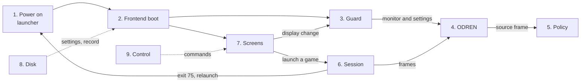

# Flows

These pages describe what NEPTRON does, step by step, from power on to a game on the screen. Each page covers one flow. Each page has Mermaid diagrams, a table of the states or screens, a table of the transitions with their conditions and constants, a list of what can go wrong, links to the source, and the differences from `docs/definition/`.

The pages come from the code on the branch where they were written. Where the code and `docs/definition/` differ, the page follows the code and lists the difference at its end. When the code changes, change the page in the same commit.

## Start here

Read [What happens when](10-what-happens-when.md) first. It answers real situations (first boot, black screen, crash, power cut) in one table, with a link to the detail.

## Pages

| Page | What it covers |
| --- | --- |
| [1. Power on to first picture](01-power-on.md) | Firmware and GRUB, init, the state and share partitions and the first-boot share rules, the launcher (exit codes, backoff, relaunch window, stop), the shutdown order. |
| [2. Frontend boot](02-frontend-boot.md) | Settings and presets, display detection and the CRT or flat panel class rule, the output kind and its limits, the guard record, new boot against continued boot, the safe default, the boot prompt. |
| [3. The guard](03-guard.md) | The confirm-or-revert state machine: `Confirmed`, `Pending`, `Safe`, every reason and error, the limits, safe mode, blind recovery, last known good, the flat panel offer. |
| [4. ODREN](04-odren.md) | The video engine: triggers, debounce, decision, validation, modeset, read back, restore, candidate walk, device errors, flip wait, blank, mute, the switch trace. |
| [5. The policy](05-policy.md) | How a mode is chosen for a game: picture styles, rungs, refresh policies, super width, crop, padding, the fitted rung, interlace, whole-kHz clocks, the flat panel path, the notice flags, with examples from the golden file. |
| [6. The session](06-session.md) | A game from launch to exit: launch settle, the frame loop, double refresh, the quick menu hotkey, blind recovery hold, save RAM flush, display errors, end reasons. |
| [7. Screens and UI flow](07-screens.md) | Every screen, the navigation and the buttons, each row, the Video block words, notices, settings levels, the keep prompt, when a setting reaches the disk. |
| [8. What lives on disk](08-on-disk.md) | The partitions, settings files and levels, the guard record, the relaunch file, save RAM and `.bak`, logs, the hot folder. |
| [9. Control protocol and bench tools](09-control-and-bench.md) | The control socket commands, `neptronctl`, `selftest video`, `cargo xtask os push`, `logs` and `ssh`, and which are in a development build only. |
| [10. What happens when](10-what-happens-when.md) | Real situations with the exact outcome and the way out. |

## How the flows connect

## Conventions

- Times are in the units of their constants: a name that ends in `_NS` is in nanoseconds, and the page also gives the value in seconds or milliseconds.
- Frequencies in the code are in millihertz. The pages give them in Hz or kHz.
- UI texts are quoted exactly as the code has them.
- Source links are relative to this folder and name the function. They give no line numbers, because line numbers change.
